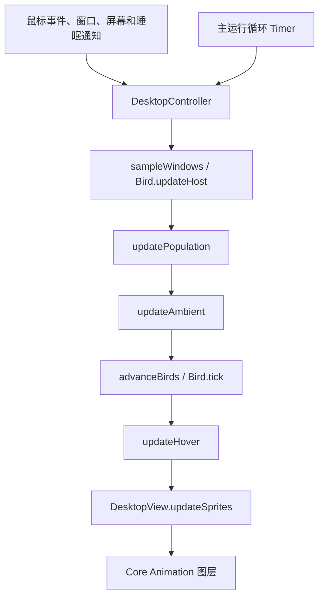
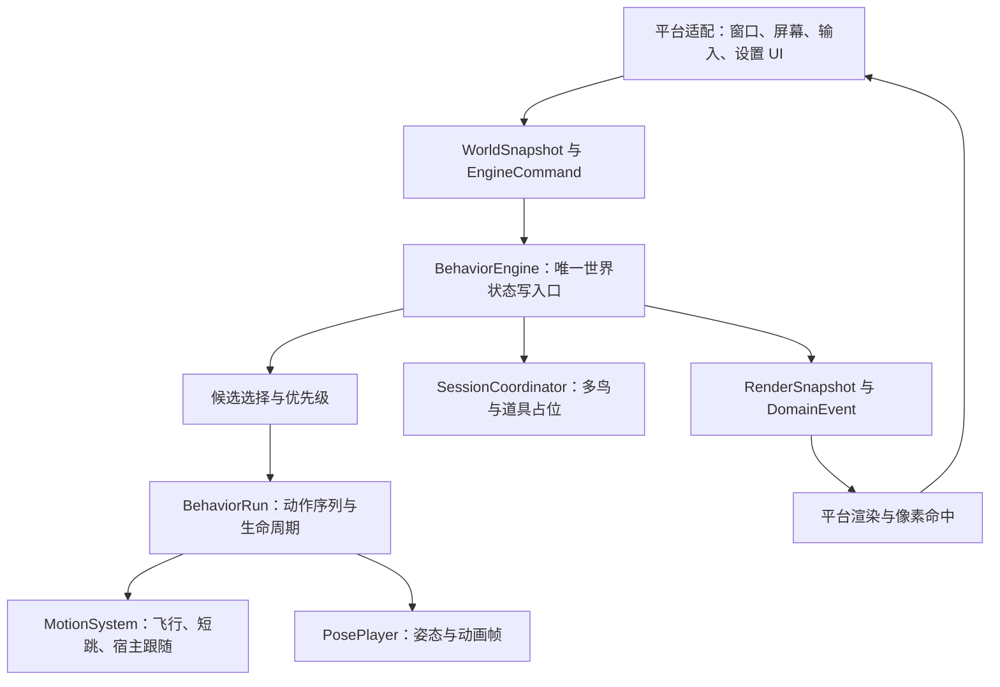
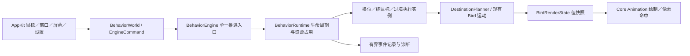

# ChirpOS 行为与互动引擎设计

最后更新：2026-10-24

状态：macOS M6a–M6f.2 阶段验收通过；M6f.2随本阶段记录本地提交、未安装，下一阶段M6g灰喜鹊熟客礼物；全部M6–M7仍在进行。当前安装版为 M6a/b，后续安装保护用户最新设置与草稿。最新范围和状态以 [实施进度](IMPLEMENTATION-PROGRESS.md) 为准；实施按 [内容实施规格](BEHAVIOR-CONTENT-SPEC.md) 与 [逐鸟交付矩阵](SPECIES-DELIVERY-MATRIX.md)。
初次分析基线：`fix/click-to-relocate-birds`，`2b3c05c` 加当时工作区的点击换位、悬停延迟、绕鼠标和鸟群过境。M0–M2 已归入 `c2f7350`，后续实施见第 17 节。
范围：按用户 2026-10-24 的最新决定，实施 macOS 行为、素材、鸟种支持及真实桌面验收。Windows 引擎迁移、双端语义对齐和 Windows 原生验收移出当前范围，不作为 macOS 完成门槛；已有 Windows 代码保留。

阅读说明：第 3–9 节是迁移前的架构分析，第 16–34 节是各批历史记录；其中“尚缺”“待解锁”及 Windows 后续任务描述反映当时状态，不覆盖上述最新范围。

## 1. 结论与决策

ChirpOS 正在形成一套面向桌面鸟类的**行为与互动引擎**。它需要决定鸟想做什么、什么时候允许做、如何执行、遇到打断如何退出，最后才是选取动画帧。

当前建议：**沿已完成的 macOS 行为运行时继续扩展，先集中鸟种支持配置并建立最小姿态片段契约，再补专用素材和新场景。引擎基础迁移已完成，无需重新开始。**

现有实现适合作为迁移基础，继续直接叠加特殊标记和控制器分支则会增加维护成本。整项目重写的收益不足以抵消重新验证多屏坐标、落脚、遮挡、点击穿透、物种动画和设置兼容的成本。

| 决策 | 选择 | 原因与边界 |
| --- | --- | --- |
| 是否重写整个应用 | 否 | 有价值的几何、路径、平台适配和回归测试可以直接保留 |
| 是否重构行为系统 | 基础迁移已完成，继续增量扩展 | 沿用统一生命周期、抢占和群体协调入口，补齐内容配置 |
| 是否更换 AppKit / Core Animation | 当前不需要 | 本次痛点来自调度与状态归属，尚无证据证明渲染框架构成瓶颈 |
| 是否自建通用游戏引擎 | 当前不需要 | 先覆盖鸟类、桌面表面、互动道具这几个明确领域 |
| 是否立即引入大型行为树 / GOAP / ECS | 当前不采用 | 先用显式状态、带类型的动作序列和小型条件选择器，保留替换选择策略的边界 |
| 是否共享 Swift/C# 执行二进制 | 当前不安排 | Windows 引擎不在本阶段范围，保留现有共享素材与夹具 |
| 下一步开发内容 | M6g 灰喜鹊熟客虚拟礼物，继续 M6–M7 全部范围 | 每批实现完整后统一验收，真实长期与硬件项目单独保留证据 |

这里的“优雅好用”落实为：新增普通行为时，不再要求同时修改桌面控制器、鸟状态、事件清理、计数和渲染；涉及新运动能力或新素材时，修改相应扩展点即可。

## 2. 产品目标和行为储备

目标是安静、可发现、有回应的桌面陪伴。以下频率、持续时间和优先级属于产品设计建议，不是野外行为测量结果。

### 2.1 已有能力

- 飞入、飞出、寻找窗口或地面落点；窗口移动跟随、遮挡与失效处理。
- 物种化振翅、滑翔、盘旋、起伏飞行；弧长路径与平滑速度包络。
- 眨眼、呼吸、理羽及物种专属小动作，部分鸟有原地跳动。
- macOS 点击同一只鸟换位置、悬停名字与可配置等待时间。
- macOS 偶发绕鼠标、3–5 只同种鸟过境，频率开关与预览。

这些项目在当前工作区已有实现，不应在后续需求表中重复标记为全新功能。Windows 尚未同步本轮 macOS 交互扩展。

### 2.2 行为清单

优先级定义：P1 为引擎迁移后的第一批，P2 为社交与场景能力，P3 为长期内容。成本是相对判断，包含动作素材与验证；不是工期承诺。

| 编号 | 行为 | 可见片段与触发条件 | 引擎依赖 / 素材 | 优先级 / 成本 |
| --- | --- | --- | --- | --- |
| B01 | 观察鼠标 | 鼠标进入附近，先转头再决定是否转身；离开后恢复 | 注意目标、方向切换滞回；真正转头需要新增帧 | P1 / 中 |
| B02 | 侧跳让路 | 鼠标靠近时沿同一落脚边跳开一段；边缘不够宽就放弃 | 落脚区间、占位、短跳运动；不能只移动画面不改落脚坐标 | P1 / 中 |
| B03 | 着陆后整理 | 站稳、收翅、抖动或理羽，再休息 | 着陆完成事件、短动作序列，可先复用素材 | P1 / 低—中 |
| B04 | 短暂打盹 | 安静停留后闭眼、缩身；靠近、点击或落脚失效时醒来 | 休息行为、中断、姿态帧；参考 S1 | P1 / 中 |
| B05 | 起飞前准备 | 看目标、下蹲、展翅、起飞 | 起飞准备序列；点击换位可跳过等待 | P1 / 中 |
| B06 | 探头观察 | 走到窗口边缘低头，再退回来 | 短距离移动、边缘约束、探头帧 | P2 / 中 |
| B07 | 警觉后放松 | 鼠标快速掠过附近时短暂警觉，随后恢复 | 鼠标速度摘要、冷却、警觉帧；与已有窗口惊飞区分 | P2 / 中 |
| B08 | 并排停靠、让座 | 第二只鸟飞来，第一只侧移，随后各自休息 | 双鸟会话、落点预约、参与者退出策略 | P2 / 中—高 |
| B09 | 相互招呼 | 一只朝同伴做出鸣叫姿势，另一只延迟回应 | 双鸟会话与分角色时间线；声音默认关闭 | P2 / 中 |
| B10 | 结伴起飞 | 一只起飞，同伴稍后跟上，随后各自落下 | 同伴角色、错峰启动、独立安全降落 | P2 / 中 |
| B11 | 短暂追逐 | 两只鸟追赶几秒，避开鼠标保护区，再分开 | 有界追逐运动、间距限制、超时和取消 | P2 / 高 |
| B12 | 同伴理羽 | 两只靠近，一只整理另一只头颈羽毛 | 稳定双鸟站位、物种能力、成对素材；家燕配偶行为参考 S2 | P3 / 高 |
| B13 | 临时结队、散开 | 独立飞行的鸟短暂同行，随后各自继续 | 运动目标协调、间距和转向限制 | P3 / 高 |
| B14 | 临时食盘 | 用户放置道具，鸟观察、靠近、啄食、离开 | 道具实体、可用槽位、食性配置；不设必须喂养的惩罚 | P2 / 高 |
| B15 | 小鸟浴盆 | 观察、试水、洗澡、甩水、理羽 | 场景序列、道具失效处理、水花和洗澡素材；参考 S8 的维护行为概述 | P3 / 高 |
| B16 | 追逐落叶 | 用户放出虚拟叶片，鸟观察、扑向或叼起 | 道具生命周期、追逐、携带关系；物体游戏灵感参考 S3 | P2 / 中—高 |
| B17 | 空中捕虫 | 家燕沿弧线追赶小飞虫，捕获后恢复飞行 | 移动目标、捕获判定、结束后路线恢复；参考 S4 | P2 / 中—高 |
| B18 | 固定小栖木 | 用户指定低干扰位置，鸟偶尔前往 | 虚拟表面、位置持久化、屏幕布局变化后的重新定位 | P2 / 中 |
| B19 | 叼来小礼物 | 熟客带来虚拟叶片或羽毛，短暂停留后离开 | 长期身份、携带物、低频奖励；明确为拟人化设计 | P3 / 高 |
| B20 | 观察手册 | 首次看见某种行为后，在图鉴留下记录 | 行为完成事件、去重记录；用户主动查看 | P3 / 中 |
| B21 | 个体性格 | 同种鸟在胆量、好奇心、社交和活跃度上有稳定差异 | 生成时采样的特征、行为权重；不能逐帧重抽 | P1 / 中 |
| B22 | 昼夜与安静节奏 | 根据用户选定模式和本地时段改变活动倾向 | 用户策略和行为权重；按鸟种配置，不统一让夜行鸟夜间睡觉 | P3 / 中 |

食盘、浴盆、落叶仅操作应用自己的虚拟对象。主动放置通过菜单或明确的放置模式进入，保留普通桌面点击穿透语义。单击鸟继续代表换位置，不同时承担喂食或抚摸。

### 2.3 内容组合原则

- 用“观察 → 接近 → 互动 → 恢复”表达一个片段，避免所有动作随机无缝拼接。
- 小幅观察、休息动作可常见；横穿屏幕、追逐、道具场景共用显著事件预算。
- 保留鸟种差异。家燕捕虫、合适鸟种的同伴理羽、不同体型的起落节奏分别配置。
- 先以麻雀、家燕和一种大型鸟做代表样例；基础交互与安全规则仍覆盖全部鸟种。
- 先保存短期偏好与冷却；长期熟客、礼物、关系成长后置。
- 外部资料提供行为灵感，不证明某个桌面动作会让用户更喜欢；最终观感仍需预览与人工体验。

## 3. 现有架构：主链与状态归属

### 3.1 当前执行链



`DesktopController.tick` 用系统运行时钟计算帧间隔，上限 0.05 秒；窗口采样目标约 30 Hz，动画 timer 目标约 60 Hz。暂停时跳过数量与偶发动作推进，手动换位仍可完成；窗口采样仍执行。因此当前暂停不能概括为“冻结所有世界状态”。见 E1、E2。

### 3.2 关键对象

| 当前对象 | 当前职责 | 扩展价值与限制 |
| --- | --- | --- |
| `DesktopController` | 系统输入、鸟集合、数量、选落点、互动状态、设置、菜单、诊断 | 平台入口可保留，行为编排需要迁出 |
| `Bird` | 姿态状态、坐标、宿主、路线、速度、盘旋、动画帧、失效与离场标记 | 运动资产有价值；状态、动作和渲染选择职责应逐步拆开 |
| `SpeciesBehavior` | 按物种和时间取模选择栖息帧、原地跳动 | 适合保留为基础动作库，不宜承担情境决策和社交会话 |
| `FlightPath` / `FlightTiming` | 弧长采样与速度包络 | 可复用的运动底层，已具备针对连续性和速度的测试 |
| `Geometry` / `Surface` | 桌面坐标、遮挡、可用落点、窗口/地面关系 | 可保留并逐步提取为只读世界查询 |
| `Population` | 常驻数量范围与迁入迁出节奏 | 保留独立策略，由引擎统一管理生命周期和计数口径 |
| `AmbientScheduler` | 两类偶发事件的时间、条件与选择 | 已有仿真时间思路，可迁为显著事件预算和候选机会来源 |
| `DesktopView` / `BirdArt` | 屏幕图层、裁剪、像素帧、悬停名字 | 保留绘制方式；后续改读渲染快照 |
| `BirdSettings` | 鸟种、概率、互动参数、持久化及旧配置补齐 | 保留迁移经验，新增配置需要明确版本与能力校验 |

### 3.3 具体扩展压力

1. **一次行为分散在两层。** 绕鼠标同时依赖 `Bird.isVisitingPointer`、控制器的 `pointerVisitor` / `pointerVisitCenter` 和 scheduler；过境还有 `pendingFlock`、离场标记和计数过滤。增加动作时容易遗漏其中一条收尾路径。见 E2、E3、E4。
2. **状态维度混合。** `flying / landing / perched` 是运动状态，`isVisitingPointer` 是行为意图，`isPassingThrough` 是访问角色，`isDeparting` 又参与生命周期和常驻计数。当前组合可工作，但不应把每个新行为都继续添加成布尔字段。见 E3。
3. **运行与决策耦合。** `Bird.tick` 推进路线并判断着陆；`needsDestination` 让控制器在下一层选择新行为；`updateHost` 还可能直接惊飞或标记路线失效。规则尚未统一收敛。见 E1、E3。
4. **动作选择缺少情境。** `SpeciesBehavior.frame` 主要由 `age % cycle` 驱动，无法自然表达刚睡醒、刚互动、暂时避开鼠标等短期记忆。见 E5。
5. **随机源只局部可注入。** 路径与 scheduler 可传随机闭包，但控制器仍直接调用随机选择，鸟初始化也随机采样。当前能测局部规则，尚不能用一个 seed 重放整个互动过程。见 E2、E3、E4。
6. **预览与运行入口不完全一致。** 预览直接请求开始动作，正常触发先经过 scheduler。未来应共用校验与执行，只明确允许预览绕过概率等待。见 E2、E8。
7. **模型和帧名耦合。** `Bird.frameName` 直接产出 `String`，渲染按名字找素材。增加侧头、睡觉或道具接触动作时，需要有能力声明和缺帧退化，不能依赖所有鸟都有相同素材。见 E3、E7。
8. **诊断口径已经出现分歧。** 菜单单独展示过境数量，但 `writeDiagnostics` 的 `departingCount` 仍用 `birds.count-residentCount`，包含过境鸟。应作为迁移时的明确修正项，不能将当前测试通过理解为所有语义均已统一。见 E1。
9. **双平台已有复制成本。** Swift 与 C# 分别实现状态和动作参数。现有 parity 脚本校验物种时间表、飞行参数和素材契约，不证明两端运行时行为完全一致。见 E9。

这些是从源码得出的结构判断；没有据此声称当前存在并发崩溃、性能瓶颈或已通过完整用户体验验收。

## 4. 建议架构与依赖方向



这是职责划分，不要求第一版就拆成独立包、线程或大量 manager 类。先放在现有 `BirdingCore` 中，以少量类型形成明确边界。

| 层 | 应当负责 | 不应负责 |
| --- | --- | --- |
| 平台适配 | 采集窗口几何和鼠标摘要；坐标转换；菜单、保存和屏幕生命周期 | 决定哪只鸟睡觉、直接改飞行路径 |
| `BehaviorEngine` | 状态所有权、命令排序、更新阶段、生命周期与统一输出 | 读取 `NSEvent`、调用设置窗口、依赖真实系统 timer |
| 候选选择 | 条件、能力、冷却、个体权重、注意力预算、候选排序 | 直接移动鸟、创建图层、临时修改随机全局状态 |
| `BehaviorRun` | 一个行为实例的开始、步骤推进、中断、完成和清理 | 查询 OS、拥有自己的 `Timer`、把恢复任务藏在延时闭包里 |
| `MotionSystem` | 执行路径、速度与转向约束、落脚跟随、短跳；发出运动结果 | 决定今天想社交还是睡觉 |
| `PosePlayer` | 根据动作阶段、运动状态和物种能力生成姿态 | 决定行为意图、修改世界位置 |
| `SessionCoordinator` | 多参与者角色、资源预约、同步点与退出 | 再实现另一套独立鸟计时与运动系统 |
| 平台渲染 | 消费最终快照、裁剪、缩放、像素命中数据 | 在绘制过程中推动行为或修改鸟状态 |

借鉴 S5 的显式状态转换思想，以及 S6 对动作选择、转向与运动的职责区分；具体类型与边界是本项目的设计提案，并非外部资料对该实现的保证。

## 5. 状态模型：分清“是什么、在哪里、想做什么”

建议分别表达以下维度，避免把所有组合塞进一个巨型枚举或一组互相依赖的布尔值：

| 维度 | 示例 | 约束 |
| --- | --- | --- |
| 稳定身份 | `BirdID`、`BehaviorRunID`、`SessionID` | 单次运行 ID 不复用；长期熟客身份后置；不持久化 `ObjectIdentifier` |
| 访问角色 | resident / transient | 过境属于 transient，与是否正在离开分开 |
| 生命周期 | entering / active / departing / removed | 只有生命周期管理能完成移除和统计 |
| 运动状态 | flying / landing / perched / hopping | 由运动系统拥有；宿主引用含表面标识和落脚比例 |
| 行为意图 | rest / relocate / pointerVisit / passThrough / nap | 通过运行实例表达，包含进度、原因和所属资源 |
| 性格与短期记忆 | curiosity、sociability、lastInteraction、cooldowns | 生成时确定性采样；随仿真时间推进 |
| 可见姿态 | stand、blink、sleep、lookLeft 等 | 有类型的语义 ID，最后映射到实际帧名与素材 |

维度分开仍需合法组合检查，例如 transient 过境结束直接离场；正在手动换位的鸟不能同时被招募为追逐同伴。规则由引擎与资源仲裁集中维护。

首版可以保留现有 `Bird` 作为运动执行对象，由 runtime 包装；在迁移阶段明确每个字段的唯一拥有者，禁止旧控制器和新 runtime 同时推进同一只鸟。

运行期 ID 可由世界代次加递增序号生成，方便稳定排序与重放。需要跨启动保留的“熟客身份”使用另一套持久化身份，不混用运行实例 ID。

## 6. 行为定义、动作序列与扩展契约

每个行为定义至少包含：稳定 ID、支持能力、触发条件、优先级、所需资源、冷却、最长时间、中断与恢复策略。规则读取快照，只返回候选；接受候选后才创建有状态的执行实例。

建议的接口语义如下；这是接口草图，不是已存在或已编译的 API：

```text
BehaviorRule.evaluate(context, bird) -> Candidate | RejectionReason
Candidate = behaviorID + participants + priority + score + claims + plan

BehaviorRuntime.tryStart(candidate) -> Started(runID) | Rejected(reason)
BehaviorRun.advance(dt, events) -> Effects + Running | Succeeded | Failed(reason)
BehaviorRun.cancel(reason) -> CleanupEffects + RecoveryRequest?

Effects = StartMotion | PlayPose | ReserveTarget | ReleaseTarget | EmitDomainEvent
RecoveryRequest = FindSafePerch | ContinueDeparture | ReturnToIdle
```

- `evaluate` 不消耗随机数、不修改鸟。先按稳定 ID 排序候选，再由决策器使用注入的随机源选择，避免遍历顺序影响可重放性。
- `tryStart` 对参与者、表面版本、能力和资源做最后校验；候选评估之后世界可能已经改变。
- 运行实例只能产生有类型的效果，由引擎验证并执行；不能绕过运动系统直接写 `position`。
- 引擎只提交一次终态：Succeeded、Failed 或 Cancelled。完成与取消各有终态事件；取消清理不会再触发成功奖励。
- 第一版只需顺序步骤、等待条件和有上限的重复。并行动作必须经过通道资源检查；不要立刻设计通用脚本语言。
- 每个等待条件有超时，每次更新的即时步骤转换有数量上限，避免无条件循环阻塞动画主线程。

例如“洗澡”以后可表达成：观察水盆 → 占用槽位 → 接近并落脚 → 播放洗澡 → 甩水 → 理羽 → 释放槽位。水盆被撤走、鸟被点击、宿主失效都走相同取消接口。

新增同伴理羽时，需要新增行为与双鸟素材，但不应再往 `DesktopController.tick` 添加理羽专用分支。新增短跳这种真正的新运动方式，则合理地扩展 `MotionSystem`，不能承诺所有新功能只增加一条配置。

## 7. 优先级、资源竞争与取消

### 7.1 先处理有效性，再处理优先级

建议顺序：世界与目标有效性检查 → 明确用户命令 → 正在运行的动作与恢复 → 自发行为候选。屏幕消失、鸟被移除等属于有效性约束，不能被高权重的“想玩”覆盖。

在通过有效性检查的候选中：手动换位高于主动玩具互动，主动互动高于随机显著事件，显著事件高于普通休息变化。全局暂停是执行策略，不靠一个更高的数字优先级模拟。

### 7.2 用资源声明避免动作打架

- 每只鸟的 `locomotion` 同时只有一个拥有者。
- 当前素材是一张完整鸟的像素帧，`fullBodyPose` 首版也应互斥。不能假设头、翅膀和身体已经可以独立混合。
- 可兼容的基础呼吸、眨眼由 pose 策略决定是否叠加或替换，不让每个业务行为自行争抢。
- 落脚区间、道具槽位、多鸟角色均有带拥有者的预约。
- 横穿、追逐等共用 `foregroundEncounter` 预算，初始全局最多一个显著事件；局部轻动作单独限流。
- 多鸟资源要么一次获得全部，要么全部不获得；在单线程引擎中实现原子预约，不引入线程锁或无限等待。

### 7.3 中断规则必须与行为同时定义

| 事件 | 建议语义 |
| --- | --- |
| 用户点击鸟 | 取消可打断互动，释放关系与道具预约，从当前位置开始换位；连续点击不反复重置同一换位 |
| 鼠标离开绕飞范围 | 结束互动意图，进入安全返回运动，不瞬移、不消失、不继续追踪 |
| 关闭某个行为开关 | 停止创建；活跃实例执行该行为声明的软退出；当前过境可自然飞完 |
| 暂停 | 保留现有“手动换位可以完成”的语义；冻结自主计时和等待队列，取消鼠标绑定互动；窗口必要跟随与有效性检查仍可执行 |
| 睡眠 / 屏幕重建 / Space 切换 | 清理临时会话与待入场对象，重新验证落点；恢复后无积攒爆发 |
| 同伴或道具消失 | 结束或降级会话；存活参与者独立寻找落点，不能永久等待 |
| 应用退出 | 停止输入、取消运行实例、清理临时资源；不强行播放退出动画 |

释放逻辑资源与终止运动要分开：取消追逐不意味着立即把正在空中的鸟切成站立。恢复过程仍由统一执行器拥有运动资源，完成交接后旧实例才完全退出。

## 8. 时间、事件回调与逐帧数据流

### 8.1 当前异步机制

平台 Timer、鼠标全局/本地监听、屏幕与睡眠通知都能进入控制器；设置 UI 直接调用保存和预览入口。鼠标点击目前直接选择新落点并改状态，下一帧继续推进。`pendingFlock` 暂存鸟与延迟，`updateAmbient` 到时加入鸟集合；飞出所有显示范围后由 `advanceBirds` 清理。退出时移除鼠标监听。见 E1、E2、E6、E10。

这是事件回调与逐帧模拟，不是网络流式任务。现有延迟队列不会向下游发送文字 chunk；下游消费的是当前鸟状态与每帧渲染结果。

### 8.2 建议的输入与更新顺序

所有平台回调统一切入一个串行拥有者。macOS 第一版可由主线程适配器调用纯核心引擎，不给每只鸟分配线程、actor 或 timer。

```text
平台输入 -> 归一化坐标、命中 BirdID、序号/世界版本 -> 命令队列
窗口采样 -> 最新 WorldSnapshot（屏幕、表面、遮挡、鼠标摘要）

一次模拟步：
  1. 安装世界快照，处理屏幕/宿主/目标失效。
  2. 消费有序命令，处理取消、显式换位和配置变更。
  3. 推进现有动作，执行运动/姿态，收集完成和失败事件。
  4. 完成资源释放、离场清理、会话收尾和数量统计。
  5. 在决策时间点评估新候选；校验并启动允许的行为。
  6. 输出只读 RenderSnapshot 和有序 DomainEvent。
```

新动作从下一模拟步推进，规则固定，防止同一帧内递归启动无限事件。命中来自最近一次渲染快照，提交时再次确认目标仍存在；失效目标返回忽略原因。

输入处理需要有界：鼠标移动采用最新摘要，并保留速度/最大位移信息供“快速掠过”使用；点击和生命周期事件保序。队列满时丢弃过期预览、合并重复移动，并记录原因，不能悄悄丢失清理通知。

### 8.3 时钟与重放

- `dt` 与随机源从入口注入，行为内部不读墙上时间、不自行 sleep。
- 建议引入固定模拟步及有界 accumulator；初始可用 1/60 秒、每次回调最多 3 步作为待性能验证参数。暂停/睡眠清空积压，不长时间补帧。
- 运动逐步更新；自发行为选择可以低频执行，例如 5 Hz，点击和失效命令在下一个模拟步优先处理。频率是建议值，需实测调整。
- 使用明确算法与版本的 seeded RNG；各鸟和场景使用稳定子流。相同 seed、配置版本、输入事件与模拟步序列，应重现相同决策。
- 迁移要覆盖初始化停留时长、物种选择、落点采样和群体成员抽样等所有随机入口，不能只给最外层 scheduler 加一个 seed。
- 跨 Swift/C# 不承诺浮点逐位相同；比较事件语义、状态、位置容差与时间容差。仅记录 seed 不能重放外部窗口变化，需要同时记录归一化输入。

### 8.4 完成、失败与输出

`DomainEvent` 至少区分 `BehaviorStarted`、`BehaviorCompleted`、`BehaviorCancelled`、`BehaviorFailed`、`BirdRemoved`。含 bird/run/session ID、原因、模拟时间和配置版本。

拒绝候选不等于运行失败：`noSpace`、`cooldown`、`capabilityMissing`、`resourceBusy` 是可诊断的拒绝结果。运行中的宿主消失则产生失败或取消，并请求恢复行为。

观察手册只消费去重后的成功完成事件；UI 显示预览被拒绝的具体原因；渲染只消费最终快照。一次运行最多一次终态，清理可重复调用且无副作用。

## 9. 多鸟、道具和动画资源

多鸟互动使用 `InteractionSession`：记录参与者和角色、资源预约、开始条件、最长等待、当前阶段和退出策略。候选鸟不应靠每帧“再找一下另一只”来维持关系。

“并排停靠”的完整流程：选择两只可用鸟 → 验证可用边缘长度 → 预约两处落点 → 同时接受邀请 → 分别到达 → 同步进入招呼 → 释放会话。任一方被点击或落点失效，另一方立即获知并独立恢复。

道具后续作为带稳定 ID、版本和可用槽位的世界实体加入，复用同一套会话与资源机制。点击穿透的桌面层不直接变成捕获全部鼠标的游戏窗口；放置、拖动道具使用用户明确进入的交互模式。

素材能力通过 `SpeciesCapabilities` 和 `ClipCatalog` 声明。只有可解析的帧、锚点、持续时间和方向变体才能启用相关行为；缺少真正睡眠帧时，禁用该行为或标注为“闭眼休息”退化，不能宣称已经实现完整睡姿。

原有脚部锚点、翻转、缩放和像素命中保持同一契约。新姿态必须同时检查头顶名字位置、遮挡裁剪和点击命中，不能只验动画图片。

## 10. 配置与素材兼容策略（当前仅 macOS）

第一版继续采用 Swift 定义行为和类型化参数，先把接口运行起来。验证过若干行为后，再把合适的数值与能力表提取到版本化共享 JSON；复杂逻辑不塞进字符串表达式。

- 用户设置与物种默认值分开：用户控制开关、频率和体验预设，物种数据控制能力和行为偏好。
- 引入 `schemaVersion`，继续兼容旧 `hoverDelay`、`pointerVisits`、`flockPasses`、`ambientFrequency`。未知可选内容可禁用并报告；未知必需版本不覆盖原文件。
- 保存成功后一次性应用配置；候选用新版本，活跃动作明确选择保留已采样参数或软退出，不能中途重抽路径。
- 预览走正常的校验、资源、运行和取消入口，仅允许绕过随机等待，并在诊断中标记 preview。
- Windows 保留现有实现，当前不安排引擎迁移、功能补齐或原生验收。共享目录继续作为素材与重放夹具来源，存在共享文件不代表承诺双端功能一致。
- 增加共享场景夹具：输入事件、seed、时间步、期望语义事件和位置容差。现有正则参数 parity 继续保留，但不能替代行为一致性测试。

是否最终需要共享 C++/Rust 等核心，应由双端持续演进成本、性能测量和团队维护能力决定，当前资料不足以支持提前切换技术栈。

## 11. 迁移路线与每步验收

每个阶段先完成实现，再统一编译、验证和验收。阶段以可回归的行为边界划分，不边改几个函数边反复全量编译。

| 阶段 | 范围 | 完成标准 |
| --- | --- | --- |
| M0：锁定语义 | 固化点击、暂停、失效、离场、数量、设置迁移场景；记录已有失败 | 有明确输入/输出夹具；既有 flaky 检查单独标注 |
| M1：运行时骨架 | BirdID、输入命令、世界快照、时钟/RNG 注入、运行实例与取消；包装现有运动 | 单鸟只被一处推进；基础飞行、落脚、暂停和点击规则保持 |
| M2：迁移已有互动 | 依次迁移点击换位、绕鼠标、过境；统一资源、预览、计数和诊断 | 删除对应旧控制器调度分支与状态源；不能留下新旧双运行时 |
| M3：验证扩展性 | 实现打盹或观察鼠标一个完整样例，再加入着陆整理与个体差异 | 普通行为无需修改 DesktopController 的调度或渲染分支；素材缺失可解释 |
| M4：多鸟会话 | 并排停靠、招呼、结伴起飞；验证同伴中断 | 参与者被点击/离场/失去落点后，剩余鸟和预约均可收尾 |
| M5：道具场景与生态内容 | 落叶、熟客、节奏、群体互动、栖木、食盘、观察手册（已至 M5n） | 道具删除、设置切换、屏幕变动无悬挂实例；macOS 核心与原生验收 |

首个重构里程碑建议止于 M2，并以 M3 的一个行为证明接口可扩展。不一次性实现全部行为库，也不先造完整行为编辑器。

迁移以行为为单位替换，临时适配器把新请求转换为现有 `Bird.fly` / `FlightPath` 调用。同一行为只能选一个实现路径。保留行为级回退开关或独立提交边界，验证后删除旧分支，不长期维护两套互相修改状态的实现。

## 12. 验证、可观测性与架构验收

### 12.1 已有证据

下列为迁移前读取的上一轮留存日志。迁移后的验收记录见第 16 节，不将旧结果当作本次通过证据。

| 证据 | 已有结果 | 能证明什么 |
| --- | --- | --- |
| `.build/ambient-tests.log` | 98 项单元测试通过 | 当前已覆盖的路径、几何、配置和行为规则 |
| `.build/ambient-birds.log` / `ambient-bird-check/report.json` | 40 项鸟行为检查通过 | 当前点击优先、鼠标退出、互斥、过境清理等 |
| `.build/ambient-settings.log` | 51 项设置检查通过 | 当前设置保存、默认值、语言切换等 |
| `.build/ambient-population.log` | 7 项数量检查通过 | 当前迁入迁出和数量行为 |

这些是旧实现的回归基线，不是未来引擎的测试结果。临时日志位于 ignored `.build/`，不作为仓库长期证据；可提交的依据是测试源码与可复现命令。

此前桌面集成检查有 `playsLandingState` 着陆时序不稳定记录，并曾在未修改基线复现；迁移验收需单独记录该项结果，不能仅凭核心用例写成“全部集成测试通过”。迁移应优先把依赖真实时钟的核心判定改成可控时间场景，并保留少量真实桌面烟雾检查。

### 12.2 引擎需要新增的验收场景

1. 同一输入与 seed 可重放；30/60/120 Hz 外层回调产生约定容差内的结果。
2. 单鸟运动资源不被两个动作同时拥有；同一 run 只产生一次终态。
3. 在动作每个阶段插入点击、关闭开关、暂停、睡眠、同伴移除、道具移除与屏幕变化，最终没有泄漏预约或永远等待。
4. 暂停期间只有明确允许的手动换位推进；自主概率、延迟入场、等待超时不积攒爆发。
5. 负坐标、多屏断开、宿主移动与遮挡变化不产生瞬移、悬空站立和幽灵命中。
6. 过境与常驻数量分开，菜单、诊断和测试使用相同口径。
7. 有能力但缺素材、无合适落点、道具已过期时有确定拒绝原因和安全退化。
8. 预览与正常动作共享中断、清理和安全约束。
9. 以 50 常驻 + 最多 5 过境为现有规模基线，测量引擎耗时、窗口采样耗时、帧间隔、素材内存和待处理队列；报告硬件和 p95/p99，不凭架构图宣称性能改善。
10. 动画观感单独人工验收：转向是否抖动、动作是否过密、姿态是否滑脚、名字/点击是否对齐、是否挡工作区域。

建议提供可关闭的本地诊断面板：当前行为与阶段、参与者、资源拥有者、冷却、候选被拒绝原因、最近中断原因。使用有上限的环形事件记录，默认不长期保存桌面轨迹。

### 12.3 判断架构是否完成的标准

- 新增打盹等普通行为，只改行为定义、必要素材/能力和测试；不增加控制器专用计时字段。
- 删除一个行为后，不留下悬空 scheduler、监听器、参与者引用和计数分支。
- 所有点击、预览和自主触发汇入一个运行入口；所有结束路径汇入统一清理。
- 决策层不依赖 AppKit；核心测试不需要真正显示桌面窗口。
- 群体动作能解释“为什么没发生、为什么被取消”，无需靠随机等待猜原因。
- 物种差异、用户偏好和技术执行分开，参数可调整且可验证。

## 13. 源码阅读与证据索引

下列 E1–E12 是迁移前架构评估的证据索引，行号和部分已删除符号保留为历史记录。迁移后的入口见第 16 节，以符号名定位。

| 编号 | 文件与定位 | 证据用途 |
| --- | --- | --- |
| E1 | [Desktop.swift](../platforms/macos/Sources/Birding/Desktop.swift)，`tick` 372、`advanceBirds` 359、`updateStatusLine` 130、`writeDiagnostics` 388 | 主循环、暂停例外、清理与计数 |
| E2 | [AmbientAnimations.swift](../platforms/macos/Sources/Birding/AmbientAnimations.swift)，`updateAmbient` 24、`startPointerVisit` 59、`startFlockPass` 75 | 互动生命周期、延迟队列、随机源与预览执行 |
| E3 | [World.swift](../platforms/macos/Sources/BirdingCore/World.swift)，`Bird` 120、`fly` 179、`updateHost` 280、`tick` 304、`frameName` 359 | 状态归属、路径执行和动作帧耦合 |
| E4 | [AmbientBehavior.swift](../platforms/macos/Sources/BirdingCore/AmbientBehavior.swift)，`AmbientScheduler` 19 | 仿真时间、条件选择与随机注入 |
| E5 | [SpeciesBehavior.swift](../platforms/macos/Sources/BirdingCore/SpeciesBehavior.swift)，`hop` 61、`frame` 67 | 固定周期与现有物种动作 |
| E6 | [HoverNames.swift](../platforms/macos/Sources/Birding/HoverNames.swift)，`bird(at:)` 19、`relocateBird` 37、`handleMouseDown` 49 | 像素命中、点击穿透、回调与清理 |
| E7 | [PixelArt.swift](../platforms/macos/Sources/Birding/PixelArt.swift)，像素与锚点约定 5；[Desktop.swift](../platforms/macos/Sources/Birding/Desktop.swift)，`updateSprites` 27 | 素材、裁剪、名字和坐标契约 |
| E8 | [SpeciesSettingsWindow.swift](../platforms/macos/Sources/Birding/SpeciesSettingsWindow.swift)，`previewPointerVisit`、`previewFlockPass`；[Probability.swift](../platforms/macos/Sources/BirdingCore/Probability.swift)，`BirdSettings` 81 | 设置、预览与配置兼容 |
| E9 | [Windows World.cs](../platforms/windows/ChirpOS.Core/World.cs)，`Bird` 66；[parity 脚本](../scripts/test-species-parity.py) | 双平台重复实现和检查边界 |
| E10 | [main.swift](../platforms/macos/Sources/Birding/main.swift)，`applicationDidFinishLaunching` 37、退出清理 61 | 生命周期入口与测试入口 |
| E11 | [FlightBehavior.swift](../platforms/macos/Sources/BirdingCore/FlightBehavior.swift)，`FlightPath`、`FlightTiming`；[Population.swift](../platforms/macos/Sources/BirdingCore/Population.swift)，`tick` 25 | 可保留的运动与数量基础 |
| E12 | [AmbientTests.swift](../platforms/macos/Tests/BirdingCoreTests/AmbientTests.swift)、[FlightBehaviorTests.swift](../platforms/macos/Tests/BirdingCoreTests/FlightBehaviorTests.swift)、[WorldTests.swift](../platforms/macos/Tests/BirdingCoreTests/WorldTests.swift)、[ExpandedVerification.swift](../platforms/macos/Sources/Birding/ExpandedVerification.swift) | 可复用的测试与迁移回归基线 |

建议阅读顺序：E1 → E2 → E3 → E4/E5 → E11 → E6/E7 → E12 → E9。

## 14. 外部资料与使用边界

资料核对日期：2026-10-23。以下为行为灵感和架构思想来源，采用概述，不复制原文；优先级、类型设计、参数与迁移路线均为本项目建议。

| 编号 | 来源 | 在本文中的用途 |
| --- | --- | --- |
| S1 | Cornell Lab，Do Birds Sleep?：`https://www.birds.cornell.edu/k12/do-birds-sleep/` | 闭眼、蓬羽、藏喙等休息姿态灵感 |
| S2 | Audubon，Barn Swallow：`https://www.audubon.org/field-guide/bird/barn-swallow` | 家燕配偶靠坐、接触鸟喙和相互理羽的物种限定参考 |
| S3 | Cornell Lab，Do birds play?：`https://www.allaboutbirds.org/news/do-birds-play/` | 幼鸟扑叶、摆弄和抛接物体的游戏灵感，不泛化到所有鸟种 |
| S4 | Cornell Lab，Barn Swallow Overview：`https://www.allaboutbirds.org/guide/Barn_Swallow/overview` | 家燕追逐飞虫的飞行行为参考 |
| S5 | Apple，GameplayKit Programming Guide / State Machines：`https://developer.apple.com/library/archive/documentation/General/Conceptual/GameplayKit_Guide/StateMachine.html` | 显式状态、合法转换和分离状态相关更新；是归档概念资料，不是依赖升级建议 |
| S6 | Craig Reynolds，Steering Behaviors For Autonomous Characters：`https://www.red3d.com/cwr/steer/gdc99/` | 动作选择、转向、运动分层，以及后续追逐/避让的参考 |
| S7 | VS Code Pets 官方文档：`https://tonybaloney.github.io/vscode-pets/pets/` | 鼠标互动、交朋友、追逐和抛球的产品参考；未审计其源码，也不据此判断适合直接引入 |
| S8 | BTO，Preening, sunbathing, dustbathing and waterbathing：`https://www.bto.org/learn/about-birds/behaviour/preening-bathing` | 理羽、洗澡和部分鸟种相互理羽的概述；本次读取到搜索索引正文摘录，原页直接打开超时 |

浴盆的具体动作序列、适用鸟种和持续时间仍属于待验证设计，不能由通用洗澡资料直接推导。

## 15. 后续决策记录

后续每轮修改在这里补充：日期、已接受的决策、替代方案、验证结果和改变原因。

| 日期 | 记录 |
| --- | --- |
| 2026-10-23 | 记录动作储备与架构评估；建议渐进重构。目标架构与 M0–M5 均为提案，本轮未迁移运行代码。 |
| 2026-10-23 | M4 拆成可独立验收的小阶段：先交付同一边缘的双鸟招呼，用真实双参与者行为验证共同退出；并排停靠、让座与结伴起飞需要落点预约，留到后续。 |


## 16. M0–M2 实施记录（2026-10-23）

### 16.1 实际边界

M0–M2 在 macOS 落地统一行为运行时，迁移点击换位、绕鼠标、鸟群过境。该阶段完成时 Windows、M3 新行为样例、M4 社交会话和 M5 道具能力尚未实现。M3 的后续实施记录见第 17 节。第 3–10 节中更完整的感知、动作姿态、能力库、个体状态和共享配置设计仍是后续目标。



| 入口 | 本轮职责 |
| --- | --- |
| `BirdingCore/Behavior/BehaviorTypes.swift` | BirdID、BehaviorRunID、角色、命令、输入与渲染快照、拒绝原因、固定算法随机源 |
| `BehaviorEngine.swift` | 鸟注册与移除、输入校验、设置、数量推进、固定时间步、候选选择、事件日志 |
| `BehaviorRuntime.swift` | 单鸟运动占用、显著事件互斥、实例推进、超时与唯一终态、统一释放 |
| `InteractionExecutions.swift` | 三个行为实例自己的参与者、阶段/等待、完成条件和恢复逻辑 |
| `DestinationPlanner.swift` | 将原控制器的落点选择提取为先规划后应用；换位持续避开原位置 |
| `Birding/AmbientAnimations.swift` | 平台输入快照、预览入口和结果文案；不再保存运行队列 |
| `Birding/Desktop.swift` / `HoverNames.swift` | AppKit 生命周期与命令适配；绘制、名字与命中读取值快照和稳定 ID |
| `BehaviorEngineTests.swift` | 不依赖 AppKit 窗口的可控场景与资源生命周期回归 |

原控制器中的 `relocatingBirds`、`pointerVisitor`、`pendingFlock`、`pendingPointerPreview` 和 `updateAmbient` 已删除；`Bird.isPassingThrough/isVisitingPointer` 已删除。访问角色由引擎记录，行为归属由运行时记录，不能用飞行动画状态推断角色。

### 16.2 运行契约

- 调用方在主线程串行调用 `updateWorld`、`handle`、`advance`。核心同步执行，没有行为自建的 Timer、异步回调或第二个运动循环。
- 每个可见鸟每个仿真步只调用一次 `Bird.tick`。固定步为 1/60 秒，单次外层更新最多接收 0.05 秒、推进 3 步；睡眠和负载造成的长间隔不会集中补发动作。
- 引擎 `time` 记录所有固定步，包含暂停期间手动换位的时间。自主调度、人口、过境等待与非手动实例的 age 在暂停时冻结；已有窗口跟随仍由平台采样更新。
- 点击换位先得到可用计划，再抢占原行为。重复点击不重新开始；暂停允许手动换位完成。宿主失效通过 `motionRevision/needsDestination` 触发重新规划，持续避开原点。
- 绕鼠标、过境共享显著事件占用；每只参与鸟的运动只能属于一个行为。延迟预览也阻止新的显著事件。预览仅绕过自动等待，复用同一校验和执行。
- 鼠标移动/点击、暂停、关闭开关记录为取消；宿主失效或超时记录为失败。每个 run 恰好一次终态，先释放占用再执行清理回调。
- 关闭过境开关时撤销尚未出现的成员，已出现成员自然离开；睡眠、屏幕变化、Space 切换、退出会取消全部相关运行实例并清空过境成员。主动移除任一过境参与者按整组取消处理。
- 菜单和诊断同读 `residentCount/departingCount/passingCount/pendingCount`。过境不增加常驻迁出统计，数量调度不以过境充当常驻。
- 事件环最多保留 256 条，序号单调增加。`--diagnostics` 包含 seed、行为 run、参与者 ID、来源和结束原因；默认没有长期桌面输入录像。

### 16.3 明确保留的迁移桥与限制

- `Bird` 仍承载运动和素材帧选择。`installFixtureBirds` 与可读 Bird 引用服务既有桌面验证器；生产事件从命令入口进入。完全封闭 Bird 可变状态、拆出 MotionController/PosePlayer 留待下一阶段。
- RNG 使用固定版本 SplitMix64 单一 seed 流，主要决策、初始停留时间和路径采样由引擎注入。同一代码版本、配置、初始状态、世界快照和命令时间线可在核心测试中复现；只有 seed 不能复现真实桌面。
- 尚未实现每鸟/每行为独立随机子流、输入记录文件、跨平台逐位重放。新增随机采样会改变后续序列，跨版本不保证相同轨迹。
- 暂未加入通用优先级评分器、外部行为注册插件、通用落脚区间预约、道具资源和能力表。当前接口允许在核心内新增执行类型；新种类的命令/选择器仍需显式接入，不增加桌面专用定时字段。
- 不在此次迁移更改用户配置 schema，不需要迁移或重写已有设置文件。
- 未测量 p95/p99 或整机能耗，不宣称此次重构提高性能；动画观感仍需真实桌面人工体验。

### 16.4 本轮验收

全部实现完成后集中执行，结果如下。没有提交或推送 Git，也没有修改 Windows 实现。

| 验收 | 本轮结果 | 本地证据（ignored，不随仓库提交） |
| --- | --- | --- |
| Release 开发包构建 | 通过 | `.build/engine-build.log` |
| XCTest | 114/114，通过；新增 16 个引擎用例 | `.build/engine-tests.log` |
| 物种/飞行参数 parity | 46 鸟种、34 帧名、46 飞行参数匹配 | 同上，test.sh 前置检查 |
| 鸟行为与像素命中 | 40/40 | `.build/engine-bird-check/report.json` |
| 设置与持久化 | 51/51 | `.build/settings-check.3ppdYz/report.json` |
| 常驻数量与离场 | 7/7 | `.build/population-check.bfJ4oV/report.json` |
| 地面/落点/渲染 | 24/24 | `.build/engine-ground-check/report.json` |
| 完整桌面集成 | 12/13；`playsLandingState` 未通过 | `.build/desktop-check.8Hup30/report.json` |
| `git diff --check`、开发包 codesign 校验 | 通过 | 执行命令返回 0 |
| 本地开发版重启与启动检查 | 通过；新进程已运行，常驻鸟正常进入，overlay 不抢焦点 | `.build/engine-live.json` |

完整集成未通过项与迁移前在未修改基线复现的着陆采样时序问题一致。此次保留失败报告，未更改其断言、重复运行取通过结果或将其隐藏为成功。核心固定步场景已验证换位实际着陆及完成事件；这不能代替对原桌面时序用例的后续修正。

可复现命令：

```bash
./scripts/build.sh
DEVELOPER_DIR=/Applications/Xcode.app/Contents/Developer ./scripts/test.sh
dist/ChirpOS.app/Contents/MacOS/Birding --verify-birds .build/engine-bird-check
./scripts/verify-settings.sh
./scripts/verify-population.sh
dist/ChirpOS.app/Contents/MacOS/Birding --verify-ground .build/engine-ground-check
./scripts/verify-desktop.sh
git diff --check
codesign --verify --deep --strict dist/ChirpOS.app
```


## 17. M3 实施记录（2026-10-23）

### 17.1 范围与扩展验证

M0–M2 提交为 `c2f7350`（`feat(behavior): 引入统一行为引擎并迁移桌面互动`）。本阶段增加闭眼休息、着陆整理与个体节奏，修复完整桌面检查的着陆时序依赖。没有添加社交、道具或 Windows 行为实现。

- **闭眼休息**：顶边停稳、鼠标远离、剩余停留时间足够时，按独立节奏偶尔闭眼数秒。当前复用 `blink`，没有新增缩身/藏喙完整睡姿，产品明确称为“闭眼休息”。
- **着陆整理**：实际着陆计数发生变化后，有 65% 机会在站稳后短暂停顿，再交替播放 `preen0/preen1`；一个着陆事件最多尝试一次，不能长时间排队等待。
- **个体节奏**：每只鸟拥有由 seed 与 BirdID 派生的独立随机流；休息间隔基础为 12–26 秒、乘个体 0.8–1.2 倍节奏，休息约 2.7–5.5 秒，整理约 1.5–3.1 秒。参数为桌面动画设计值，不是野外行为频率。
- **可打断**：鼠标距离小于 `max(100, 72 × 精灵缩放)` 时退出，按键/点击、换位、设置关闭、宿主失效与全局生命周期命令也能结束。暂停保留姿态并冻结实例进度，手动点击仍可抢占。
- **配置**：`perchActions` 默认 true，旧配置缺字段时兼容开启；保存后立即应用。新设置控制上述两种新行为，既有物种固有闲置动作仍由原有素材逻辑呈现。

扩展采用 `PerchActivityExecution: BehaviorExecution`，复用开始、资源占用、超时、取消和唯一终态；调度数据放在 `PerchActivityPlanner`，没有给 DesktopController 加停栖专用计时器或分支。

### 17.2 通用姿态接口

`BehaviorExecution.presentation(for:in:)` 可返回 `BirdPose`（帧名和跳动偏移），默认 nil。运行时持有执行实例，也就持有姿态；终态解除动作帧覆盖，`PoseMixer` 在 0.2 秒内将视觉跳动偏移回混到实时底层状态。该过渡不持有行为资源，不恢复旧 frame，也不能覆盖新的运动版本。

引擎把运动状态与当前姿态组合成同一个 `BirdRenderState`，绘制、名字、像素命中和边界计算读取相同结果。动作开始与结束在 0.35 秒内混合跳动偏移，保持脚部位置与遮挡契约。点击开始飞行或宿主惊飞使运动版本改变，旧停栖姿态不能覆盖飞行帧。

`BehaviorExecution.validate` 将宿主、运动版本与帧能力失效检查和动画推进分开。输入更新时立即校验；暂停只冻结动作计时，不能让已失效动作继续占用资源。

平台只新增通用 `availableFrames` 能力输入，由已加载的 BirdArt 实际帧键构成并缓存。可选动作必须确认所需帧存在；缺帧拒绝返回 `missingFrames`。非空能力清单中缺少当前底层闲置帧时，统一回退到 `stand` 或稳定排序的首个可用帧，避免鸟消失；完全没有能力清单的旧适配器保留原有绘制约定。没有在渲染器里增加 rest/preen 的专用分支。

### 17.3 着陆检查修复

旧验证在发起飞返后固定 0.6 秒读取 `.landing`，与实际路径计算出的飞行时长不匹配。修复提交为 `1d85a1d`（`fix(verification): 按实际飞行阶段验证着陆过程`）。新的检查观察正常桌面仿真进度，不自行推进鸟或篡改速度，要求真实位移 → `land0` → `land1` → `land2` → 正确宿主/深度/落脚点，再隐藏宿主检查惊飞。仿真时间和墙钟均有超时，13 项预期检查预置为失败，缺步骤不能静默通过。

### 17.4 统一验收结果

全部实现与两位协作 agent 的代码审查、测试合并后统一执行。以下均为本阶段的新结果；未重试筛选通过结果，未更改飞行速度或绕开真实桌面着陆流程。

| 验收 | 本阶段结果 | 本地证据（ignored） |
| --- | --- | --- |
| Release 开发包 | 通过 | `.build/m3-build.log` |
| XCTest | 135/135；新增 16 个停栖行为与 5 个配置用例 | `.build/m3-tests.log` |
| 物种/飞行 parity | 46 鸟种、34 帧名、46 飞行参数匹配 | 同上 |
| 真实鸟帧、像素命中与交互 | 49/49；包含镜像/缩放、遮挡、悬停、抢占 | `.build/m3-bird-check/report.json` |
| 设置与持久化 | 70/70；双语截图人工检查通过 | `.build/settings-check.tkNCVY/report.json` |
| 常驻数量与离场 | 7/7 | `.build/population-check.9iVS9N/report.json` |
| 地面/落点/渲染 | 24/24 | `.build/m3-ground-check/report.json` |
| 完整桌面集成 | 13/13；完整着陆帧序列与隐藏宿主惊飞通过 | `.build/desktop-check.v89uiZ/report.json` |
| 差异格式、开发包签名 | `git diff --check` 与 codesign 通过 | 本地命令返回 0 |
| 开发版重启 | 新进程已运行；自动整理已完成，点击抢占与取消事件正常 | `.build/m3-live.json` |

新回归覆盖 30/60/120 Hz 一致回放、原飞行随机流隔离、实际着陆后的单次整理机会、个体节奏、暂停冻结、暂停期间目标/素材失效立即释放、取消后 0.2 秒姿态回混与新飞行抢占。真实绘制检查另外保存 `perch-rest-blink.png`、`perch-preen-preen0.png` 与 `perch-preen-preen1.png`；设置检查保存 `perch-activities-en.png` 和 `perch-activities-zh.png`。

本阶段完成 M3 的基础停栖动作与姿态扩展入口。完整藏喙睡姿、头部朝向素材、侧跳、社交会话、落点预约和道具尚未实现；不能把本次通过解释为 M4–M5 已完成，也未测量整机能耗或长期性能。


## 18. M4a：双鸟招呼（2026-10-23）

### 18.1 本阶段设计

两个已经停稳的常驻鸟，在同一条可见边缘且距离合适时转向彼此，发起者先做一段物种自身的小动作，同伴稍后回应，最后恢复闲置。整个片段约 4.6 秒，无声音，不创建新鸟，不修改落脚坐标。复用 `idle0/idle1/idle2`、`stand` 和 `blink`，不同鸟种呈现自己的动作，因此产品称“招呼”，不宣称还原鸟类的真实鸣叫交流。

- **候选条件**：两只鸟属于同一宿主边缘、停留剩余时间大于 6 秒、无其他行为占用、鼠标远离；转向后的完整精灵位于同一显示器中且未被遮挡，彼此间至少留 12pt，脚锚距离不超过 `420 × 全局缩放`。几何检查不消耗随机数。
- **统一频率**：招呼、绕鼠标与过境共用 `AmbientScheduler` 的低/中/高频选项，每次只尝试一种。条件不足直接跳过；不新增定时器，不积攒待执行招呼。
- **预览**：使用已保存配置与现有两只鸟，绕过概率等待但保留空间、能力、占用和暂停检查；无同伴时显示明确提示，不为展示效果改变用户的鸟数。
- **控制**：新增 `socialInteractions`，默认开启，旧文件缺字段时补齐。关闭立即取消当前招呼；暂停冻结共同时间线，恢复后继续；宿主/素材失效即使暂停也要释放会话。

### 18.2 架构落点

`SocialGreetingPlan` 只定义参与者角色和无副作用的配对几何校验；`SocialGreetingExecution` 持有两只鸟的角色时间线、初始运动版本与宿主身份。现有 `BehaviorRuntime` 已能原子占用多个参与者，因此这一阶段直接复用它，不再建立第二套会话时钟或资源表。

运行实例始终拥有两个参与者。点击换位、移除或迁出其中一只，会通过同一个 run 释放两者；同伴保持自己的脚锚并回到闲置。鼠标靠近任一只、按下鼠标、关闭功能、切换屏幕/空间、睡眠和退出也走统一终态。发起者选择使用独立随机流，不额外消耗飞行路线的随机数。

通用 `BirdPose` 新增可选 `facingRight`，只影响输出姿态，不回写 `Bird.facingRight`。`renderSnapshot` 与 `bounds` 统一应用朝向，真实图层、悬停名牌和像素命中读同一个快照。动作取消后释放朝向覆盖，不能覆盖新飞行状态。新增行为没有给 `DesktopController` 或渲染器添加招呼专用计时分支。

### 18.3 后续边界

本阶段只交付 M4 的第一个双参与者样例。并排停靠、侧移让座、结伴起飞仍需落脚区间预约与有上限的运动协调；这些能力应先落在核心，再接平台设置。道具、熟客关系、持久化性格、音频及 Windows 对齐仍未纳入本阶段。

### 18.4 验收

全部功能和测试实现完成后统一编译，交叉审查发现的两项边界问题修正后完成最终构建与验收。地面按各鸟种自身合法脚锚判断，兼容隐藏/侧置 Dock 下不同体型的尾部留白；运行中空间校验使用实际输出姿态，避免未展示的闲置跳跃误取消招呼。两项均有回归用例。

| 验收 | 结果 | 本地证据（ignored） |
| --- | --- | --- |
| Release 独立测试包 | 通过 | `.build/m4a-build-final.log` |
| XCTest | 164/164；新增 16 项招呼、6 项配置、3 项调度用例 | `.build/m4a-tests.log` |
| 物种/飞行参数 parity | 46 鸟种、34 帧名、46 飞行参数匹配 | 同上 |
| 鸟图层、朝向、命中与互动 | 61/61 | `.build/m4a-birds/report.json` |
| 设置、保存与双语布局 | 100/100，双语截图人工检查通过 | `.build/settings-check.ixxu9P/report.json` |
| 数量与屏外飞入 | 12/12 | `.build/population-check.DY4o3l/report.json` |
| 完整桌面集成 | 13/13 | `.build/desktop-check.6WwmoO/report.json` |
| 地面/落点/绘制 | 24/24 | `.build/m4a-ground/report.json` |
| 更新器设置集成 | 17/17 | `.build/m4a-updates/report.json` |
| 差异与安装包签名 | `git diff --check` 与 codesign 通过，安装前后二进制 SHA-256 相同 | 本地命令 |
| 已安装版本 | 更新并重启 `~/Applications/ChirpOS Dev.app`，通过 Finder 重开设置；原有 0.2 秒悬停偏好保留，双鸟开关开启；真实点击预览后显示“正在预览双鸟招呼” | 本机 UI 验收 |

两角色错峰、共同释放、暂停/失效、30/60/120Hz 重放、低频共享与无积压均通过。渲染检查使用两只真实精灵和实际 CALayer，确认转向后的像素命中与悬停，并验证点击一只后另一只释放。截图位于 `.build/m4a-birds/social-greeting-1.png`、`social-greeting-2.png`，设置截图位于对应设置检查目录。

## 19. M4b–M4d 分批实施计划（2026-10-23）

本轮沿已确认的 M4 顺序完成鼠标跟随、落点预约、并排停靠、让座、结伴起飞。按批实现完整代码后统一验证；每批记录实际结果，不把未来素材/道具储备算作已交付。

- **M4b：鼠标跟随与预约基础。** `pointerFollowEnabled` 默认 false，旧配置保留移动结束的习惯。开启后以有限速度跟随同屏鼠标，屏幕边缘使用安全中心；一次绕飞仍有明确结束，点击/暂停/设置切换可取消。预约由行为运行实例持有，以宿主 ID、PID、相对落点与鸟 ID 表示；占位跟随窗口，正常选点也避开预约，结束时随实例释放。
- **M4c：并排停靠与让座。** 两只已有常驻鸟参与，不生成额外鸟。并排停靠保留一只的位置，另一只飞到旁边；让座先由原占位鸟短距离飞到旁边，等实际停稳，来访鸟再飞到腾出的落点。预约在动作开始前整体验证；失败不启动半组动作。
- **M4d：结伴起飞。** 两只鸟短暂朝向目标，先后起飞，到两个独立预约位置落下。等待者和飞行者共享会话时间与取消规则，飞行只由 Bird.tick 推进。禁止跨显示器拉扯或无限追随。

所有社交动作继续共用一个显著事件预算和已有社交开关；失败机会丢弃，没有动作排队。取消时已经开始且仍有效的飞行可自然结束，无效目标重新选点；等待者立即释放。点击某一只始终表示换位置，不额外改变喂食等语义。闭眼休息、整理与社交动作不能同时占用同一只鸟。

后续 B01/B06/B12 等需要头部或成对素材的动作，以及 M5 道具、熟客和 Windows 迁移仍是独立内容阶段；本轮 M4 的提交和测试不会把这些列为完成。

### 19.1 M4b 已交付与验收

跟随只平移圆心，圆心限速 90pt/s，并在入圈和出圈处平滑启停。进场路径保持稳定，一圈结束后只重建一次返程，鼠标继续移动不会续期。进入别的显示器会取消；仍在原显示器但靠近边缘时夹紧安全圆心。开关变化取消旧实例，新实例读取新配置。地面尾部按对应物理显示器校验，脚锚允许位于工作区下边界。

输入取消在固定模拟步处理，世界同步/绘制读取只校验路径和宿主有效性，避免预览或命中读取抢先释放行为。Bird 记录宿主 PID，在采用新脚锚前检查 ID＋PID，防止窗口编号复用造成瞬移。预约在运行中复查相互冲突，窗口缩窄导致重叠会释放整组预约。

| 验收 | 结果 | 证据（ignored） |
| --- | --- | --- |
| XCTest / parity | 190/190；46 鸟种、34 帧、46 飞行参数匹配 | `.build/m4b-tests-final.log` |
| Release 开发包 | 通过 | `.build/m4b-build-final.log` |
| 设置与持久化 | 127/127，英文截图人工检查通过 | `.build/m4b-settings/report.json` |
| 真实鸟图层与交互 | 61/61 | `.build/m4b-birds-final/report.json` |

第一轮鸟图层检查有 3 项失败，暴露了同步快照提前处理鼠标取消的问题；修正生产输入处理时机、增加回归后重跑通过，未降低断言。原失败证据保留在 `.build/m4b-birds/report.json`。安装更新安排在下一批多鸟动作验证完成后统一进行。

### 19.2 M4c/M4d 实现契约

新增 `SocialMotionKind` 与 `SocialMotionExecution`，三种移动片段共用计划、资源、准备、飞行、安定与取消机制。预览入口为 `socialMotion(kind, .preview)`；自动机会仍只由原来的三类事件时钟产生，社交机会内部再选择可用片段，增加内容不增加总发生频率。

| 动作 | 角色与时序 | 落点 |
| --- | --- | --- |
| 并排停靠 | 主人保留脚锚；来客准备约 0.45 秒后飞来 | 选择来客所在一侧，避免穿过等待同伴 |
| 让座 | 主人准备后短距离跃飞，真正停稳后才启动来客 | 主人移到相邻位置，来客接替原脚锚 x；地面 y 按各自体型计算 |
| 结伴起飞 | 朝向目标，前方鸟约 0.45 秒起飞，同伴晚约 0.65 秒出发 | 保持左右顺序的两个预约脚锚；先飞者按目标方向选择 |

两只鸟都停稳后再安定 1.2 秒，随后开始新的停留周期。整个会话上限 30 秒。移动调用现有 `Bird.fly`，增加 `allowsOrbit` 参数以复用直接航线的加减速、波动和真实飞行帧，同时避免社交短途被猛禽普通长盘旋拖长；没有新的桌面 Timer。让座用低弧短距离飞行，当前素材表现为振翅挪位，不宣称新增了独立的侧跳或下蹲图集。

计划阶段在隔离的 Bird 副本上使用同一个飞行入口、固定步长和起飞顺序预演，检查两只完整精灵的间距与显示器边界，不修改真实鸟或消耗实际飞行随机流。每种动作最多尝试 12 条预演路径，返回至多 8 个候选；开始飞行前再次检查。让座的上方通道在等待及短跃阶段持续检查，不能只检查两端而允许途中被新面板遮住。这是片段内两参与者的路径检查，不是整个桌面的全局避碰系统。

预约与静态落点随宿主相对位置变化；宿主消失、PID 更换、占位重叠、缩放、屏幕变化或帧能力失效都会终止会话。点击、关闭双鸟互动、移除同伴也释放整组。已开始且目标仍有效的飞行可以落完；失效路线从当前位置重新选点，待出发者直接回到闲置。暂停冻结准备与运动进度，但有效性检查不冻结。所有动作使用现有常驻鸟，预览不增加数量。

设置页使用“双鸟互动”总开关，包含招呼及上述三个移动片段，并各提供预览按钮。开关仍使用已有 `socialInteractions` 键，旧配置无需迁移，预览读取已保存设置。

### 19.3 M4c/M4d 最终验收与安装

两批均先完成实现，再统一编译与验证；交叉审查后的最终结果如下。核心测试覆盖三种动作的阶段转换、30/60/120Hz 重放、完整精灵间距、动态遮挡、点击抢占、暂停期间失效、资源释放及不增加自动事件频率。

| 验收 | 结果 | 本地证据（ignored） |
| --- | --- | --- |
| XCTest | 210/210，零失败 | `.build/m4cd-tests.log` |
| 物种与参数 parity | 46 鸟种、34 帧名、46 飞行参数匹配 | 同上 |
| Release 开发包 | 通过 | `.build/m4cd-build-final.log` |
| 真实鸟图层与交互 | 81/81，含移动鼠标绕飞和三种多鸟移动 | `.build/m4cd-birds/report.json` |
| 设置与持久化 | 182/182，中英文截图人工检查通过 | `.build/m4cd-settings/report.json` |
| 数量与屏外进入 | 12/12 | `.build/population-check.aKwwjk/report.json` |
| 完整桌面集成 | 13/13 | `.build/desktop-check.QVrPEx/report.json` |
| 地面、落点与绘制 | 24/24 | `.build/m4cd-ground/report.json` |
| 更新器设置集成 | 17/17 | `.build/m4cd-updates/report.json` |
| 差异与开发包签名 | `git diff --check`、严格 codesign 验证通过 | 本地命令 |
| 已安装版本 | 更新并重启 `~/Applications/ChirpOS Dev.app`；原生设置窗口确认跟随开关、双鸟互动和三个新增预览入口，悬停 0.2 秒保留 | 本机 UI 验收 |

桌面集成初次失败暴露的是验证夹具的窗口动画与指令时序问题：AppKit 已完成状态修改时，WindowServer 仍可能报告过渡尺寸或已隐藏的遮挡窗口；固定时间触发也可能覆盖前一个未完成指令。夹具现关闭自身窗口动画，写入指令确认与窗口状态，验证器按实际观测顺序推进，再观察返程着陆。原有 13 个断言全部保留；失败证据仍在 `.build/desktop-check.3M41aZ`、`.build/desktop-check.kz8NI0` 和 `.build/desktop-check.LvR6vX`，最终报告另保存 `window-evidence.json`。该修复独立提交为 `4f6b12a`。

设置截图为 `.build/m4cd-settings/social-greetings-zh.png` 与 `social-greetings-en.png`；实际精灵截图包括 `.build/m4cd-birds/pointer-follow-flight.png`、`socialMotion-sideBySide-1.png`、`socialMotion-giveWay-2.png` 和 `socialMotion-pairedTakeoff-2.png`。

安装前版本备份于 `.build/m4cd-previous-install/ChirpOS Dev.app`。安装包与构建包可执行文件 SHA-256 一致：`9b58d06915674cc51988c1ada6be34ed01cb6e461b68b52449b72085296995aa`。本轮仅更新测试版，未推送远端。鼠标跟随默认关闭，可在“交互”中勾选“绕飞时跟随鼠标移动”并保存；预览始终读取已保存配置。

本轮完成 macOS M4 的既定动作与资源协调；新增素材、道具、熟客关系和 Windows 对齐仍属于后续阶段。测试证明当前有限场景与生命周期契约，不代表全桌面全局避碰或长期能耗测量。

## 20. M5a：落叶游戏与运行期道具（2026-10-23）

### 20.1 本批范围

从 B16 的虚拟落叶场景开始验证道具能力：用户在“设置 → 交互 → 落叶游戏”点击“放一片落叶”，3 秒后在鼠标所在显示器的开阔区域尝试启动。选择一只已有、停稳且有相应素材的常驻鸟，观察叶片，短暂追随，再返回预约停靠点。叶片淡出后释放，用户也可以随时清除。没有合适鸟或安全空间则说明原因，不生成临时鸟。此次呈现为拟人化桌面游戏，不声称所有鸟种都有真实的追叶习性。

该场景只由用户主动触发，不加入自动机会池，不增加环境互动频率。开关 `leafPlayEnabled` 默认开启，旧配置补齐；关闭并保存会取消待触发和正在进行的落叶游戏。“清除落叶”不依赖开关状态。预览和操作读取已保存配置。

### 20.2 架构约定

- **道具身份与所有权**：`ScenePropID` 是引擎内单调增长、永不复用的运行期身份。`BehaviorExecution.propIDs` 声明所有权，运行时在开始时拒绝重复或被占用的身份。道具和参与鸟属于同一个 run，终态统一释放，无独立定时器或第二份生命周期表。
- **值快照**：`ScenePropRenderState` 提供位置、大小、旋转、透明度和遮挡；平台读取 `propSnapshot()` 后绘制。叶片不加入鸟类像素命中列表，桌面覆盖层继续点击穿透。旋转纹理使用完整包围范围裁剪。
- **统一待触发队列**：`ScheduledEncounter` 保存行为种类和剩余仿真时间，替代鼠标专用倒计时；一次最多一个待触发请求。暂停、睡眠、屏幕切换和明确清除可撤销请求，不会在之后意外补播。
- **场景控制**：`leafPlay(at:source:)`、`releaseLeafAfter`、`removeProp` 与 `clearProps` 都进入同一命令入口。针对旧 ID 的删除不会影响之后的新道具；清除只结束带道具的运行实例。
- **互斥与返程**：追随占用一个显著互动名额、一只鸟和原落点预约。点击换位优先。宿主、显示器、缩放或素材能力失效时结束；从实际位置恢复有效飞行，不能恢复旧坐标或长期等待不存在的对象。
- **暂不持久化道具**：叶片是短时、不可编辑实体，没有跨启动保存或位置修改接口，因而当前不引入持久化 ID 或版本迁移。未来食盘等常驻可编辑道具另加实体存储和版本校验，沿用运行时预约。

### 20.3 素材

`platforms/macos/Sources/BirdingCore/Resources/leaf.png` 使用内置 imagegen 生成，随 SwiftPM 资源包分发，保留透明通道；运行时只调整显示尺寸与旋转。生成提示为：

> Create a production sprite asset for a macOS desktop pixel-art bird companion app. Single small autumn leaf on a truly transparent background, centered with generous transparent padding. A simple narrow oval gently pointed ochre amber leaf with short brown stem and single warm cream midrib. Approximately 24x24 logical pixel design enlarged with crisp blocky square pixels, 5 flat colors, no antialias soft painting, no shadow, no glow, no face, no lettering, no frame, no additional objects. Diagonal leaf tip pointing upper right, stem lower left. Leaf silhouette occupies around 65 percent of square canvas. Must remain instantly recognizable when rendered 24 to 36 screen pixels wide. Actual transparent alpha, no checkerboard.

### 20.4 验收记录

本批完整实现后统一编译、验证。最终验收如下，全部通过：

| 检查 | 结果 | 本地证据（ignored） |
| --- | --- | --- |
| XCTest / parity | 234/234；46 鸟种、34 帧名、46 飞行参数匹配 | `.build/m5a-tests.log` |
| Release 开发包 | 通过 | `.build/m5a-build.log` |
| 真实鸟与叶片图层 | 89/89 | `.build/m5a-birds/report.json` |
| 设置、持久化与双语布局 | 217/217 | `.build/m5a-settings/report.json` |
| 桌面窗口集成 | 13/13 | `.build/desktop-check.Zdznr3/report.json` |
| 数量与屏外飞入 | 12/12 | `.build/population-check.QdNm7v/report.json` |
| 地面与绘制 | 24/24 | `.build/m5a-ground/report.json` |
| 更新器集成 | 17/17 | `.build/m5a-updates/report.json` |
| 格式与签名 | 差异检查和严格 codesign 通过 | 本地命令 |

新核心用例覆盖单圈追随、连续淡出、暂停、清除、旧道具 ID、地面与负坐标、30/60/120Hz、动态面板遮挡、宿主 PID 和设置变化。计划与正常完成不消耗飞行随机流。原生检查确认透明 PNG、真实叶片图层、共同暂停、返程与点击抢占；截图 `leaf-play-observe.png`、`leaf-play-chase.png` 及双语 `leaf-play-{zh,en}.png` 已人工检查。

审查阶段修正了地面脚锚恰在边界时被拒绝、碰撞裕量误当实际显示边界、最近 8 个无效候选耗尽预演名额，以及清除成功提示被后续取消事件覆盖的问题，均纳入本次回归。原生验证使用 `dist/ChirpOS.app` 开发包；已安装测试版安排在紧接的被动生态批次验证后统一更新，避免连续打断当前桌面。

M5a 只交付短时落叶场景；食盘、浴盆、叼取携带、熟客关系、头部或成对新帧和 Windows 对齐仍在整体待完成清单中。

## 21. 整体目标与持续完成审计（2026-10-23）

用户要求持续开发直至整个行为引擎完成，并强调以被动能力和更自然的桌面生态为核心；允许增加设计、生成素材和多 agent 分工。后续子任务使用 GPT-6.1 Sol / high，主会话负责整合、范围和验收。单个场景通过不等于整体完成。

### 21.1 当前范围与下一阶段顺序（2026-10-24 更新）

- Windows 引擎已由用户明确移出当前范围；不再以 Windows 未迁移阻止 macOS 阶段完成。
- 已完成 M0–M5n，测试安装已更新；当前代码工作暂停。本轮评估和文档更新不自动恢复持续开发。
- 后续顺序：M6a 侧跳归因与内容契约 → M6b 四鸟专用姿态 → M6c 十二鸟扩展与其余鸟种基线审计 → M6d 浴盆 → M6e 携带落叶 → M6f.1/f.2 捕虫 → M6g 熟客礼物 → M6h 真实长期桌面验收；再做 M7a 珠颈斑鸠求偶展示 → M7b 叼枝运材 → M7c 简化筑巢 → M7d 验收。
- 每批先完整实现，再统一编译、验证、原生验收；中文 Conventional Commit，本地提交，未经新授权不推送。
- 每批鸟种、素材清单、验收与暂缓项见 [macOS 下一阶段规划](MACOS-BEHAVIOR-ROADMAP.md)。该文件明确区分已有能力、候选设计和实际开放支持。

### 21.2 当前审计基线

| 要求 | 当前证据 / 缺口 | 完成时必须具备的证据 |
| --- | --- | --- |
| macOS 单一模拟时钟、生命周期、点击抢占 | M0–M5n 已落地并通过各批验收 | 单次终态、无重复运动推进、所有取消路径回归 |
| 多鸟与落点预约 | M4 核心与原生检查已有证据 | 所有新增行为继续覆盖各阶段中断与预约释放 |
| 道具代表场景 | M5a 已通过第 20.4 节核心和原生验收 | 完整追随返程、清除、暂停、屏幕/宿主失效、真实图层与设置验收 |
| 自主生态、性格与短期记忆 | M5b 已交付性格权重、惊扰衰减、关注与自动落叶；M5f 已交付熟客身份、长期熟悉度与安全保存 | 相同 seed 稳定性、个体差异、记忆衰减、预算不叠加、可解释选择 |
| 能力表与配置版本 | M5c 已接入 macOS 动作定义与配置版本保护；后续集中鸟种允许名单与姿态元数据 | 缺帧退化、未知必需版本保护、旧配置迁移和保存失败不影响运行 |
| 输入文件重放与场景夹具 | M5n 保持模拟语义版本 10，十四份场景通过；观察消费者不改变回放 | 新行为继续覆盖稳定事件顺序与 30/60/120Hz 对照；语义变化明确升版本 |
| Windows 同语义引擎与平台适配 | 2026-10-24 移出当前范围；保留旧实现 | 不纳入当前计划与完成门槛 |
| 被动动作与长期内容 | M5g 已有可配置昼夜/安静节奏，M5h 已有窗口边缘探头，M5i 已有双鸟追逐，M5j 已有空中临时结队，M5k 已有同伴理羽，M5l 已有固定栖木，M5m 已有临时食盘，M5n 已有观察手册；第 21.3 节列出动作缺口 | 每项代码、素材与能力声明、预览/自动路径和取消证据 |
| 性能与观感 | M5e 已有 64 鸟/4 屏和一小时核心自动模拟；原生长期运行与能耗尚未量化 | 多鸟/多显示器压力场景、回调耗时上限、长时无资源增长及实际观感检查 |

每批在本节保留剩余项，同时在对应实施章节记录可复现命令与实际结果。未取得证据的项目继续保持未完成，不用改写范围的方式结束整体目标。

### 21.3 动作储备逐项审计（截至 M5n）

| 编号 | 当前实现 / 剩余范围 |
| --- | --- |
| B01、B07 观察与警觉放松 | 已有被动感知、短时注意和警觉恢复；独立转头/警觉新帧仍缺 |
| B02 侧跳让路 | 已实现安全侧跳、占位与中断验收 |
| B03、B04 整理与打盹 | 已实现，复用理羽与眨眼帧；缩身新素材仍可扩充 |
| B05 起飞准备 | 已实现朝向/展翅后起飞；独立下蹲新帧仍缺 |
| B06 探头观察 | M5h 已实现四种鸟的窗口端点靠近、低头与退回，含自动机会和手动预览；其余鸟种待合适素材 |
| B08、B09、B10 双鸟互动 | 已有并排停靠/让座、招呼与错峰结伴起飞 |
| B11 短暂追逐 | M5i 已实现六种鸟的同轨追逐、错峰起飞和独立返程，含自动机会、预览与中断验收 |
| B12 同伴理羽 | M5k 已实现家燕与暗绿绣眼鸟的跳近、头颈整理与原位返回，含成对专用素材、自动机会、独立开关和中断验收；其余鸟种待专用素材 |
| B13 临时结队 | M5j 已实现六种鸟从独立飞行平滑汇合、共同飞行与回到各自原落点；含自动机会、手动预览与中断恢复验收 |
| B14 临时食盘 | M5m 已实现独立场景物件、三份食物与寿命、两鸟种专用啄食素材、真实访问和返程，含自动机会、设置、取消与原生图层验收 |
| B15 小鸟浴盆 | 尚未实现洗澡场景与水花素材；可复用 M5m 的独立物件和槽位基础 |
| B16 落叶 | 已有自动/手动观察追随与返程；叼取、携带尚缺 |
| B17 空中捕虫 | 尚未实现 |
| B18 固定小栖木 | M5l 已实现三槽草稿放置、持久化、确定性多屏映射与六种鸟的真实访问，含自动机会、预览、中断、原生图层与设置验收；物理显示器热插拔和日常桌面观感待实际验收 |
| B19 礼物 | 熟客身份基础已交付；携带、低频礼物场景尚缺 |
| B20 观察手册 | M5n 已实现已完成行为记录、来源独立计数、原生搜索筛选、本机保存、并发增量合并和损坏文件保护；含核心与原生验收 |
| B21 个体性格 | 已有稳定特征、短期惊扰与长期熟客记忆 |
| B22 昼夜与安静节奏 | M5g 已有三种用户模式、平滑时段倾向与明确物种策略；不等同于完整生理模型 |

当前 macOS 缺失动作、专用素材、鸟种支持扩展和真实长期桌面验收继续保留；Windows 对齐已移出本轮范围。实现仍暂停，后续按新规划逐批恢复。


## 22. M5b：被动观察、个体性格与短期惊扰记忆（2026-10-23）

### 22.1 行为与配置

增加观察鼠标（watch）与短暂警觉（alert）：使用已有 stand/blink 素材表现整只鸟转向与眨眼，不声称具有独立头部转动素材。转向只覆盖渲染姿态，保留脚锚和飞行方向；24×缩放的横向滞回避免光标轻微抖动导致反复翻转。自动观察需要鼠标进入关注范围，警觉来自快速掠过，离开后可以完成短暂收尾。

每只鸟按引擎 seed 和 BirdID 取得固定的胆量、好奇心、社交倾向、活跃度，均约束在 0.2–0.8。独立随机流生成性格与选择，避免可选姿态扰动原有飞行随机序列。性格参与休息节奏、观察概率、社交对象权重、落叶参与权重和惊扰强度。当前身份仅在一次引擎会话内稳定，尚不代表持久化熟客关系。

`passiveAttentionEnabled`、`ambientLeafPlayEnabled` 默认开启，旧配置自动补齐。前者受停栖动作总开关约束；后者受落叶游戏总开关约束。主开关关闭时保留子选项草稿。四个预览入口（休息、理羽、观察、警觉）读取已保存配置；观察预览允许鼠标远离小鸟。自动落叶开关不限制手动放落叶。

### 22.2 感知与资源约定

- 感知只在未暂停的固定步里推进。最近七个位置样本（六个时间间隔）平滑 30/60/120 Hz 输入；速度判定使用进入/退出滞回；第一次采样、跨显示器与明显指针跳变重建速度基线。关注半径约为靠近半径两倍，离开范围增加 20% 滞回。
- 快速经过和点击提高惊扰值，以 6 秒半衰期衰减。一次按下命令和之后的按钮状态采样去重。惊扰较高时抑制休息、理羽、观察、社交和落叶；短时警觉独立判断。暂停不消耗记忆或冷却。
- 运行时统一在开始和唯一终态通知规划器。观察 8 秒、警觉 12 秒、休息/理羽 6 秒、社交家族共用 20 秒、落叶 90 秒冷却，从结束时开始；预览绕过自动冷却。
- 每一步至多新启动一个停栖类自动动作，警觉优先。仅自动警觉可替换自动休息/理羽/观察，完整候选验证后才取消旧动作；手动预览和显著互动不被此策略抢占。
- 自动落叶占现有环境调度机会的 10%，没有独立时钟；关闭其他环境行为不会将落叶放大到每次必播。失败或忙碌时丢弃机会，没有重试队列。选择已有、空闲、平静鸟，目标来自同屏安全区域并避开鼠标；所有候选总计最多八次完整路径预演。
- 自动落叶沿用 M5a 的同一生命周期、返程预约和清除逻辑。关闭自动子开关只取消自动来源，手动来源继续由落叶总开关控制。
- 诊断输出增加每鸟性格、惊扰、安静时长与剩余冷却，可核对行为原因。快照读取和世界校验不得推进记忆或消耗随机数。

### 22.3 本批验证

代码与测试夹具全部实现后统一运行核心测试、Release 构建及原生验收，最终全部通过：

| 检查 | 结果 | 本地证据（ignored） |
| --- | --- | --- |
| XCTest / parity | 282/282；46 鸟种、34 帧名、46 飞行参数 | `.build/m5b-tests.log` |
| Release 开发包 | 通过 | `.build/m5b-build.log` |
| 鸟、道具和关注姿态图层 | 99/99 | `.build/m5b-birds/report.json` |
| 设置、持久化、双语布局 | 301/301 | `.build/m5b-settings/report.json` |
| 桌面窗口集成 | 13/13 | `.build/desktop-check.91pK56/report.json` |
| 数量与屏外飞入 | 12/12 | `.build/population-check.29OFyl/report.json` |
| 地面、更新器 | 24/24、17/17 | `.build/m5b-ground/report.json`、`.build/m5b-updates/report.json` |
| 差异与签名 | `git diff --check`、严格 codesign 通过 | 本地命令 |

复审补强了 610/650/800 pt/s 在 30/60/120 Hz 下的一次掠过判定、暂停连续点击、按钮采样与原生事件两种先后顺序、关注外圈点击抑制、事件真实坐标同步，以及停栖即将到期时拒绝落叶预演。首轮编译修正原生夹具不能直接写入 stateTime；首轮测试修正自动命令在感知步之前的即时位置门控。这些失败已修复并纳入最终结果。

已人工查看关注站立图层、英文被动设置和中文落叶设置截图，未见裁切或重叠。`~/Applications/ChirpOS Dev.app` 已更新并重启，旧安装完整备份在 `.build/m5b-previous-install/ChirpOS Dev.app`。构建包和安装包可执行文件 SHA-256 均为 `21eb8c74201aa916d7372a03d02bd5108dddd236d2c3ebd20e3c0bc90f84b7c3`。用户明确选择先保存现有草稿；已通过原生界面保存并确认更新后悬停 0.2 秒、鼠标跟随开启、低频设置保留。已安装版显示两个新增子开关和预览按钮，“预览留意鼠标”实际成功启动。

仍需后续交付：类型化动作能力、配置版本、外部输入录制/重放、长期个体关系与其余动作、Windows 同语义迁移、长时负载证据。M5b 不将整体行为引擎标为完成。

## 23. M5c：动作定义、配置版本与本地输入重放（2026-10-23 至 2026-10-24）

本批将已交付的 12 种行为整理为固定动作定义：站立、眨眼、理羽、招呼、飞行、着陆六种素材能力组合，统一所需帧、显著互动占用、暂停策略、冷却和抢占许可。现有执行器、候选筛选、冷却规划读取同一契约；优先级本身不授予抢占权，仍只允许明确的用户迁移与自动警觉规则。基础迁移、绕鼠标和过境保留旧适配器的素材回退；高级动作要求真实完整帧。

配置新增 `schemaVersion=1`。无版本或版本 0 的旧文件迁移并保留所有设置、概率和锁；未来版本及不合法版本在读取内容前拒绝。保存还会检查现有目标版本，避免应用启动回退默认值后覆盖更新版本的配置文件。设置文件继续使用原子写入。

`BehaviorInputLog` 记录初始 seed/设置、世界快照、窗口采样、命令、原始回调和实际调度开关，以及外部数量范围修改、显式到达/离开/选路与屏幕重排。引擎入口用调用深度区分外部输入和输入产生的内部动作，不重复记录内部选路。事件记录独立于 UI 的 256 条诊断环；保存时附完整事件与终态报告。录制从空引擎开始，不声称支持任意时刻的可变 Bird 内存快照。

通过 `--record-behavior <本地文件>` 显式启用录制，正常退出时保存；可用 `--record-duration 8` 运行一个有界测试进程。`--replay-behavior` 在原生应用初始化前运行，不需要桌面权限。`--replay-hz 30|60|120` 在保留输入边界与原始 0.05 秒截断的条件下拆分回调。仅记录表面几何、进程/表面的数字标识、鼠标坐标和引擎配置，不含窗口标题、内容或屏幕截图；无上传逻辑。

磁盘格式与手写场景在 `shared/behavior-fixtures/README.md` 和 `shared/behavior-fixtures/v1/`。目前共享场景覆盖观察/警觉、落叶完整返程、双鸟招呼、暂停中点击换位。手写夹具保留独立完成/取消/零资源残留断言；生产录制通过 `expected` 比较完整报告。未知版本、无效几何、未知输入、非有限时间、超限或不完整录制不得静默略过。限制为 32 MiB、60,000 条输入、216,000 次回调、一小时有效模拟。

### 23.1 验收结果

本批完整实现后统一编译、测试与原生录制/重放。最终 XCTest 319/319，物种与参数 parity 通过（`.build/m5c-tests.log`）；Release 开发包与严格 codesign 通过（`.build/m5c-build.log`）。原生回归通过：鸟图层 99、设置 301、地面 24、更新器 17（`.build/m5c-{birds,settings,ground,updates}/report.json`），桌面集成 13（`.build/desktop-check.YeBh0K/report.json`），数量与屏外进入 12（`.build/population-check.MyAH2v/report.json`）。

复审后修正延迟参数截断、无效 elapsed 空操作、外部 Population.tick 录制和极小时间增量；319 项核心测试及最终构建已覆盖这些修正。上述原生回归在修正前的本批构建运行，最终构建另完成真实输入录制与三频率重放。8 秒真实进程记录为 `.build/m5c-final-live.json`（831,971 字节、1,154 条输入、2 个事件），30/60/120Hz 均与原始完整事件和最终状态报告一致；报告为 `.build/m5c-final-live-report-{30,60,120}.json`。录制不改变未启用录制时的随机结果。窗口清单采用首份完整、后续增量，避免每帧重复素材清单；仅连续且无采样时间的重复世界快照可省略，命令边界保留。

已安装测试版仍为 M5b，本批无新增产品界面，安排与下一批可见动作一起更新。Windows 核心仍未迁移，暂不把共享文件等同于跨端语义验收。后续仍需被动侧跳、起飞准备和其余场景内容、长期关系、Windows 适配与压力证据。


## 24. M5d：侧跳让路与自主起飞准备（2026-10-24）

### 24.1 行为契约

本批继续 B02 与 B05。侧跳使用独立的 0.36 秒低弧运动，在 Bird.tick 内连续推进脚锚和宿主相对 fraction，之后用已有着陆帧安定。它不是仅改变渲染偏移，也不调用普通长途飞行伪装跳跃。候选按 85、110、60 倍显示缩放的距离向远离鼠标方向尝试；整段精灵扫过区域必须在同一显示器内，且无遮挡、其他鸟和预约冲突。没有空间就留在原位。旧站立/着陆帧复用，不宣称增加专门侧跳图集。

鼠标从远处进入附近时，只产生一次有界机会；性格影响是否响应，24 秒冷却进一步限频。失败机会也消耗，持续靠近不会重试；快速掠过交给已有警觉行为。按钮按下、点击换位、宿主身份失效、窗口尺寸变化、缩放或显示器变化都能结束。暂停冻结跳跃进度，世界失效仍检查。取消从实际位置恢复选路，不退回旧脚锚。

自主起飞准备使用已选好的目的地，不再次抽取路线。自然停栖到期后约 0.45 秒先朝向目标、后展示已有 fly0 展翅帧，再由普通飞行接管；没有新增下蹲素材。目标预先预约，窗口温和移动后按相对脚锚更新。缺帧或目标不合适时直接普通起飞。用户点击换位、惊飞、屏外进入不加入等待。

新增 sideHopEnabled、takeoffPreparationEnabled，默认开启并兼容旧设置；均受 perchActions 主开关控制，关闭主开关保留子项偏好。设置页提供中英文说明和独立预览，预览读取已保存值，不增加鸟的数量。两种动作不增加环境事件时钟，不占用显著互动名额，但独占参与鸟并统一管理落点预约。

录制格式仍为 version=1；因自动决策与运动语义发生变化，simulationVersion 更新为 2。旧版本录制明确拒绝，不能只改版本号冒充迁移。共享夹具增加 side-hop 与 takeoff-preparation，原有四份手写场景更新到新语义并继续保留独立完成/取消/资源断言。

### 24.2 验收记录

实现完成后统一编译和验证：XCTest 360/360，46 鸟种、34 帧名及 46 飞行参数 parity 通过（`.build/m5d-tests.log`）；开发 Release 包和严格 codesign 通过（`.build/m5d-build-final.log`）。原生检查共 564 项通过：鸟图层 121、设置 377、地面 24、更新器 17、桌面集成 13、数量与屏外进入 12。证据分别在 `.build/m5d-{birds,settings,ground,updates}/report.json`、`.build/desktop-check.beEQ0m/report.json`、`.build/population-check.LAzFJh/report.json`。

最初核心测试的侧跳无空间断言修正为明确目标鸟，避免另一候选先返回忙碌；最终核心测试覆盖该修正。桌面验收暴露的是测试坐标假设：AppKit 窗口移动 90 点，WindowServer 将其尺寸和位移缩放为 90%，鸟实际准确跟随 81 点。验收现独立检查完整 AppKit 位移、稳定缩放、实际鸟位移与脚锚，并等待有界状态完成。失败证据保留在 `.build/desktop-check.z0FAi1` 和 `.build/desktop-check.bWxbQD`；最终证据包含 `slow-movement-evidence.json`。最终仅修改验收器，重新构建并运行受影响桌面验收、数量验收和真实录制；核心及其他四组原生结果来自修改验收器之前的同批功能代码。

六份共享夹具通过独立完成/取消/资源断言和 30/60/120Hz 重放。8 秒真实进程录制 `.build/m5d-live-inputs.json` 为 1,026,006 字节、1,152 条输入、2 只鸟、0 个行为事件；三个频率均与原始终态报告一致（`.build/m5d-live-report-{30,60,120}.json`）。此实机记录验证普通运行输入和终态，动作生命周期由六份共享夹具及原生场景覆盖，不将零事件录制算作动作完成证据。

已查看新增侧跳/展翅图层、中英文设置截图，未见控件裁切或重叠。用户设置文件与 `.build/m5d-settings-before.json` 一致。安装更新时 Mac 已锁屏，原生工具无法操作，已请求用户解锁；已安装测试版暂仍为 M5b，待解锁后保存并应用现有设置、更新与界面验收。整体长期内容、Windows 同语义迁移及长时性能目标仍未完成。

## 25. M5e：长期运行与压力验收（2026-10-24）

新增显式 `--stress-behavior <报告路径>` 诊断入口，在 NSApplication 和 DesktopController 初始化之前运行真实核心引擎，不读取用户设置、不创建桌面覆盖层。工作负载使用固定 seed、多个显示器与窗口、受控鼠标轨迹和生命周期打断。所有输入和样本数量均有上限；报告记录核心回调和世界采样耗时分位数，以及动作、预约、道具、生态记忆的存活峰值和收尾状态。

验证脚本 `scripts/verify-behavior-stress.sh` 要求预先完成开发构建，串行执行三组模拟：24 鸟/2 屏/10 分钟，64 鸟/4 屏/10 分钟，12 鸟/2 屏/1 小时的持续自动生态。前两组以脚本触发动作及打断；最后一组在预热及一个完整落叶场景后，仅注入窗口、暂停、设置等外部变化，由引擎持续自行选择行为，并要求自动来源动作真实完成。这里的时长指固定步模拟时间，不等于同长度的真实桌面运行。`/usr/bin/time -l` 另存各进程最大驻留内存；它包括诊断器自身的样本与启动开销，不能直接证明生产应用不存在堆泄漏。原生渲染、实际窗口枚举和真实墙钟长时验收仍需独立证据。

命令参数分别为 `--stress-seconds`、`--stress-birds`、`--stress-displays`、`--stress-seed`，`--stress-mode scripted|autonomous` 选择脚本或持续自动模式；未知、重复、不完整或越界参数必须在启动桌面之前明确失败。报告原子写入，检查失败返回非零退出码；耗时报告描述本机本次测量，不设置容易因后台负载波动而误报的通用硬件门槛。

### 25.1 验收结果

所有代码与测试实现后统一验证。首轮误用系统 Command Line Tools，找不到 XCTest（`.build/m5e-tests-initial.log`）；仅对命令设置 `DEVELOPER_DIR=/Applications/Xcode.app/Contents/Developer` 后，最终 372 项 XCTest 全部通过（`.build/m5e-tests-final.log`），其中 12 项覆盖压力工具本身的输入边界、确定性、故障检测与持续自动模式。Release 开发包、严格 codesign、脚本语法和 `git diff --check` 均通过（`.build/m5e-build-final.log`）。

第一版三组脚本场景虽通过，但审阅发现持续自动调度覆盖不足；随后补充独立 autonomous 模式、自动来源计数和完成断言，重新进行完整测试、构建和三组压力验收。最终证据目录为 `.build/behavior-stress.CqNVPM`，脚本输出为 `.build/m5e-stress-final.log`。12 组非法参数也均以退出码 1 正常拒绝且未创建报告。

| 场景 | 完成/取消/失败动作 | 核心 advance p99 / 实测最大值 | 命令实测最大值 | 进程最大 RSS |
| --- | --- | --- | --- | --- |
| 24 鸟、2 屏、600 秒脚本 | 51 / 6 / 0 | 0.0195 / 0.1313 ms | 1.1198 ms | 13.72 MiB |
| 64 鸟、4 屏、600 秒脚本 | 48 / 8 / 0 | 0.0481 / 0.1255 ms | 8.3704 ms | 13.92 MiB |
| 12 鸟、2 屏、3600 秒自动 | 567 / 118 / 0 | 0.0153 / 1.5177 ms | 0.0053 ms | 13.44 MiB |

自动场景真实启动 682 个自动来源动作、完成 564 个；其余三个启动来自预热和首次落叶探针。期间执行 30 轮窗口移除/鸟替换以及暂停、设置、睡眠等打断。三个场景均无超时、无完整性违规，排空后动作/预约/租约/道具为零，无需终场强制取消；移除居民后个体生态记忆为零。自动场景最多同时 7 个动作、8 只参与鸟；事件环到 256 条后保持有界，完整计数及摘要继续累计。手写短场景测试另覆盖结束时仍有活跃动作的自然排空，避免仅以恰好空闲的整分钟结尾作为唯一证据。

报告分别测量模拟推进、命令、世界数据构造、核心世界更新、快照、设置；百分位样本按类别和阶段最多保留 4096 个，最大值记录全部调用。事件审计只保留尚未结束的运行和固定类别计数。任何运行触发 timedOut、资源违规或自然排空失败，都使总报告失败，不允许末尾强制清理掩盖。

这些结果仅证明本机本次有限场景；未测量 AppKit 绘制、真实窗口枚举开销、实际一小时墙钟内存曲线或能耗。持续自动模式不保证每种行为都发生，完整动作语义仍由单元测试与六份共享夹具覆盖。已安装版仍待用户解锁后更新。

## 26. M5f：熟客身份与长期熟悉度（2026-10-24）

### 26.1 身份与被动体验

引擎运行中的 BirdID 继续表示一次实例；熟客使用独立、可持久化的十进制身份。居民到访时先选择同种、当前不在场的熟客，多个候选按最近访问次序轮转；没有候选则建立新档案。同步出现的同种鸟不能共享身份，过境鸟不占熟客名额。档案保留生成性格的 seed，所以换一个引擎 seed 或重启应用后，该熟客的胆量、好奇心、社交倾向和活跃度保持不变。性格生成算法属于档案版本契约，后续修改须明确迁移，不能在原版本中重新解释已保存 seed。

熟悉度来自当前显示器上的安静靠近：鸟已停稳、落脚仍可用、鼠标在关注范围且没有压在鸟身上，没有按键、快速掠过或较高惊扰。仅在未暂停的固定步积累，最多累计 300 秒有效相处；读快照、窗口采样、关闭应用或经过墙钟时间都不增加熟悉度。点击只造成现有短期惊扰，不扣除长期熟悉度；没有离线惩罚或必须照料的要求。

熟悉后略提高观察机会、降低自动侧跳倾向，并小幅缓和快速经过的惊扰。原始个体性格不变；点击换位、碰撞和鼠标保护区、宿主失效、窗口惊飞、显著互动预算与冷却均沿用原契约。此阶段不增加礼物、声音或新动作帧，也不将熟客身份等同于真实鸟类识别。

`visitorMemoryEnabled` 默认开启，独立于停栖小动作总开关。关闭时停止学习与熟悉度影响，保留已有档案和在场鸟的原始个性；关闭期间新来的鸟使用会话内个性，不在重新开启瞬间改写身份，下一次到访再加入熟客池。设置页沿用草稿、取消、保存后生效和双语说明。

### 26.2 保存与重放

本机档案位于 `~/Library/Application Support/Birding/visitors.json`，采用独立 version=1 格式；最多 128 个身份、256 KiB。满额时仅淘汰不在场且最久未访问的档案；所有身份正在使用时，新鸟继续使用会话内个性。档案只保存虚拟身份、物种、个性 seed、访问计数与熟悉度，不保存鼠标轨迹、窗口信息或真实用户身份。

正常桌面在首次生成鸟之前载入，沿用现有 tick 每约 30 秒检查变更，退出时补存。构造控制器不读写文件；没有变化就不写。载入失败后本次会话禁写，保存前再次验证目标文件，拒绝覆盖损坏或未来版本的档案。失败重试有时间间隔，不逐帧重试或重复刷日志。录制进程只读载入并把恢复操作写入输入文件，禁止写回；其他验证进程使用隔离路径。

模拟语义版本升为 3，录制格式仍为 1。恢复档案是显式引擎输入，只能在尚无鸟注册时执行；重放读取录制中的档案，不读取本机用户文件。终态报告同时比较熟客身份、实际生效熟悉度与完整持久档案。旧模拟版本 1、2 明确拒绝，六份既有手写夹具升级语义版本并保留独立动作断言，新夹具覆盖熟客再次到访。

### 26.3 验收

全部实现后统一编译与验收，核心 **408 XCTest / 0 失败**，素材校验为 46 种鸟、34 帧、46 组飞行参数。发布构建、严格签名与 `git diff --check` 通过。原生检查 **640 项全部通过**：设置与保存 453、鸟类 121、地面 24、更新 17、桌面 13、数量与屏外进入 12。

证据：`.build/m5f-tests.log`、`.build/m5f-build-final.log`、`.build/m5f-settings-final/report.json`、`.build/m5f-birds/report.json`、`.build/m5f-ground/report.json`、`.build/m5f-updates/report.json`、`.build/desktop-check.uec22e/report.json`、`.build/population-check.JV2mhO/report.json`。已查看熟客中英文设置和落叶区截图，未见裁切或重叠。首次核心测试暴露夹具的最小停留值 600 超出允许上限 300，已改为最小 300 / 最大 600；首次原生检查发现旧验收器假定滚到底即落叶区，已改成按标题定位并保留可见性断言。初次失败日志保留在 `.build/m5f-tests-initial.log` 和 `.build/m5f-settings/report.json`。

三组压力场景均通过，证据 `.build/behavior-stress.krCu4U/`：

| 场景 | 模拟时间 | 熟客档案峰值 | 单步 p95 / p99（毫秒） |
| --- | --- | --- | --- |
| 24 鸟 / 2 屏，脚本扰动 | 600 秒 | 24 | 0.021917 / 0.024833 |
| 64 鸟 / 4 屏，脚本扰动 | 600 秒 | 64 | 0.049958 / 0.054666 |
| 12 鸟 / 2 屏，自主生态 | 3600 秒 | 12 | 0.012333 / 0.014458 |

三个报告均无生命周期失败与完整性违规；清理后熟客占用、行为、预约、道具和短期记忆归零，持久档案按设计保留。12 项非法 CLI 参数拒绝检查通过。这是加速的核心仿真，不代表实际一小时桌面绘制、能耗或内存曲线。

七份共享夹具 CLI 重放通过（`.build/m5f-fixtures.log`），核心测试覆盖 30/60/120Hz 与独立动作/身份断言。最终构建录制 8 秒真实输入共 1154 条，在 30/60/120Hz 下完整报告一致，见 `.build/m5f-live-inputs.json` 和 `.build/m5f-live-report-*.json`；本次真实录制有 0 个动作事件，只证明输入重放稳定性，不代替动作覆盖。

用户 `settings.json` 哈希保持 `96442206e1b7fdb26d995a6b0368a18dfd10aa0c957343f2efe642c1d0293325`，`visitors.json` 原本不存在、验收后仍不存在。Mac 仍锁屏，测试版更新与人工观感验收待解锁；现有已保存设置保留。

## 27. M5g：昼夜与安静节奏（2026-10-24）

### 27.1 可选择的陪伴节奏

设置追加 `activityRhythm`，默认 `steady`（保持日常），旧配置缺失/null 时补默认，未知值拒绝；设置 schemaVersion 仍为 1。采用已有草稿、取消、保存、语言切换和恢复默认机制，不立即更改用户现有配置。

- **保持日常**：沿用原有场景频率、停栖和休息安排。
- **跟随本地昼夜**：只调整显著自动互动的机会间隔和安静停栖后打盹的等待倾向。08:00–18:00 为日间平台，22:00–06:00 为夜间平台，清晨 2 小时、晚间 4 小时用 smoothstep 过渡。夜间显著互动机会时钟为日间的 35%，仍尊重已有低/中/高频设置。多数鸟夜间打盹等待积累最多 1.6 倍；夜鹭、领角鸮用反向休息时段。这是桌面产品节奏，不是鸟类生理或真实日出日落模型。
- **安静陪伴**：暂停新发起的自动绕飞、鸟群过境、双鸟场景和落叶游戏；安静停栖的打盹等待积累为 1.6 倍。已进行的互动可以自然结束，手动预览仍可触发。普通飞行、数量调度、被动观察/警觉/侧跳、点击换位继续原有契约。

变化只缩放场景机会时钟或下一次打盹等待，不缩放飞行、动画、落地整理延迟、鼠标静止检测、惊扰衰减、熟悉度学习或冷却。安静模式退出重置机会间隔，暂停和离线时间不积攒待播放互动。日夜变化不会强制中断当前动作，也不改变物种概率、个体身份和用户配置的停栖时长。

### 27.2 平台输入与重放

引擎通过 `BehaviorWorld.localMinuteOfDay` 接收 0–1439 的本地民用分钟，纯策略不读取 Date、Calendar 或 RNG。缺失时日夜模式使用中性倍率；录制中的非法分钟拒绝。后续世界输入省略分钟意味着清空，不继承上一分钟。macOS 仅在日夜模式按单调时钟限频取样本地时间（最多每秒一次），处理跨午夜、睡眠后跳变和时区更新；系统时间跳动只改变当前倾向，不推进仿真。

模拟语义版本升至 4，旧版本 1–3 明确拒绝。七份已有手写夹具升级版本并保留独立断言；第八份 `activity-rhythm.json` 覆盖安静模式自动休息、自动群飞拒绝及手动群飞完成。真实历史录制保留原版本，不修改标签伪装迁移。跨 Windows 语义迁移仍待实施。

### 27.3 验收

本批全部代码实现后统一验证，首次运行即通过 **431 XCTest / 0 失败**（新增 23 项）；素材校验保持 46 种鸟、34 帧、46 组飞行参数。发布构建、严格签名、`git diff --check` 通过。独立只读审查未发现确定的逻辑问题；安静模式切换后的自然结束有群飞专项覆盖，其他场景依赖通用入口审查与既有生命周期测试，没有宣称每个组合都经专项穷举。

原生 **821 项全部通过**：设置/保存/本地时钟 634、鸟类 121、地面 24、更新 17、桌面 13、数量与屏外进入 12。证据：`.build/m5g-tests.log`、`.build/m5g-build.log`、`.build/m5g-settings/report.json`、`.build/m5g-birds/report.json`、`.build/m5g-ground/report.json`、`.build/m5g-updates/report.json`、`.build/desktop-check.fUjSGg/report.json`、`.build/population-check.aPAYKD/report.json`。设置验证覆盖 24 种开关组合与六张中英文/模式截图；已人工查看中英文安静模式截图，标题、说明、选项及底部按钮均完整。原生时钟验证覆盖午夜、睡眠后的时间跳变、时区变化和重复采样限频。

八份共享夹具 CLI 重放通过（`.build/m5g-fixtures.log`）；核心独立断言验证自动场景拒绝、仍能休息与手动预览、点击换位、暂停、没有补播、旧模拟版本拒绝和本地时间输入的 30/60/120Hz 一致性。最终构建的 8 秒真实录制有 1150 条输入，在三种回调频率下完整报告一致（`.build/m5g-live-inputs.json`、`.build/m5g-live-report-*.json`）。真实进程沿用默认日常模式且无动作事件，不能替代新节奏的专项场景覆盖。

三组默认日常压力复核通过（`.build/behavior-stress.blqVMw/`）：24 鸟/2 屏 600 秒、64 鸟/4 屏 600 秒、12 鸟/2 屏 3600 秒自主仿真。全部无失败、完整性违规或清理后的活动资源残留，事件与终态摘要均与 M5f 对应场景相同，证明本次默认策略在这些场景保留旧行为。单步 p95/p99 分别为 0.020375/0.022125、0.051541/0.056250、0.012458/0.014375 毫秒；12 项非法参数拒绝检查通过。这些是加速核心仿真结果，真实一小时桌面内存和能耗仍待测量。

用户设置与熟客档案状态同 `.build/m5g-user-files-before.json` 一致。Mac 仍锁屏，已安装测试版仍待更新与人工观感验收；不绕过系统解锁。

## 28. M5h：窗口边缘探头观察（2026-10-24）

### 28.1 可见片段与范围

B06 使用已有可确认低头的素材：麻雀、乌鸫、戴胜、中杓鹬。它们在窗口上沿左右端点附近安静停稳后，有机会小幅靠近端点、朝外低头观察约 1.6 秒，再退回原来的相对落脚位置。靠近与退回使用两段连续低弧短跳；头部姿态依次使用现有 `idle0 → idle1 → idle2 → idle1 → idle0`，没有把原地转身冒充低头。其他鸟种或缺少完整帧组时不参与；本批不新增、生成或重绘素材。

只有距离窗口真实端点 80–110 倍精灵缩放点的鸟会参与；不为了预览将中间的鸟传送到边缘，也不把遮挡形成的缝隙或地面当作窗口端点。自动机会来自每只鸟独立的安静停栖累计（10–22 秒一轮），共用当前固定步，无额外 timer。失败机会立即丢弃，冷却至少 45 秒，不逐帧重试。性格中的好奇心、胆量影响候选权重；点击、指针接近、飞行和关闭设置清空等待累计，暂停冻结累计。

`edgePeekEnabled` 默认开启，受停栖小动作总开关控制；关闭总开关保留子偏好。设置页追加双语开关与预览，沿用草稿、取消、保存后生效和恢复默认。预览绕过概率和自动等待，保留鸟种、帧能力、落脚、鼠标和空间约束。安静陪伴仍允许这种小范围被动动作，显著互动预算不受影响。

### 28.2 生命周期与复用

场景一次预约原落点与观察点，持有同一只居民鸟的运动权。几何检查复用 `SideHopPlan`，通过小型 `LedgeTraversalExecution` 接口互相检查侧跳和探头的连续移动区域，避免复制碰撞规则或只检查两个端点。行进中只有 `Bird.tick` 推进实际脚锚；执行器管理靠近、观察、退回阶段和姿态。预览不产生新鸟。

点击换位抢占场景；鼠标进入保护范围、按键、设置关闭、窗口遮挡/移除/尺寸失效、屏幕变化等会撤销。暂停保留运行与预约并冻结模拟，仍检查宿主有效性。温和窗口移动按当前相对落脚点跟随。取消空中移动从实际位置请求安全后续路线，观察中取消仅在实际脚锚已跟上当前宿主且落脚仍可见时保留停栖；观察点被遮挡或尚有暂停积压位移时，从实际位置请求恢复，不强制传送回起点。成功或中断都只产生一个终态并释放预约、姿态与运动权。

模拟语义版本升为 5；旧录制 1–4 拒绝，已有八份手写共享夹具保留独立断言后升级。第九份 `edge-peek.json` 覆盖两次完整来回及途中暂停。Windows 的同语义引擎迁移仍在整体目标内。

### 28.3 验收

全部实现后统一验证，核心 **466 XCTest / 0 失败**（较 M5g 新增 35 项），素材校验保持 46 种鸟、34 帧和 46 组飞行参数。发布构建、严格签名和差异格式检查通过。首次核心运行中的九条失败均来自八鸟并行夹具：窗口垂直间隔不足，前景窗实际遮住了下一只鸟的完整占位，正确被拒绝。增大夹具间隔并保留八鸟/十六预约断言后，全量测试通过；初次日志保存在 `.build/m5h-tests-initial.log`。

独立审查发现并修正两项边界问题：观察点失效或暂停积压宿主位移后，取消不能仅凭 `.perched` 留在原宿主；对外请求必须经过 `handle(.edgePeek)` 才能录制，因此定向内部请求收紧为模块内方法。专项回归覆盖遮挡观察端点、暂停慢窗移动后关闭子/总开关，以及无候选拒绝事件的完整回放。

原生 **1112 项全部通过**：设置 788、鸟类 258、地面 24、更新 17、桌面 13、数量与屏外飞入 12。证据：`.build/m5h-tests.log`、`.build/m5h-build.log`、`.build/m5h-settings/report.json`、`.build/m5h-birds/report.json`、`.build/m5h-ground/report.json`、`.build/m5h-updates/report.json`、`.build/desktop-check.BNn62H/report.json`、`.build/population-check.TUdCsP/report.json`。新增原生用例覆盖四种鸟的左右两方向、真实帧/脚锚/点击与透明穿透、两阶段暂停、点击抢占、宿主失效和隔离设置保存。已查看中英文开关页与四种鸟的观察截图、麻雀靠近前与退回关键帧；鸟类图是原生视图合成裁剪证据，不是锁屏期间可见的完整桌面截图。

九份共享夹具 CLI 在 120Hz 重放通过（`.build/m5h-fixtures.log`）；核心同时覆盖 30/60/120Hz 和独立动作断言。最终包录制八秒真实输入共 1150 条、2 个事件（自动理羽开始与退出取消），三种回调频率完整报告一致（`.build/m5h-live-inputs.json`、`.build/m5h-live-report-*.json`）；这段真实录制没有探头事件，探头覆盖来自专项原生/核心场景。

压力工作负载升级为 2，新增端点居民和探头完成要求，不能与前批工作负载 1 的事件摘要直接对比。三组报告均通过，证据 `.build/behavior-stress.6TzLbH/`：

| 场景 | 模拟时长 | 完成探头次数 | 单步 p95 / p99（毫秒） |
| --- | --- | --- | --- |
| 24 鸟 / 2 屏，脚本扰动 | 600 秒 | 2 | 0.023500 / 0.025625 |
| 64 鸟 / 4 屏，脚本扰动 | 600 秒 | 2 | 0.059625 / 0.065042 |
| 12 鸟 / 2 屏，自主生态 | 3600 秒 | 6 | 0.014167 / 0.016500 |

三组没有完整性违规、超时或清理后活动资源残留；12 项非法参数检查通过。普通场景无失败终态，拥挤/自主场景各一次 `targetInvalid`，不能记成“零失败动作”。额外诊断确定前者为 304.1 秒的预览绕飞，后者为 3260.1 秒的自动探头返程：另一只飞行中的鸟进入受保护的连续移动区域，两个预约点仍有效、鼠标未进入保护区，场景按几何保护规则退出并从实际位置恢复。诊断日志见 `.build/m5h-stress-failure-trace.log`、`.build/m5h-stress-detail-trace.log`；临时诊断代码已删除并逐字节恢复验收版本。核心专项测试另外覆盖同类入侵、终态唯一和释放。加速一小时仿真不代表真实一小时桌面绘制、能耗或内存曲线。

用户设置哈希保持 `96442206e1b7fdb26d995a6b0368a18dfd10aa0c957343f2efe642c1d0293325`，熟客文件仍不存在。Mac 仍锁屏，已安装测试版仍为 M5b；最新开发包已构建，替换安装和实际桌面观感待解锁。


## 29. M5i：短暂双鸟追逐（2026-10-24）

### 29.1 行为与范围

B11 由两只已存在、同种且在附近停稳的居民鸟参与：先后起飞，进入同一条闭合弧线，在明确的前后间距下追赶约 3–4 秒，再分别落回各自原来的位置。初始支持麻雀、家燕、暗绿绣眼鸟、白头鹎、灰喜鹊、黑领椋鸟，使用现有飞行和着陆帧。它是桌面互动片段，不宣称所有列入鸟种都有同一种生态学追逐动机。B13 仍指独立飞行中的临时结队，不能由本批追逐或既有结伴起飞代替。

新增 `chaseEnabled` 默认开启，受双鸟互动总开关控制；配置沿用草稿、保存/取消和旧文件默认补齐。自动追逐只参与已有的一次社交机会选择，与社交、绕飞、群飞和落叶共用显著互动预算；不增加调度时钟。自动候选尊重性格、安静状态和社交恢复期，预览绕过等待与概率但保留现存同种鸟、完整帧、落脚、鼠标及空间条件。安静模式禁用新自动追逐，已经开始的片段可自然结束。

### 29.2 运动与生命周期

`CoordinatedFlightRoute` 组合现有弧长路径与速度包络，每段连接位置和速度需要连续。两只鸟使用同一环形路径与相同巡航速度，进入时差制造前后追逐；接近和返程曲线与环相切。场景持有两只鸟的运动权和两个独立落点预约。安装路线本身不移动脚锚，错峰等待也由 `Bird.tick` 积分；等待期间保留宿主层级，真正起飞后进入飞行层。所有姿态与图层读取同一真实坐标。

候选与曲线检查有数量上限。采样区间用最大速度推导的保守扫掠范围覆盖，检查两鸟间距、整只鸟的显示边界、鼠标保护区、系统面板、其他鸟和预约。正常窗口不阻挡空中飞行，返程落点仍必须可见。此批采用固定宿主计划：宿主移动、尺寸/PID/屏幕/缩放改变即取消，并从实际脚锚请求新路线；不会把整条追逐轨迹瞬移到窗口新位置。点击、禁用、缺帧及参与者移除释放全场景；已被外部替换的路线不被清理代码覆盖。

模拟语义版本升为 6，旧版本 1–5 明确拒绝；九份旧手写夹具保留独立断言后升级，新增 `chase.json` 覆盖两次完整追逐与暂停。压力工作负载升为 3，第一对居民改为同种，预热包含完整追逐并验证资源清理。

### 29.3 验收

全部实现后统一验证，核心 **496 XCTest / 0 失败**（较 M5h 新增 30 项）；素材校验仍为 46 种鸟、34 帧与 46 组飞行参数。首次编译发现新增测试夹具对数组调用 `union`，改为显式 `Set` 后完整测试通过；初次日志保留于 `.build/m5i-tests-initial.log`。最终测试与发布构建见 `.build/m5i-tests.log`、`.build/m5i-build.log`。严格签名与 `git diff --check` 通过。

独立审查发现：第三只鸟的宿主突然移动时，其下一步目标修正可能超过上一帧速度，单纯在当前位置周围增加速度余量不能保护追逐路径。现改为检查其他飞行者的完整计划轨迹包围范围，包含宿主平移修正、短跳、普通波动、绕飞和可跟随指针的允许区域；`FlightPath` 缓存静态路径边界。核心回归覆盖宿主修正跨越追逐环时，在实际脚锚前进前取消场景；底层测试另对普通/波动/绕飞轨迹逐帧验证包围范围。

原生 **1269 项全部通过**：设置 894、鸟类 309、地面 24、更新 17、桌面 13、数量与屏外飞入 12。证据为 `.build/m5i-settings/report.json`、`.build/m5i-birds/report.json`、`.build/m5i-ground/report.json`、`.build/m5i-updates/report.json`、`.build/desktop-check.getwMt/report.json`、`.build/population-check.G4Ck7z/report.json`。新增原生追逐验收使用麻雀/家燕的真实帧与图层，覆盖错峰、完整返程、暂停/恢复、两名参与者分别被点击、宿主移除、Space 切换、设置禁用、缺帧和空间不足；设置验证覆盖草稿、取消、保存失败、恢复默认、中英文与总开关联动。已查看中英文设置截图，以及麻雀错峰/追逐、家燕追逐/落回的关键帧。鸟类图片是原生图层合成裁剪，不是锁屏期间可见的完整桌面截图。

十份共享夹具 CLI 以 120Hz 重放通过（`.build/m5i-fixtures.log`），核心另有完整追逐与自动调度在 30/60/120Hz 下的一致性检查。最终包八秒真实录制含 1151 条输入、2 个事件（自动理羽开始与退出取消），三种频率下完整报告一致，见 `.build/m5i-live-inputs.json` 与 `.build/m5i-live-report-*.json`。此段真实输入没有追逐事件，追逐的自动触发和完成来自 900 秒专门调度测试，不能用真实录制替代专项覆盖。

压力工作负载 3 的三组结果均通过（`.build/behavior-stress.rDyAlg/`）：

| 场景 | 模拟时长 | 完成追逐次数 | 单步 p95 / p99（毫秒） |
| --- | --- | --- | --- |
| 24 鸟 / 2 屏，脚本扰动 | 600 秒 | 1 | 0.023166 / 0.025291 |
| 64 鸟 / 4 屏，脚本扰动 | 600 秒 | 1 | 0.059500 / 0.064125 |
| 12 鸟 / 2 屏，自主生态 | 3600 秒 | 1 | 0.014125 / 0.016625 |

三组的追逐完成均来自预热手动命令，不能声称压力场景自然发生了追逐。自主场景另有 606 次自动行为完成；三组均无失败终态、完整性违规、超时或清理后活动资源残留，12 项非法参数检查通过。该数据来自加速核心仿真，真实长期桌面性能与能耗仍未量化。

用户设置哈希保持 `96442206e1b7fdb26d995a6b0368a18dfd10aa0c957343f2efe642c1d0293325`，熟客文件仍不存在。Mac 仍锁屏，已安装测试版仍为 M5b；M5i 开发包已构建，替换安装与实际桌面观感待解锁。整体目标、B12/B13 等其余内容动作、素材和 Windows 迁移继续保持未完成。


## 30. M5j：独立飞行中的临时结队（2026-10-24）

### 30.1 与既有双鸟片段的关系

B13 从两只正在独立飞行、方向接近的现存同种居民开始。它们沿当前速度平滑接入，形成短暂同行，再分开飞向各自原有落点。选择不能把停栖者强制起飞、生成同伴或传送到空中；预览也保留这一限制。与 B11 从停栖开始的闭环追逐和 B10 结伴起飞分别保留独立定义。

自动结队加入原有社交机会选择，共用显著互动预算和恢复期，不增设 timer。独立子开关受双鸟互动总开关控制，安静模式不触发新自动结队，既有场景继续自然结束。六种初始参与鸟种为麻雀、家燕、珠颈斑鸠、白头鹎、灰喜鹊、黑领椋鸟，复用已有飞行与着陆帧。

### 30.2 运动接续与共享保护

普通飞行暴露最近固定步的真实速度向量和原落点快照。协调飞行新增空中接续入口，拒绝静止、离场、失效目标、已被其他场景占用等状态；从实际坐标和非零速度开始，保持原扑翼相位。速度包络支持非零起点与终点，长度不足时拒绝，不用缩小入口速度的方式制造突然减速。只有 `Bird.tick` 继续积分。

追逐与结队共用 `FlightSceneEnvelope` 的连续扫掠检查，覆盖同伴间距、鼠标保护区、其他鸟及其完整计划轨迹、系统面板、显示边界和预约。两个原目的地保持预约，宿主/屏幕变化取消固定计划，从实际脚锚恢复普通路由；外部已替换的路线不被场景清理覆盖。模拟语义版本升为 7；旧输入 1–6 明确拒绝，手写共享夹具保留各自独立断言后迁移。

同一窗口上的两个落点需要提前保留前后错位，避免分离时横向间距收窄造成相交。汇合时刻取两条自然入场时长的平均值，分别求解两只鸟的巡航速度；初末速度、最低巡航比例与连续扫掠限制仍需满足。显示空间较小时可尝试 0.7 倍共同行进速度，入口保持一秒平滑减速；不能适配时明确拒绝。回归覆盖左右镜像、斑鸠与椋鸟、逐帧位移上限、相交保护和两个原落点。

### 30.3 验收

全部实现完成后统一编译与验证，失败项保留诊断并修复后复验：

| 检查 | 实际结果 | 本地证据 |
| --- | --- | --- |
| XCTest 全量 | 531 项，0 失败；含六鸟种、同窗镜像、空中速度/相位接续、真实自动机会及各阶段中断 | `.build/m5j-tests-final.log` |
| 原生鸟类图层与交互 | 350 项通过；两种代表鸟完成汇合、至少 1.8 秒同行、空中分离与原位着陆；点击任一成员、宿主移除、配置关闭、暂停继续及资源释放通过 | `.build/m5j-birds/report.json`、其中 `travel-together-965FCCB9-3C2C-45AF-BEE6-95D64069EDAD/` |
| 中英文原生设置 | 964 项通过；草稿、保存、取消、父子开关、重置、保存失败重试、预览门槛与布局 | `.build/m5j-settings/report.json` |
| 地面 / 更新 / 桌面 / 种群 | 24 / 17 / 13 / 12 项通过 | `.build/m5j-ground/`、`.build/m5j-updates/`、`.build/desktop-check.s0ZLr1/`、`.build/population-check.gdD1PG/` |
| 共享录制夹具 | 11 份在 CLI 120Hz 通过；核心同时覆盖 30/60/120Hz 一致性 | `.build/m5j-fixtures.log`、`shared/behavior-fixtures/v1/travel-together.json` |
| 真实进程录制重放 | 8 秒、1,154 条输入、最终 3 只居民；30/60/120Hz 完整报告相等。本次短录制没有行为事件，不把它当作自然触发结队证据 | `.build/m5j-live-inputs.json`、`.build/m5j-live-report-{30,60,120}.json` |
| 开发包 / 签名 | Release 开发包构建成功，严格签名检查通过 | `.build/m5j-build-final.log`、`dist/ChirpOS.app` |

原生检查累计 1,380 项。图片为生产 `BirdArt` / `DesktopView` 与真实 NSWindow 的图层裁剪合成，已查看独立飞行、同行、分离、落地及中英文设置画面；它们不是完整桌面截图。

验收中修复了同窗回程挤压和调速过度的问题；另将原生夹具窗口高度从 50 改为 100，使普通恢复路由可以选择该宿主。分离判据使用已持续同行后相对位置向量的可见变化，同时要求两只鸟仍在空中、后续各自落回原目标；避免只用欧氏距离增大来误判同窗落点。初始失败证据保留在 `.build/m5j-birds-initial/` 和 `.build/m5j-birds-fixture-failure/`。

### 30.4 压力验证与交付边界

工作负载升级为 4，预热以实际普通飞行把既有居民送入同向航路，再请求结队；不通过新增或传送居民完成覆盖。报告位于 `.build/behavior-stress.SQbNm2/`。

| 规模 | 核心仿真时间 | 结队完成 | active advance p95 / p99（毫秒） |
| --- | --- | --- | --- |
| 24 鸟 / 2 屏 | 600 秒 | 1 | 0.025500 / 0.027542 |
| 64 鸟 / 4 屏 | 600 秒 | 1 | 0.065875 / 0.069959 |
| 12 鸟 / 2 屏，自主生态 | 3600 秒 | 1 | 0.015250 / 0.017583 |

三组结队完成均来自预热命令；真实自动机会由 `TravelTogetherSchedulingTests` 的 16 个 seed、已有飞行居民和生产机会时钟单独验证。压力场景无完整性违规、超时或最终活动资源残留；自主场景有 647 次自动行为完成。真实长期桌面性能与能耗仍未量化。

自主场景另有 **1 次 `edgePeek / targetInvalid` 失败终态**，不是零行为失败。复现定位在仿真时刻 3374.35 秒：BirdID 64 的飞行占位进入 BirdID 78 探头返程预留范围，连续路径安全检查拒绝后安全释放；宿主仍存在、运动版本一致。证据为 `.build/m5j-stress-diagnostic.log` 和 `.build/m5j-stress-edge-diagnostic.log`，临时诊断代码已恢复移除。三组结队均完成且无结队失败，12 项非法 CLI 参数检查也通过。

另将原先受随机椭圆几何影响的巡航速度测试改为四组确定的极端尺寸，分别在 120Hz 检查弦长相对误差、600Hz 检查逼近真实速度；未修改既有绕飞运动算法。

用户设置哈希保持 `96442206e1b7fdb26d995a6b0368a18dfd10aa0c957343f2efe642c1d0293325`，熟客文件仍不存在。Mac 仍锁屏，已安装测试版仍为 M5b；M5j 开发包已构建，替换安装与实际桌面观感待解锁。B12、B14–B20 剩余动作与素材、Windows 同语义迁移和真实长期桌面验收继续列在整体目标内。


## 31. M5k：同伴理羽与共享停靠区域（2026-10-24）

B12 使用同一窗口上已安静停稳的两只同种居民，第一批为家燕与暗绿绣眼鸟。整理者沿原有短跳运动接近，同伴原地低头接受头颈整理，短暂接触后整理者退回原位。分别绘制给方与接受方的三个姿态，不能把自理羽帧改名当作同伴互动。原生验收需核对双鸟真实脚锚、专用帧、接触位置及躯干分离。

双鸟共享一段停靠区域和跳动所需的上方空间，租约仍属于两只鸟。`LandingReservation` 的可选 `span` 与 `headroom` 描述该区域，其可见性和冲突校验覆盖整段，中间遮挡也会使预约失效；其它动作仍使用原有单点预约。内部喙与头颈的接触不意味着允许第三只鸟、普通落点或其他场景穿过此区域。点击任一只鸟先结束双鸟场景，再执行被点击鸟换位；另一只从实际位置恢复，窗口失效等取消不得覆盖已替换的运动。

加入独立开关、已保存配置预览、共享社交机会和冷却；安静模式不开始新的自动理羽，既有场景可自然收尾。模拟语义版本升级为 8，旧真实录制明确拒绝；新增独立手写共享场景与物种专用帧清单，供后续跨端迁移。

### 31.1 接续、安全与素材契约

现有单次短跳距离上限为 110 个缩放逻辑点，因此候选初始间距为 95–134，接触时脚锚间隔 24；不靠钳制落点或传送满足条件。接触阶段持续 3.6 秒并含停顿。共享社交预算、双方冷却与安静模式均保留。宿主采样先针对接触场景执行有效性检查，再更新普通跟窗运动，使移动/缩放窗口时从实际脚位恢复；回归覆盖带 `sampleDT` 的真实采样入口。

`shared/art/manifest.json` 增加可选 `speciesFrames`，两种支持鸟的完整序列为原 34 帧加六个给方/接受方姿态。公共索引保持原位。逐像素比较确认全部 46 种鸟的旧帧不变，仅两幅图集扩展；Windows 现有读取器按图集高度取公共帧，仍可读取旧动作。这不代表 Windows 已实现同伴理羽或同语义引擎。契约同步到 `shared/README.md`。

### 31.2 统一验收

所有实现齐备后开始编译和测试；保留初轮失败证据，修复后执行相关复验。

| 检查 | 结果 | 本地证据 |
| --- | --- | --- |
| 全量 XCTest | 566 项、0 失败，较 M5j 新增 35 项；含两种鸟、多缩放、镜像、自然调度、共享区域和各阶段中断 | `.build/m5k-tests-final.log` |
| 原生鸟类与素材 | 449 项通过；检查实际图层、两只鸟的点击/悬浮、接触持续时间、脚锚、暂停、恢复及清理；专用素材九种相位组合检查躯干分离和喙/头颈接触 | `.build/m5k-birds-final/report.json` |
| 中英文原生设置 | 1,060 项通过，覆盖草稿、取消、保存、恢复默认、保存失败、父子开关和预览门槛 | `.build/m5k-settings/report.json` |
| 地面 / 更新 / 桌面 / 种群 | 24 / 17 / 13 / 12 项通过 | `.build/m5k-ground/`、`.build/m5k-updates/`、`.build/desktop-check.HGWtzc/`、`.build/population-check.AVMSdk/` |
| 共享录制夹具 | 12 份 CLI 120Hz 通过；核心测试另比较 30/60/120Hz 完整报告 | `.build/m5k-fixtures.log` |
| 真实进程录制重放 | 8 秒、1,152 条输入、最终两只居民；一次自动自理羽开始并完成，三频率完整报告一致；没有同伴理羽事件 | `.build/m5k-live-inputs.json`、`.build/m5k-live-report-{30,60,120}.json` |
| 共享素材、构建与签名 | 46 种鸟公共帧像素一致，公共参数校验通过，Release 开发包与严格签名通过 | `.build/m5k-art-compatibility.log`、`.build/m5k-build-final.log`、`.build/m5k-signature.log` |

原生累计 **1,575 项**。已查看中英文设置、家燕各相位合成图与绣眼鸟接触图；原生鸟类图片是生产图层裁剪合成，不能当作锁屏期间的完整桌面截图。

首轮核心的 6 个失败断言均来自压力工作负载缺少理羽完成：测试预定窗口上方的另一窗口侵入短跳 headroom，安全规则正确拒绝。改用既有的较低窗口完成普通飞入和理羽，没有改动安全阈值。首轮原生另发现家燕 Give1/Receive2 双喙有一个像素重叠，已调整接受方闭喙；窗口取整与 CALayer 重建 frame 的浮点尾差造成的夹具误判，分别改为预先使用整数窗口尺寸及严格比较实际 bounds/position/anchorPoint/transform，脚锚阈值未放宽。初始证据保留于 `.build/m5k-tests-initial.log`、`.build/m5k-birds-initial/`。

### 31.3 压力结果与交付边界

工作负载 5 用现有居民通过普通飞行抵达空闲窗口后发出理羽预览；无新增或传送参与鸟。三组均完成一次理羽，并通过完整性、超时与资源清理检查，12 项非法 CLI 参数检查通过。证据：`.build/behavior-stress.Cp7r1s/`。

| 规模 | 核心仿真时长 | 理羽完成 | active advance p95 / p99（毫秒） |
| --- | --- | --- | --- |
| 24 鸟 / 2 屏，脚本扰动 | 600 秒 | 1 | 0.024959 / 0.027500 |
| 64 鸟 / 4 屏，脚本扰动 | 600 秒 | 1 | 0.061833 / 0.067083 |
| 12 鸟 / 2 屏，自主生态 | 3600 秒 | 1 | 0.015000 / 0.017375 |

这些理羽完成来自预热预览，不是自然触发证据；自然触发另由 16 个 seed 的真实社交机会测试覆盖。自主场景另有 584 次自动行为完成。

24 鸟和自主场景各有 **一次 `edgePeek / targetInvalid` 失败终态**，不能表述为零行为失败。诊断分别定位在仿真时刻 537.0833 秒、BirdID 41 和 3405.5500 秒、BirdID 67；无理羽失败、资源违规或最终残留。诊断文件 `.build/m5k-stress-diagnostic.log` 与两个诊断报告保留，临时输出已移除。Debug 诊断和 Release 的事件摘要及所有行为计数相同，但状态摘要不同；本批不声称跨优化构建位级一致。跨端位置/时间容差与真实长期桌面性能仍需后续验证。

用户设置哈希保持 `96442206e1b7fdb26d995a6b0368a18dfd10aa0c957343f2efe642c1d0293325`，熟客文件仍不存在。CUA 再次确认 Mac 锁屏；M5k 开发包已构建，已安装应用仍为此前的 M5b，替换安装和真实桌面观感待解锁。整体目标继续保留 B14/B15、B16 携带、B17–B20、剩余专用素材、Windows 迁移与真实桌面验收，不能以本批完成代替整体完成。

## 32. M5l：持久固定小栖木（2026-10-24）

B18 新增最多三个用户指定的固定栖木，默认启用但没有位置。设置中的放置/移动按钮在三秒后采样鼠标，只更新草稿；保存后应用。取消、关窗、切换槽位、重建语言、重置及保存都会撤销等待中的采样，旧回调不能覆盖新草稿。关闭开关保留锚点。预览使用已保存的位置和现有小鸟。

锚点保存屏幕稳定标识、原屏幕几何与归一化坐标，解析时匹配实际工作区域。屏幕断开时确定性选择可用屏幕，重连后恢复原屏幕，临时映射不回写锚点。空间不足或槽位相撞时不生成该虚拟表面。固定栖木独立于临时道具和动作实例：普通窗口不遮住栖木，系统面板仍会遮挡；普通随机落点不占用栖木，每根只接待一只鸟。

### 32.1 访问与恢复契约

首批参与者为麻雀、家燕、暗绿绣眼鸟、红耳鹎、鹊鸲和红嘴相思鸟。现有居民自然准备离开原停靠点时，以 15% 概率考虑栖木，再按安静时间、惊扰、好奇心与冷却选择。每次运动版本只尝试一次；没有新增自动计时器、强制起飞或补生小鸟。安静模式停止新自动访问，允许既有访问收尾和手动预览。

实际飞行使用同一运动时钟、普通巡航速度、起飞与刹车曲线，连续扫掠覆盖鼠标、系统面板、第三只鸟及其完整计划路径和预约；单段路线最多三十秒。抵达后先完成着陆，再静歇三秒、释放租约与预约，鸟继续正常停栖。运行不占显著互动预算，但开始时仍避开正在进行的显著互动。

栖木移动、删除、禁用、屏幕重新解析或素材不可用时，先验证并取消关联动作，再更新普通跟随；鸟从实际脚位恢复，不跳到新位置。正常到期的停栖者有明确的协调飞行入口，默认不放宽其他场景条件。素材可用性是世界输入的一部分，缺少真实栖木图像时不会产生隐形落点。模拟语义版本为 9，旧输入明确拒绝；共享场景增加固定栖木访问，报告包含解析后的栖木快照。

### 32.2 素材来源

`platforms/macos/Sources/BirdingCore/Resources/fixed-perch.png` 由内置 imagegen 模式生成，原输出未经修改复制入项目，实际为 2172×724 透明 PNG。运行时依据 alpha 裁掉透明外边，并寻找中央上沿作为脚锚接触线；单次缓存，保持宽高比例和最近邻采样。原生验收同时核对原图/裁图行方向、透明度、真实接触像素与生产图层。

生成提示词：

> Create one production game sprite: a small horizontal wooden bird perch for a desktop pixel-art bird app. Transparent background with genuine alpha. Wide canvas 1536x512 (3:1). ONE isolated horizontal warm-brown cut twig/perching rail, front-facing orthographic side view, no supports, birds, scene, text, external shadows. Stepped pixel-art blocks, muted brown/tan and dark outline, matches 48x48 birds. Top edge LEVEL across central 80%. Slight woodgrain, tapered rounded ends, one downward knot. Nearly full width, narrow transparent margin, thickness 1/10 width, no upward twigs/leaves/perspective, no contact sheet.

### 32.3 验收记录

全部实现完成后统一编译和验证；运行中发现的问题修复后进行了相关复验，最后一次核心全量为 622 项。

| 检查 | 实际结果 | 本地证据 |
| --- | --- | --- |
| XCTest | 622 项、0 失败；覆盖六鸟种、64 个 seed 的真实到期机会、占位、完整路线、各阶段中断、屏幕重定位、素材能力及配置持久化 | `.build/m5l-tests-verified.log` |
| 原生鸟类与图层 | 537 项通过；家燕和暗绿绣眼鸟完成真实飞行、着陆、三秒静歇，验证单槽占用、点击/悬浮、清除和恢复；原图与裁图 alpha 行方向一致 | `.build/m5l-birds-final/report.json` |
| 中英文设置 | 1,198 项通过；草稿、三秒采样、失效回调、保存/取消、重置、保存失败、预览门槛和布局 | `.build/m5l-settings-final/report.json` |
| 地面 / 更新 / 桌面 / 种群 | 24 / 17 / 13 / 12 项通过 | `.build/m5l-ground-final/`、`.build/m5l-updates-final/`、`.build/desktop-check.yJEr3J/`、`.build/population-check.PFBNwj/` |
| 共享夹具 | 13 份 CLI 120Hz 通过，核心另比较 30/60/120Hz 完整报告 | `.build/m5l-fixtures.log`、`shared/behavior-fixtures/v1/fixed-perch.json` |
| 真实进程录制 | 8 秒、1,149 条输入、最终两只居民，30/60/120Hz 报告完全相等；本次没有行为事件，不作为自动访问证据 | `.build/m5l-live-inputs.json`、`.build/m5l-live-report-{30,60,120}.json` |
| 开发包 / 签名 / 参数 | Release 开发包、严格签名检查和 46 鸟种共享参数校验通过 | `.build/m5l-build-verified.log`、`.build/m5l-signature.log`、`.build/m5l-parity.log` |

原生累计 **1,801 项**。已查看两鸟停在栖木上的生产图层合成图，以及中英文设置画面；这些图像不是锁屏下的完整桌面截图。自己的真实 NSWindow/NSPanel 几何被显式传给渲染与遮挡规则，锁屏时无法取得该面板的 WindowServer 层信息，证据中单独保留不可用状态，不据此声称跨进程窗口采样或物理热插拔已验收。

首轮编译修复一处 Swift 跨行字符串运算符空白；首轮核心发现地面脚位的合法起飞被保守碰撞 padding 拒绝，修复为先用整个三次曲线的包围范围验证真实尺寸，再保持完整 padding 检查障碍。共享连续扫掠支持单鸟和双鸟，避免复制另一套碰撞规则。另增加原窗口 PID 校验，防止编号复用且尚未采样跟窗时从错误宿主起飞。

原生首轮的关闭开关场景促使取消顺序明确为先记录 `settingsChanged`，再移除虚拟表面和恢复实际脚位；设置验证器改用单次 Timer 的触发日期检查三秒延时，重复间隔属性应为零。初始失败证据留在 `.build/m5l-tests-initial.log`、`.build/m5l-tests-second.log`、`.build/m5l-birds-initial/` 和 `.build/m5l-settings/`。

### 32.4 压力与交付边界

工作负载升级为 6，增加 128 秒预热：现有居民通过普通飞行抵达已有窗口，再真实飞向栖木，不新增或传送参与者。三组每组完成一次栖木访问，均来自预热预览；自然触发证据另由 64 个 seed 的生产到期路由测试提供。报告 `.build/behavior-stress.pX2Uwv/`，12 项非法 CLI 参数检查同样通过。

| 规模 | 正式工作负载时长（预热另计） | 栖木访问完成 | active advance p95 / p99（毫秒） |
| --- | --- | --- | --- |
| 24 鸟 / 2 屏，脚本扰动 | 600 秒 | 1 | 0.024166 / 0.026625 |
| 64 鸟 / 4 屏，脚本扰动 | 600 秒 | 1 | 0.060958 / 0.064875 |
| 12 鸟 / 2 屏，自主生态 | 3600 秒 | 1 | 0.014250 / 0.017000 |

本机为 Apple M5、32 GiB 内存；三组均无行为失败终态、超时、完整性违规或最终活动资源残留，自主场景有 638 次自动完成。本次工作负载和随机消费序列已改变，因此不能把未出现上一批 `edgePeek / targetInvalid` 当作其旧场景已经修复。上述是核心模拟耗时，真实桌面长期性能和能耗仍未量化。

生成的栖木原图与项目资源逐字节一致，SHA-256 为 `84bfbb424b7ee1a119adf2c2fd2e87f788db35760249cc90ed2ff96ca9c881e1`。用户设置前后哈希仍为 `96442206e1b7fdb26d995a6b0368a18dfd10aa0c957343f2efe642c1d0293325`，熟客文件仍不存在。CUA 确认 Mac 仍锁屏，已安装测试版仍为此前 M5b；已获用户授权保存设置草稿后更新，但实际保存、替换安装与重启待桌面解锁。

B14/B15、B16 携带、B17、B19/B20、剩余专用素材、Windows 同语义迁移和实际桌面验收继续属于整体目标。M5l 完成不代表整个行为引擎已完成。

## 33. M5m：临时食盘与独立场景物件（2026-10-24）

### 33.1 行为与架构

B14 将场景物件与一次访问分开：`HabitatObjectStore` 管理位置、资源、寿命与退出状态，`BehaviorRuntime` 统一持有物件槽位和鸟的访问租约。`SceneProp` 继续服务单次动作拥有的短命落叶；食盘不会随着第一只鸟的访问结束被误删。`Surface.habitatKind` 区分固定栖木与食盘，普通寻路和不兼容的互动通过 `isHabitat` 排除，不继续增加互相独立的布尔字段。固定栖木与食盘共享 `HabitatJourney` 的完整曲线路径、加减速与安全包络。

食盘默认允许，初始不放置。设置入口延迟 3 秒在鼠标位置放置一个临时盘，位置不写入持久设置。一个盘有 3 份虚拟食物、180 秒模拟寿命；暂停冻结寿命，重启不恢复食盘。到期或耗尽后拒绝新访问，已有访问走完离开流程后才回收；明确移除、关闭开关、布局失效或素材缺失会中断并从当前脚坐标安全恢复。没有饥饿数值、惩罚或必须喂养的日常任务。

首批虚拟种子食物策略只允许树麻雀与珠颈斑鸠，素材能力也只给这两种鸟。流程为观察 0.8 秒、真实起飞与降落、约 3.6 秒观察/低头啄食/抬头循环、真实返回原栖点、停稳 0.6 秒。全程预约盘边与返回位置，并独占物件；消费发生在啄食完成时，取消不会重复扣除。自然访问只在既有离开机会作 25% 尝试，每次运动修订最多尝试一次，遵守安静模式、惊扰、个体权重和 75 秒冷却；不生成小鸟，不增加自动事件定时器。

### 33.2 素材与兼容

食盘使用内置 `image_gen` 模式生成，原图完整复制到 `platforms/macos/Sources/BirdingCore/Resources/food-tray.png`，2167×726 透明 PNG。原图路径 `/Users/sucan/.codex/generated_images/01a16816-9a96-7701-b141-aceb9b0cc6fd/exec-1cc07132-05d0-494a-ac92-4ce88ff96de6.png`，SHA-256 `1c73c65c49a62df479db3b223a930e2e57d636618f37c53ca31013868de061da`。运行时裁透明边并保持比例；脚/喙接触面对应碟中种子而非后方较高的碟沿。

生成提示词：

> Use case: stylized-concept. Asset type: transparent pixel-art sprite for ChirpOS desktop birds. A single small shallow warm terracotta bird food saucer, side elevation with a tiny visible top plane, filled level with a thin band of golden seeds. Crisp square pixel art, restrained warm brown earthy colors, dark brown outline, no perspective skew. Wide low silhouette, approximately 5:1 width to height, level straight horizontal seed contact surface across central half of tray. Transparent background and transparent padding, no cast shadow outside object, no birds, no text, no props, no plants. One isolated object, centered, entire saucer visible. This is a game sprite on which pixel birds perch and lower their beaks to seeds.

鸟采用现有原生可编辑像素画源新增 `feedLook`、`feedDown0`、`feedDown1`、`feedLift`，不替换既有图集。保留 common34 的索引和像素，新增帧追加在各物种清单后；双鸟互理羽的额外帧也保持原顺序。脚锚 `(29,39)`，低头帧喙尖目标 `(40,39)`，世界位置为脚前方 `11 × spriteScale` 与脚同高。

模拟语义版本升为 10：录制新增放置/延时/取消延时/移除/访问命令、真实素材能力、场景物件状态、独占槽位数和待放置状态。共享夹具同时升级，Windows 的行为引擎实现仍待后续迁移，不能以共享素材导出代替 Windows 行为验收。

### 33.3 验证状态

全部实现完成后统一编译和验证，初轮失败保留并修复后复验。

| 检查 | 实际结果 | 本地证据 |
| --- | --- | --- |
| 全量 XCTest | 663 项、0 失败；含食盘生命周期、三份消费、两鸟种、自然调度、各阶段取消、回放及三栖木占位回归 | `.build/m5m-tests-final.log` |
| 原生鸟类与图层 | 661 项通过；两种鸟、0.5/1/2 缩放下真实往返、专用帧、点击/悬浮、暂停、移除和到期回收 | `.build/m5m-birds-final/report.json` |
| 中英文设置 | 1,321 项通过；草稿、延时放置、取消/关闭/释放、保存失败、已有物件提示和图层接触 | `.build/m5m-settings-final/report.json` |
| 地面 / 更新 / 桌面 / 种群 | 24 / 17 / 13 / 12 项通过 | `.build/m5m-ground-final/`、`.build/m5m-updates-final/`、`.build/desktop-check.9ZvfRm/`、`.build/population-check.YMQeru/` |
| 共享场景 | 14 份 CLI 120Hz 通过；核心另检查 30/60/120Hz 完整报告相等 | `.build/m5m-fixtures.log` |
| 素材与开发包 | 46 种鸟已有图集像素全部不变，仅两种追加啄食帧；共享参数、Release 开发包与严格签名通过 | `.build/m5m-atlas-prefix.json`、`.build/m5m-parity.log`、`.build/m5m-build-final.log`、`.build/m5m-signature.log` |
| Windows 兼容 | win-arm64 交叉构建零警告/错误，现有核心检查 850 项通过；图集验证支持物种附加帧 | `.build/m5m-windows-build.log`、`.build/m5m-windows-tests.log` |

原生累计 **2,048 项**。已查看树麻雀与珠颈斑鸠低头啄食的真实生产图层合成图，喙接触种子表面。锁屏期间的图层合成不能代替完整桌面观感验收。Windows 结果只验证现有实现和扩展图集兼容，不代表新行为已迁移。

首轮核心暴露安静模式枚举测试未纳入食盘，以及压力预热的食盘位置与上一步固定栖木安全区相交。预热保留已有栖木，并将食盘移到独立的右下区域；居民仍通过真实飞行抵达，未放宽安全条件。原生恢复夹具窗口高度原为 70，小于普通落点所需的 100；修正场景后点击/移除恢复完整通过。三栖木预览的随机长航路可能使先到的居民挡住后来者，现改为优先普通窗口居民，再选择最短可行航路，稳定按鸟 ID 与槽位打破平局；自动调度仍使用生态权重。新增四 seed、双镜像的完整三槽回归。

设置控制器释放测试改为在 autoreleasepool 排空后检查弱引用，避免将 AppKit 事件派发的临时持有误判为泄漏。取消返程停稳阶段时新增原宿主有效性和脚锚校验，防止失效窗口上的鸟被保留为停栖。叶片清除命令明确为 `clearLeaf`，仅清落叶；全临时道具清除保留为 `clearProps`。初轮失败证据位于 `.build/m5m-tests-initial.log`、`.build/m5m-tests-second.log`、`.build/m5m-birds-initial/` 与 `.build/m5m-settings-initial/`。

### 33.4 压力与交付边界

工作负载升级为 7，160 秒预热中现有居民通过普通飞行抵达窗口，然后真实访问食盘、消费一份并返回；三组预热的具体 run 均完成，剩余份数为 2，移除后没有物件或槽位残留。食盘完成来自预览预热，不能当作自然触发证据；自然机会由核心的确定 seed 测试单独覆盖。

| 规模 | 正式仿真时间（预热另计） | 食盘访问完成 | active advance p95 / p99（毫秒） |
| --- | --- | --- | --- |
| 24 鸟 / 2 屏，脚本扰动 | 600 秒 | 1 | 0.024959 / 0.027125 |
| 64 鸟 / 4 屏，脚本扰动 | 600 秒 | 1 | 0.061541 / 0.066083 |
| 12 鸟 / 2 屏，自主生态 | 3600 秒 | 1 | 0.014625 / 0.016959 |

证据 `.build/behavior-stress.texzQh/`。三组均通过完整性、唯一终态、资源边界、超时和最终清理检查；12 项非法 CLI 参数检查通过。自主场景有 656 次自动完成，以及 **1 次 `targetInvalid` 失败终态**，报告没有保存该次失败的行为种类，不能声称零行为失败或将其归因为既有探头场景。三组指定食盘预热 run 均完成。以上是核心模拟回调耗时，尚无真实桌面长期能耗与观感结论。

用户设置 SHA-256 保持 `96442206e1b7fdb26d995a6b0368a18dfd10aa0c957343f2efe642c1d0293325`，熟客文件仍不存在；证据 `.build/m5m-user-files-after.json`。CUA 再次确认 Mac 锁屏。M5m 开发包已生成，已安装测试版仍是 M5b；用户已授权先保存并应用设置草稿再更新，实际操作继续等待解锁。

B15 浴盆、B16 携带、B17 捕虫、B19 礼物、B20 观察手册、剩余专用姿态、Windows 同语义迁移与真实桌面验收仍未完成。后续应补全压力报告的失败行为归因，再继续下一批能力。整体目标保持进行中。


## 34. M5n：观察手册与完成事件记录（2026-10-24）

### 34.1 范围与记录契约

B20 使用现有图鉴的白底原生窗口风格，增加状态栏和应用菜单入口（应用前台时 ⌘J）、物种/行为搜索与来源筛选。每个鸟种与行为合为一条记录，显示首次和最近记录时间，以及自动、手动、预览三个独立计数。日期覆盖该条记录的全部来源；来源筛选只决定该条是否出现，不将预览的首次日期宣称为首次自然发现。没有发现通知、奖励、连签或强制完成进度。

`BehaviorRuntime.Run` 在运行期间累计已显示且图形边界进入过显示器的参与鸟种，完成后通过单独的 `BehaviorObservation` 值回调交给平台。这保证过境鸟已离屏移除后仍能记录其鸟种，也不会因有界诊断事件环滚动而遗漏。只记录完整成功的动作，取消、失败、拒绝及点击换位不记入发现。运行时负责唯一终态，过境发现还必须确认参与鸟实际进入过显示区域；尚未出现就被关闭的整群不计入。观察器不调用命令、不推进时钟、不消耗随机数。模拟语义仍为版本 10；观察手册是输出消费者，日期和持久化不进入回放或动作调度。

核心 `ObservationJournal` 汇总记录并提供版本化 `ObservationArchive`；原生持久化适配器以 30 秒脏检查和退出 flush 保存。空手册不创建文件，未知版本/损坏文件读取失败后保护原文件，写入失败保留内存并限频重试。诊断、录制、回放和原生验证默认关闭真实手册 IO；验证必须显式注入隔离路径。记录包含鸟种、行为、日期和来源计数，不保存鼠标轨迹、窗口信息或逐事件历史。

同一用户的多个实例保存时，使用同目录稳定锁文件与非阻塞排他锁，在锁内读取最新归档，只合入本实例尚未保存的计数增量；首次/最近时间取两者最早/最晚值。周期保存遇到锁竞争立即返回并限频重试，避免阻塞动画；正常退出跳过周期重试期限，最多等待 0.5 秒取得锁。锁持续占用或磁盘持续故障时仍可能无法保存，界面显示保存失败。其他实例新增的条目在下次启动加载；本批不声称窗口实时同步其他实例。

### 34.2 压力诊断补充

压力报告增加按行为汇总的失败计数，以及最多 32 条失败样本，包含事件序号、模拟时间、run ID、来源、参与鸟 ID 和原因；超过上限仍完整累计数量并记录省略数。样本独立于引擎事件环，长时运行后仍可定位早期失败。旧压力报告缺失这一可选块时可读取；动作工作负载与回放语义不变。

### 34.3 统一验收

实现全部完成后统一编译和验证。初轮编译暴露测试夹具参数遮蔽数组名的问题，修正变量命名后通过；初轮设置检查中 4 条既有同伴理羽拒绝检查失败。该验证原先直接读取真实鼠标按键，现通过平台输入闭包给隔离夹具固定未按下状态，生产仍读取 AppKit；保留原断言并增加失败事件诊断，复验通过。

| 检查 | 实际结果 | 本地证据 |
| --- | --- | --- |
| XCTest | 683 项、0 失败；含完成顺序、迟到 run、不可见鸟群、存储校验与回放不变性 | `.build/m5n-tests-second.log` |
| 原生设置及手册 | 1,471 项通过，其中观察手册新增 150 项；中英文搜索/筛选、窗口尺寸、键盘入口、草稿保持、真实双实例合并及退出重试 | `.build/m5n-settings-delivery/report.json` |
| 原生鸟类图层 | 616 项通过；镜像同伴理羽本次较早命中目标，无需上一批额外三次尝试，因此少 45 条重复检查 | `.build/m5n-birds-final/report.json` |
| 地面 / 更新 / 桌面 / 种群 | 24 / 17 / 13 / 12 项通过 | `.build/m5n-ground-final/`、`.build/m5n-updates-final/`、`.build/desktop-check.k1ljUk/`、`.build/population-check.0dPFig/` |
| 共享场景与参数 | 14 份 CLI 120Hz 重放通过，46 鸟种参数与飞行配置一致 | `.build/m5n-fixtures.log`、`.build/m5n-parity.log` |
| 开发包 | Release 构建和安装包严格签名通过 | `.build/m5n-build-delivery.log`、`.build/m5n-install-delivery.json` |

原生累计 2,153 项。已查看真实原生渲染的中文列表、空状态和英文最小窗口截图。初轮失败保留在 `.build/m5n-tests-initial.log`、`.build/m5n-settings-initial/`。最后补充应用菜单与 ⌘J 后重新构建并全量复验设置；核心、图层与压力实现未再变化，没有重复跑无关套件。Windows 本批没有改动，沿用 M5m 的兼容结果，不声称完成 Windows 行为迁移。

### 34.4 压力结果与后续排查

工作负载仍为 7。三组模拟均通过完整性、唯一终态、零超时与最终资源清理；事件摘要、所有计数和清理状态与 M5m 逐项相等。新增记录消费者没有改变随机流或调度结果。证据 `.build/behavior-stress.iCy1bv/` 与 `.build/m5n-stress-comparison.json`。

| 规模 | 模拟时长 | active advance p95 / p99（毫秒） |
| --- | --- | --- |
| 24 鸟 / 2 屏 | 600 秒 | 0.030125 / 0.035834 |
| 64 鸟 / 4 屏 | 600 秒 | 0.073584 / 0.088042 |
| 12 鸟 / 2 屏，自主生态 | 3600 秒 | 0.021084 / 0.026125 |

自主生态完成 656 次自动动作。此前未归因的 1 次 `targetInvalid` 现定位为自动 `sideHop`，run 183、鸟 27、事件 396、模拟时间 734.1 秒。它与上一批事件摘要完全一致，不是本批新增；具体目标失效原因仍待后续复现分析，本批不宣称已修复或零行为失败。测量仅为核心回调耗时，不代表真实桌面长期能耗。

### 34.5 安装与暂停边界

用户解锁后，按授权保存并应用原设置草稿；`pointerFollowEnabled=true`、`hoverDelay=0.2`。保存后设置 SHA-256 为 `c389380f7ff7c1e9ceacc19bf855a62f0145cd54c456d08d265a506e460163a2`，验证期间保持一致。诊断进程没有创建真实观察或熟客文件；真实新版本启动后才允许创建记录。

最终开发包安装于 `/Users/sucan/Applications/ChirpOS Dev.app`，二进制 SHA-256 `fdd9344e4bdfce534f0e8ce18eec9392f48baefc5f0814fc750e9457180f015e`，与构建产物逐字节相同。旧安装保存在 `.build/m5n-previous-installed.bundle-backup`。最终通过访达明确打开安装路径，并核对运行进程路径；CUA 已用 ⌘J 打开真实手册，看到本次自然理羽记录及独立来源计数，预览筛选不会混入这些自然记录。随后在最终版设置点击鸟群预览，实际出现家燕过境条目（预览 1、自然 0、手动 0）；正常退出后归档保存 10 条记录，重启通过 ⌘J 再次看到全部记录和该预览计数。证据 `.build/m5n-live-journal-saved.json`。最终设置哈希仍与授权保存后相同，已确认只有安装目录的一份测试进程运行。

用户要求“做完这批直接暂停”。本批收尾并本地提交后暂停整体目标，不开启下一批。B15 浴盆、B16 携带、B17 捕虫、B19 礼物、剩余专用素材、侧跳失效归因、Windows 同语义迁移和真实长期桌面验收仍保留为未完成范围。


## 35. macOS 范围调整与下一阶段规划（2026-10-24）

用户决定暂不考虑 Windows 引擎，并要求更新进度、评估后续动作素材和鸟种支持。本次已修正首页与第 21 节的过时状态，保留各历史批次原始证据。新规划单独维护于 [MACOS-BEHAVIOR-ROADMAP.md](MACOS-BEHAVIOR-ROADMAP.md)，包含从源码核对的 46 鸟种支持矩阵、素材预算、M6a–M6h 分批交付与验收标准。

本次只有文档变更；没有修改引擎、生成素材、编译运行应用或启动下一批实现。当前 M5n 功能继续可用，持续开发保持暂停。Windows 范围移除是用户明确的新决定，不把其他未完成 macOS 内容一并省略。


## 36. 后续内容规格与物种定案（2026-10-24）

按用户要求，把候选鸟种和模糊行为收敛为 [内容实施规格 v1](BEHAVIOR-CONTENT-SPEC.md)，附 [46 鸟种交付矩阵](SPECIES-DELIVERY-MATRIX.md)。树枝停靠已完成首批六种；求偶、运枝、筑巢均未实现，新增明确的 M7a–d 计划，首版三种行为均选珠颈斑鸠，不再混同于招呼、通用鞠躬或同伴理羽。

已完成公开物种资料调研，来源与适用边界分别记录在 [求偶/筑巢](research/COURTSHIP-NESTING-EVIDENCE.md) 和 [其他物种活动](research/SPECIES-ACTIVITY-EVIDENCE.md)。目标为十三种鸟新增专用素材，其中十二种有基础姿态包，白眉姬鹟仅有捕虫包；最小清单 167 张鸟体姿态和 16 张道具图。其余三十三种本期保留当前能力。所有后续内容均为规划，不计入已实现进度。

本次只更新文档并核对来源、名单、素材算术、链接与规格一致性。没有生成素材、开发代码、编译或重启应用；实现保持暂停，Windows 仍不在范围。

## 37. M6a/M6b 统一配置、诊断与首批姿态（2026-10-24）

用户已恢复并扩大持续开发至全部M6–M7，第34–36节的暂停记录保留为历史，不再限制当前范围。M6a/M6b作为相互依赖的一批实现和统一验收：`SpeciesBehaviorProfile`集中六项产品名单与过境名单，`BirdCapability`独立表达完整帧能力，`PoseClip`沿所属run年龄采样。六项名单和原随机消费不变；新增麻雀、珠颈斑鸠、家燕、夜鹭各10张独立姿态，脚锚仍为(29,39)，保留46鸟全部旧图集像素。

四类增强均为可选包。休息在启动时冻结运动所有权，避免可选帧失效时将周期hop重新引入；暂停中的缺帧/恢复不改变脚位。正常结束与中断继续由Runtime/PoseMixer恢复当前引擎状态，不增加时钟、冷却或观察计数。

历史sideHop run183精确复现，主因是鸟23进入8点安全走廊余量，实际鸟体尚未交叠；运动版本未改变、终态与资源清理正确。直接退出符合动态安全保护；历史报告没有鸟23的完整航路和所有权，不把它推断成已证明所有上游规划无缺陷。详见[诊断](m6a-sidehop-diagnosis.md)。

实际证据：全量726 XCTest零失败；鸟类原生1253、设置1471、地面24、更新17、桌面13、数量12、发布脚本11项通过；14份旧回放在30/60/120Hz下42次通过；三组压力metrics/cleanup与M5n逐项一致。阶段实现、修复过程、素材和证据路径集中于[M6a/b验收记录](M6AB-ACCEPTANCE.md)。开发包已更新重启，真实UI读取确认用户设置保留、观察预览启动；用户接手设置后保留当前草稿。

M6c–M7d继续实施。2小时观察、8小时浸泡及物理多屏/睡眠验收尚未完成，留在M6h/M7d，不用加速模拟代替。

## 38. M6c 十二鸟姿态与支持扩展（2026-10-24）

新增八鸟80张基础姿态及白头鹎/鹊鸲6张探头帧，累计126张新鸟体姿态。探头共6种，固定栖木7种，追逐/结队各7种；其余名单保持。探头采用唯一0.32/0.96/0.32秒片段，专用帧缺失拒绝启动。白头鹎栖木按实际缩放校验整鸟与树枝空间。扩种改变旧录制准入，模拟版本升级11；14份仓库手写夹具保留原输入并在42次完整报告对照后迁移。

统一验收：745 XCTest、2568原生鸟类、1495设置检查通过；46鸟全部历史帧像素/索引保持，72循环GIF通过。三轮同机性能通过；普通/拥挤压力场景仅事件摘要改变，不能声称所有摘要不变。完整证据及首轮修正见[M6c验收](M6C-ACCEPTANCE.md)。尚未替换用户开发版；2h/8h、物理多屏和睡眠仍未验收，继续M6d–M7d。


## 39. M6d 浴盆、统一场景机会与归档迁移（2026-10-24）

麻雀与白头鹎各新增7张洗澡姿态，配套单盆与四帧水花，累计140张新鸟体姿态、5张新道具。浴盆与食盘共享容量，300秒/3次成功，只有洗澡、返程及落稳完整结束才扣次入册。所有权释放后通过已有安全选路恢复，暂停删除后恢复也不依赖自动离栖机会。

唯一AmbientScheduler加入场景焦点及70%对应机会，日常13%新增行为区间暂留空，用户输入60秒优先；暂停冻结原倒计时。独立固定随机流、排序候选及模拟版本12共同明确回放边界。观察档案v2能迁移v1，未来/损坏版本保护，迁移即使没有新观察也会保存。

原生视觉验收发现并修复SDK不支持的嵌套mask及软件截图图层顺序问题，最终采用单可见路径相减，真实合成像素验证鸟体可见和隐藏区域无泄漏，点击明确命中并启动换位。统一结果：785 XCTest、2845原生鸟类、1609设置检查通过；45完整回放、46鸟历史像素、72 GIF及严格签名通过。证据、性能波动与限制详见[M6d验收](M6D-ACCEPTANCE.md)。

尚未替换用户的M6a/b开发包，后续安装须保护最新设置和草稿。继续M6e–M7d；2h/8h及物理多屏/睡眠仍未验收。


## 40. M6e 静止叶片携带与附着生命周期（2026-10-24）

### 40.1 实体、运动与接触

麻雀新增carryLook/Lower/Grip/Place四张独立姿态、独立leafToken一张，四语义层与可编辑绘制几何同源；累计144张新鸟体、6张道具，剩23/10张。48逻辑画布和脚(29,39)保持；接触帧喙右(40,39)/左(8,39)，叶片16×16、柄(3,12)/支撑(10,12)，叶体只按worldScale缩放。fly/land/glide/bank/bound及stand喙锚取真实绘制几何，46鸟历史像素与索引保持。

CarriedObjectStore拥有唯一实体，run借用同一prop ID；available/attached/placed/retired不生成替身。SurfaceAnchor记录普通宿主身份与比例，支持轻微移动，身份失效取消。拾取前预约两个落脚点及80–240逻辑点同屏运输路线，以鸟叶并集检查连续空间；已有居民通过普通起降抵达，不补鸟、不瞬移。拾取停止180s旧寿命，附着由run的25s上限约束；放下原子解除附着并启动8s展示、最后0.2s淡出。放下并恢复结束才记一次完成，取消/失败不入册，放下后点击保留已提交叶片。

### 40.2 输入、调度与平台

placeCarryLeaf/After、cancelCarryLeafPlacement、removeCarryLeaf、leafCarry通过唯一引擎入口；clearCurrentScene涵盖静止叶片，clearLeaf仍只处理旧动态落叶。leafCarryEnabled缺省true，仅保存开关；场景状态不落盘。食盘可与叶片共存；浴盆与可拾取叶片使用唯一sceneFocus，放下即退出提频，恢复仍持有run资源。延时放置、阶段、实体寿命和附着均受原时钟控制，暂停冻结，删除仍清理。

模拟版本13明确拒绝旧生产录制1–12。第16夹具leaf-carry覆盖完整流程及暂停删除，报告补carriedObjects/hasCarryLeafPlacement/sceneFocusKind/prop.mirrored；旧15夹具保留独立断言。原生设置分别提供放置/清除/预览、中英文拒绝原因和观察手册条目，图层消费真实喙锚与独立叶片，不烘焙叶片入鸟图。

### 40.3 统一验证与首轮记录

Release及严格签名通过，826 XCTest、2990原生鸟类、1695设置检查通过（leaf设置86项，含首轮4个失败）；48完整回放跨率一致，46鸟旧像素/索引不变、恰增4帧及leafToken，72 GIF共7200帧解码且loop=0通过。主会话实际查看初轮与最终左右接触/飞行/放下图及英文设置，样本正常。24/64居民实际携带生命周期各3次完成、1次附着取消，暂停与自然到期后零残留。

首轮824测试有6个断言失败、涉及3个方法；leaf原生230检查中4个settings失败，真实journeys当时已通过。修正了reconcile失败终态被转成取消、短剩余路线固定巡航导致的误拒；窄宿主测试坐标改165、settings夹具仅替换pointer并保留生产保护。第二轮原断言全部通过，失败日志和详细根因保留于 [M6e验收](M6E-ACCEPTANCE.md)，旧15报告回归不替代新功能验证。

### 40.4 同机性能与交付边界

三轮、两版本、三场景共18次全部通过，三组metricsUnchanged/cleanupUnchanged均true。单位毫秒，基线为M6d；p50取三轮中位数，p95/p99取M6e三轮最差值。

| 场景 | M6d medianP50 | M6e medianP50 | 增幅 | M6e最差p95 / p99 |
| --- | --- | --- | --- | --- |
| ordinary：24鸟/2屏/600s | 0.019208 | 0.019334 | +0.655977% | 0.032291 / 0.039083 |
| crowded：64鸟/4屏/600s | 0.048042 | 0.050166 | +4.421132% | 0.076916 / 0.091417 |
| long：12鸟/2屏/3600s自主 | 0.013167 | 0.014125 | +7.275765% | 0.022375 / 0.028917 |

证据 `.build/m6e-performance/summary.json`。三组增幅均低于10%，按约定无需额外复测。这是既有工作负载7的同机加速核心模拟，不是携带专项性能或原生绘制/长期内存/能耗结论；新携带生命周期由上述专项测试与原生journeys验证。

M6e阶段已验证交付，随本阶段记录本地提交、未安装；用户开发包仍为M6a/b。后续安装保护最新设置与草稿；下一阶段M6f.1，不标记整个M6/M7目标完成。2h观察、8h浸泡、物理多屏热插拔和真实睡眠唤醒仍未验收。

## 41. M6f.1 家燕连续拦截与真实喙接触（2026-10-24）

仅复用已有普通飞行家燕，保存实际入速/切线及原目标，不补鸟、不传送、不抢占其他owner。contact候选1.2/2/2.8/3.6s、首段末端+0.25s，优先虫从前侧斜入；虫速≤480×worldScale、完整可见到窗口≥0.8s。连续真实喙resolver尊重动作切换和同tick先后次序，只有实际接触才移除虫；catchClose 0.18s/catchRecover 0.30s后恢复原目标，失效走安全落点，恢复完成才入册。错过安全恢复后failed/missedTarget，不记成功；一次拦截、≤4s，run≤35s，预览只等待自然飞行≤10s。

家燕新增catchOpen/Close/Recover三张独立姿态，四语义层、48逻辑画布及脚参考锚(29,39)保持；三帧及19个fly/land/glide/bank/bound/stand复用帧的喙锚从实际绘制几何生成。独立昆虫四帧16×16、中心(8,8)、半径3、12fps、12s寿命、全局最多1只，按worldScale缩放。累计147张新鸟体、10张道具，剩20/6；46鸟旧像素/索引不变。

insectCatch(species:source:)、cancelInsectCatchPreview、clearInsect复用唯一引擎入口；开关默认true，关闭立即清理，clearCurrentScene/clearProps涵盖虫及等待/run。点击取消保留虫原路线剩余寿命；暂停冻结阶段、虫和等待，生命周期失效清理。日常8%机会进入独立随机流，sceneFocus时不尝试，无资格不积压。模拟v14拒绝旧真实录制1–13；第17夹具insect-catch保留独立断言，旧16夹具只迁版本，完整报告增加虫、接触、错过计数、等待及冷却七字段。

统一结果：Release 74.82s与严格签名通过；860 XCTest零失败（135.830s）、3156原生鸟类及1782设置检查通过；17夹具51完整报告跨率一致，旧16报告去7新增字段与M6e一致；parity及72 GIF/7200帧/loop=0通过。24/64居民实际捕虫各2次完成、1次点击取消，暂停/原虫继续到期后零残留。六组原生虫速48–215pt/s，每60Hz步位移/虫画布宽0.049–0.296，完整入屏到接触1.734–3.369s；Euclid结合连续PNG/GIF及原时间戳复核可读性，主会话查看0.5×连续图、中英controls及英文journal正常。0.5×细节受小尺寸限制，原生approach GIF为20ms/帧，比60Hz约慢20%，观感结论结合PNG，不仅依据GIF。

首轮birds3159仅feeding完整序列期望漏catch失败，修正保留全部旧前缀；settings在新journal截图处AG grow_region退出134，按夹具autoreleasepool与controls/journal分段释放后整套复验通过，未缩减检查；0.5×虫速4615pt/s按上述候选/速度/可见性合同修正。最终3156=首轮3159+12速度检查−15次镜像重试检查：旧allopreening镜像第一attempt已满足，固定镜像断言仍true，没有删除测试。详见[M6f.1验收](M6F1-ACCEPTANCE.md)。

同机M6e→M6f.1三轮18次性能全部通过，三组metricsUnchanged/cleanupUnchanged均true；active advance单位ms，p50为三轮中位数，p95/p99为M6f.1最差轮次。

| 场景 | M6e medianP50 | M6f.1 medianP50 | 变化 | M6f.1最差p95 / p99 |
| --- | --- | --- | --- | --- |
| ordinary：24鸟/2屏/600s | 0.019209 | 0.019333 | +0.64553% | 0.037917 / 0.051709 |
| crowded：64鸟/4屏/600s | 0.048958 | 0.049250 | +0.59643% | 0.074166 / 0.089625 |
| long：12鸟/2屏/3600s自主 | 0.013833 | 0.013416 | −3.01453% | 0.022083 / 0.029959 |

证据 `.build/m6f1-performance/summary.json`。这是既有工作负载的加速核心对照，相同metrics不等于捕虫完成，实际捕虫由专项核心/原生覆盖；不代表原生渲染、长期内存或能耗结论。M6f.1阶段验收通过，随本阶段记录本地提交、未安装；安装版仍M6a/b。下一阶段M6f.2，不将全部M6/M7标完成；2h/8h、物理多屏/热插拔与真实睡眠唤醒仍未验收。

## 42. M6f.2 白眉姬鹟出击与返回（2026-10-24）

复用已有白眉姬鹟，从合法普通窗口顶部或地面栖点出击，预约原脚位；不补鸟、不传送、不新增固定小栖木资格。出击半径80–220逻辑点、拦截段≤3s、run≤25s。沿用连续真实喙接触与合喙0.18s/恢复0.30s，成功或错过均尝试返回；原点失效时从实际脚位规划安全落点，捕获且最终落稳才completed与入册。两鸟共用原8%机会、单虫与单run，无新时钟。

新增独立catch三帧及四语义层，19复用帧喙锚与实际绘制同源；白眉旧34+3=37帧，不加十二鸟基础姿态包。metadata/GIF遍历基础与catch物种并集，按实际clip构轨，新增双向0.5×/1×/2×六份预览；总78 GIF/7800帧/loop0，旧72文件名保持。46鸟全部旧像素/索引及家燕catch包保持，无新道具；累计已验证150/10，剩17/6。

模拟v15拒绝旧真实录制1–14，第18夹具`flycatcher-insect-catch.json`保留独立断言；54完整报告跨30/60/120Hz一致，旧17报告不剔字段与M6f.1完全一致。Release79.40s、严格签名、3322原生鸟与1820设置检查通过。核心证据为第三轮完整876项中其余875项通过（142.466s）＋第四轮白眉16项0失败（6.981s），含24/64居民各2次真实捕获与1次取消；不声称单次876全绿。

首轮hostID可选值未解包导致测试编译失败；第二轮876项有513断言失败，ground错误包含2pt hit padding占510次，跨draws仅`schedulerRemaining`不同占3次（idle帧实际相同）。修正为实际render/landing屏内检查、同draws跨Hz完整比较与跨draws仅归一化该字段。第三轮仅新增严格相互包含检查失败1244次；同夹具复现1ULP差异，不声称是失败tick实际值。仅该新增断言改为逐边≤4ULP，保留两项严格屏内检查，第四轮16项通过；这些测试修正未改生产代码。完整历史见[M6f.2验收](M6F2-ACCEPTANCE.md)。

M6f.1→M6f.2同机性能18/18通过，三组metrics/cleanup均一致；ordinary/crowded/long的medianP50变化为+1.973684%/−0.669912%/−1.891235%，均低于10%阈值，详见`.build/m6f2-performance/summary.json`。六组native均completed并回到原脚位，观察交付时perched，95项专项全true；主会已看联系表、0.5×连续图及中英controls/英文journal。0.5×虫点可追踪但细节难辨，深色背景通过不替代杂乱桌面；同机核心性能不替代原生渲染与长期能耗。阶段验收通过、随本阶段记录本地提交、未安装，安装版仍M6a/b；下一阶段M6g，整体M6/M7、2h/8h、物理多屏/热插拔与真实睡眠唤醒仍未验收。
