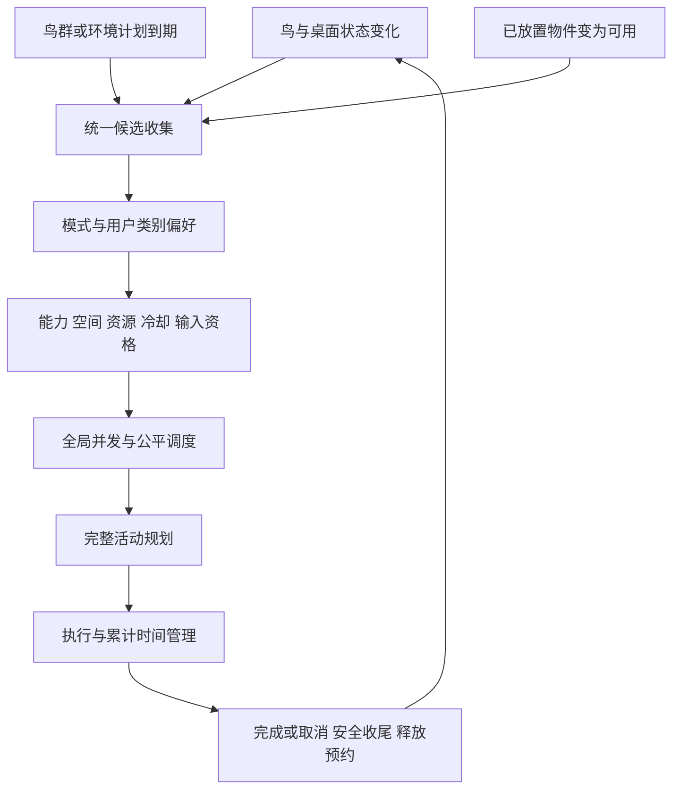

# 陪伴模式、自然触发与统一场景编辑器设计

- 日期：2026-10-27，Asia/Shanghai。
- 状态：一期实现与验收记录。参数以代码中的 `CompanionPolicy` 为准；实际通过、免验决策及未覆盖范围见第 15 节。
- 产品范围：macOS / ChirpOS Pro，沿用现有 AppKit 设置窗口、菜单栏入口和像素素材。
- 分析基线：`df5c784`；当前目录 100 种鸟。现有概率 V2 保留，模式不改变鸟种出现权重。
- 本轮交付：macOS 运行代码、原生界面、配置与场景持久化、测试和回放资源。开发分支为 `codex/companion-modes-scene-editor`；未安装、推送或发布。
- 交付决策：按用户本轮要求，模式、调度、自然触发、多实例编辑器及持久化在一期完整交付；实现按依赖顺序推进，全部实现后统一编译、验证和验收。没有另行约定的二期功能或延期功能清单。
- 验收范围更新（2026-10-27）：用户明确不再要求外接屏实际热插拔、长时间桌面运行、强制退出后的恢复验证；这三项不作为本功能完成或后续交付的阻塞条件，详见第 15.3 节。

## 1. 用户需求与本轮决策

用户在上一轮提出显著动作控制在 10 秒以内；本轮进一步明确，希望通过模式区分体验，保留目前较完整的表现作为“活泼”参考，专注时减少触发和干扰。**本方案取代“所有模式统一硬性 10 秒上限”的建议。**

已确认的方向：

1. 用户选择一个陪伴模式，统一影响动作时间、出现频率、连续活动和操作避让，不再逐个动作设置。
2. 当前较长的盘旋和完整片段可以保留，作为活泼模式的内容基线；专注模式明显减少打扰。
3. 鸟群过境拥有独立出现计划，避免被其他互动长期挤掉，并受模式控制。
4. 一期让现有适用的可手动触发行为具备自然发生路径，用户无需逐项点击预览。
5. 装饰物进入统一控制面板，用户通过拖拽布置、移动和收回，不再为每种物件堆一组设置项。
6. 上述能力一期完成，多物件共存、资源持久化和自然触发均属于交付范围，不以单场景编辑器作为最终交付。

本文记录这些方向的默认值、迁移规则和验收合同。默认模式、数字区间和物件容量由本轮实施采用，不代表用户逐项确认了每个数值。第 2 节的“当前”指审核基线；第 15 节记录本次实现。

## 2. 当前问题和可复用基础

### 2.1 源码核对结果

| 当前事实 | 对体验的影响 | 本方案处理 |
| --- | --- | --- |
| 9 种鸟有固定额外盘旋：16–52 秒，普通入场或换位可带上盘旋 | 用户工作时可能看到接近一分钟的持续移动 | 普通通勤与观赏盘旋分别管理；完整盘旋保留给活泼模式 |
| 普通飞行重新选路会重新建立飞行时钟 | 无落点或落点失效时，连续飞行可能过长 | 以整段连续活动计时，换路不重置累计预算 |
| 鸟群与绕飞、社交、落叶等共享机会，默认 180–360 秒一次 | “低频”不是每 3–6 分钟一定有鸟群 | 单独维护鸟群到期时间，仍由一个调度器仲裁 |
| 鼠标按下可刷新 60 秒抑制，机会失败后不补排 | 持续工作时鸟群可能一直不出现 | 按行为风险区分输入避让，保留一个有限待播机会 |
| `BehaviorDefinitions` 已集中能力、优先级、冷却，`BehaviorRuntime` 已管理占用、取消和清理 | 已具备统一管理基础 | 扩展现有结构，不重写所有行为 |
| 当前 `steady/localDayNight/quiet` 只覆盖部分节奏；普通飞行不完全受控 | “安静”不等于没有长盘旋 | 新模式覆盖普通飞行及独立的小动作调度 |
| 很多预览已有 `.automatic` 路径 | 不需要再写一套自动播放实现 | 逐项查漏、统一资格与触发原因、保证真实场景可达 |
| 固定栖木最多 3 个；食盘、浴盆、巢台当前共享一个 habitat 场景位 | 换一个页面不能直接获得多物件共存 | 先完成实例和预约模型，再接入统一编辑器，一期交付多物件共存 |
| 临时场景、材料、礼物有独立状态与额度 | 拖动、撤销或重启可能误重置进度 | 布局、可交互状态和已提交进度分开保存 |
| 食盘／浴盆／巢台原寿命为 180／300／900 秒，可携带叶片等待寿命为 180 秒；场景低频机会为 30–45 秒 | 直接换成数分钟的模式间隔，物件可能尚未访问就过期 | 用户布置资源等待时不按旧临时场景寿命过期，资格重评估与活动预算分开 |
| 当前场景恢复只在解除暂停后推进，运行 ID 每次启动从 1 分配 | 全局暂停下等鸟离开会互相等待，直接持久化运行 ID 会跨重启冲突 | 明确编辑应用状态机，并分离持久操作身份与会话内预约 |

已有 `LivelyMotionScheduler` 是具体的小动作实现，不能因其英文名称而直接等同于本方案的“活泼模式”；它也必须受统一模式约束。

### 2.2 这不是鸟种概率调整

陪伴模式改变“已选中的鸟如何活动”和“什么时候有互动机会”，不改变 100 种鸟的默认相对权重，不增加新鸟种，不授予缺少素材的行为能力。群飞仍在已审核的群飞物种池中选鸟；后续扩充名单需独立验证。

## 3. 三种陪伴模式

### 3.1 产品定位

| 模式 | 用户意图 | 动作时间 | 触发与空间策略 |
| --- | --- | --- | --- |
| 专注 | 工作优先，有鸟陪伴但少打扰 | 展示更短，复杂片段选择可完整收尾的短版本 | 少触发、少跨屏、偏近处落点、避免鼠标工作区 |
| 自然 | 保留生活感和偶发惊喜 | 中等长度，适度重复 | 平衡小动作、场景互动和短暂鸟群 |
| 活泼 | 愿意观看较完整的动作 | 保留当前物种时长和完整盘旋风格 | 不刻意把所有动作加密，不等于“当前高频开关全开” |

**活泼以当前完整动作作为时间基线，不宣称当前频率已经合理。** 特别是鸟群长期缺席、重复规划和操作避让问题，三个模式都需要修正。

新安装建议默认“自然”。已有用户迁移优先保留原体验，具体见第 10 节。

### 3.2 首轮时间与频率建议

下表时间为未暂停的正常播放目标，不是全局硬截止，也不要求通过提高飞速强行满足。静止停靠、道具摆放寿命、冷却、放置操作等待时间与动作片段时长分别管理。

| 项目 | 专注 | 自然 | 活泼 |
| --- | --- | --- | --- |
| 普通通勤目标 | 2–4 秒，优先邻近安全位置 | 2–6 秒 | 按现有速度与实际路径，避免无意义绕路 |
| 观赏盘旋部分 | 自动关闭；点击“体验一次”仍可演示 | 4–8 秒，作为偶发展示 | 保留物种现有 16–52 秒盘旋参数 |
| 鼠标绕飞整段目标 | 默认不主动触发 | 4–8 秒 | 保留现有一圈及自然进出路径 |
| 显著社交／场景片段 | 优先 3–8 秒的完整短版本 | 优先 4–12 秒 | 保留当前经过审核的完整版本 |
| 鸟群整群可见过程 | 3–5 秒 | 4–7 秒 | 5–9 秒 |
| 鸟群计划间隔 | 8–12 分钟 | 4–7 分钟 | 2–4 分钟 |
| 其他全局显著互动机会 | 6–10 分钟 | 3–6 分钟 | 3–6 分钟作为迁移基线，可在高级项选更频繁 |
| 两组显著自动活动之间的最短间隔 | 90 秒 | 45 秒 | 20 秒 |
| 自动观赏性活动并发上限 | 1 组 | 1 组 | 1 组 |
| 普通停靠 | 保留物种基础范围，避免不必要换位 | 保留物种基础范围 | 保留现有范围 |

“一组”可以是同一个鸟群或一次双鸟互动，不是每只鸟各占一组。必要的居民入场、离场和紧急让路不算观赏性活动，但应错峰；不能用这些豁免启动长盘旋。

显著活动分类由 `BehaviorKind.isSignificant` 统一定义，能力与开关仍由 `BehaviorDefinitions` 管理。自动观赏盘旋、绕鼠标、鸟群、社交及场景访问均受全局预算约束，包括当前 `occupiesEncounter=false` 的 `foodTrayVisit` 和 `fixedPerchVisit`。不能直接用旧占用标志代替显著性分类；这些访问从普通换位入口产生候选，也必须经过统一准入。

间隔均为随机范围，到期后仍需满足空间、资源及输入条件。鸟群与其他互动间隔不简单相加为承诺次数；它们共享全局并发和安静间隔。局部理羽、眨眼等低显著小动作有自己的物种节奏，不需每次等待 3–6 分钟，也不能让多鸟同时密集循环。

长场景不能用“播放前 8 秒后直接取消”伪装为短版。短版应缩短进出路线、减少重复次数、选用近处可达物件；仍无法完整收尾的场景，在专注模式下暂不自动触发。完整动作可在活泼或手动体验中观看。

### 3.3 时间策略与故障保护分开

配置应区分：建议展示时间、收尾预留、单行为故障超时、连续飞行故障上限。用户常用页面只展示“简短／适中／完整”的效果，不暴露所有技术时钟。

1. 鸟的连续活动身份使用会话内 `BirdID + flightEpisodeID`，贯穿接近、展示、重规划、恢复、落稳／退场；执行片段仍使用 `BehaviorRunID`，二者不作为持久资源身份。
2. `episodeElapsed` 不因换落点、换执行对象或飞行转互动而归零；普通换位与紧接其后的结队不能绕过预算。
3. 规划前用实际路线及执行器估算完整时长，累加参与鸟的连续活动年龄；专注／自然不能完整收尾的长片段不自动准入。当前不截取动作前半段，也不强制加速。模式切换时对超出新目标的片段执行现有安全取消和恢复。
4. 活泼保留长展示，但不允许无限重试；普通连续飞行的故障看门狗初始可按 90 秒设计，需结合多屏最长合法路径验收。它是异常保护建议，不是鼓励每次飞 90 秒。
5. 已有场景的 25／35 秒等故障约束逐项保留或收紧，不统一扩大到 90 秒。显著活动被取消后，恢复阶段仍由 episode 跟踪。
6. 无安全落点时先尝试近处安全退场；确实无法恢复才受控淡出并清理实体，不瞬移、不虚报完成、不立即补同一片段。
7. 用户暂停／睡眠期间不推进自动活动；恢复不补播，现有用户主动让路的暂停例外保持独立。编辑冻结与用户暂停分别管理，布局应用时的受控恢复见第 7.4 节。正常模拟时间用于动作积分，另记录可注入的未暂停经过时间诊断掉帧拖长，不能随意跳过碰撞／库存提交步骤。

### 3.4 模式切换

从菜单栏切换模式立即保存并生效；设置窗口里的编辑仍走“保存／取消”，两者使用同一配置服务。若设置窗口有草稿，菜单切换只同步未编辑字段；冲突字段明确提示，避免覆盖草稿。

新机会立即按新模式筛选。活泼切为专注时，正在进行的长展示转入安全收尾；不再开始新一圈，不直接删除鸟，也不要求已经执行 30 秒的动作倒退到 8 秒。切回活泼不复活已取消的片段。

## 4. 鸟群与全局调度

### 4.1 一个调度器，多个受管机会来源

使用现有模拟时钟维护鸟群到期、环境互动到期、局部条件变化和场景资格；不为每种动作新增系统 Timer。



每个来源只保留一个待处理机会，不累积队列。候选消失即作废；用稳定 ID 顺序及各领域独立随机流选取，不按界面卡片顺序决定出现概率。

资格变化只更新候选集合，不直接授予播放次数。鸟群使用独立计划；其他显著自动行为共享第 3.2 节的全局机会时钟，包含社交、食盘、浴盆、携带与筑巢。局部 planner、普通换位入口及执行器最终启动前都经过同一准入服务，禁止通过直接调用 `runtime.start` 绕过模式预算。全局并发占用延续到 episode 安全恢复结束，随后开始安静间隔。

模式切换时重新解析未来机会，最多保留一个仍合法的鸟群待播；关闭鸟群立即清除其待播。保存与行为无关的设置不重置到期时间，反复保存不能使鸟群无限延期。切换模式或恢复运行不会把已错过的机会补成队列。

### 4.2 鸟群专属规则

- 3–5 只仍为默认数量，不增加常驻人口。按模式选择短路径、队形长度与出场间隔，整群计时。使用恒定的物种巡航速度，按完整精灵矩形进入／离开单屏估算可见时间；小屏快速物种增加队形间隔，不能通过加速或截断凑时长。
- 默认沿单个目标屏幕的边缘走廊经过；不为穿越整个多屏桌面强行拉长时间。
- 鼠标按住或拖动期间延后；普通点击结束后等待 3 秒安静窗再评估，鼠标不必完全静止。当前不采集键盘输入。
- 绕鼠标和近距离社交采用更长的安静窗，建议自然 10 秒、活泼 5 秒；不能把旧 60 秒抑制无差别套给边缘鸟群。
- 鸟群到期但被其他互动占用时保留一次待播，获得下一次合法空档的优先权；不以超时为由强行闯入拖动区域。
- 待播建议最多保留 2 分钟，过期后合并为一个新的计划，不在工作停止后连发多群。
- 普通点击不取消已经在屏幕边缘通过的鸟群；其路径侵入当前操作区域时缩短后续路线或安全退场。

上述待播／重试仅为鸟群可靠性设计。其他事件抽中禁用、冷却或无资格候选后的安静时间不应顺手删除；任何概率语义变化应在回放和分布验收中明确记录。

### 4.3 饥饿、连续动作和可解释性

场景和社交不能无限抢占鸟群待播；公平性只对同样符合安全条件的候选生效。一次活动结束后保留模式要求的安静间隔，不能清理后立刻启动下一种展示。

内部记录 `candidate / suppressed / deferred / started / completed / cancelled / failed` 及原因、实际展示时长、延期时长。用户端只按需显示简短状态，例如“鸟群已开启 · 等待空闲时机”，不弹出调度通知或不断倒计时吸引注意。

### 4.4 场景资格、机会预算与资源寿命

现有 `sceneInterval` 与放置后缩短至 10 秒的机会属于旧临时场景合同，一期统一替换。新布置、停稳、同伴变化或冷却结束只更新资格；实际启动仍等待共享机会、输入安静窗和全局安静间隔，不因放置物件额外生成一次表演。

用户布置的食盘、浴盆、巢台及待携带叶片在等待访问时不因旧 180／300／900 秒寿命过期。容器持续存在，食物和洗澡次数按原访问提交点扣减，巢材按拾取／送达／整理状态转移；资源耗尽后停止产生访问候选，保留容器供用户查看和主动补充。可携带叶片被拾取后转入活动生命周期，投放后的效果仍按原有限寿命清理。环境落叶、昆虫和赠礼等短暂效果继续使用各自寿命，不转成永久装饰。

场景候选汇总为一个共享来源；抽中场景来源后，优先选择持续符合资格且最久未获服务的实例，以稳定 ID 打破并列。未获选实例保留资格和公平性信息，不保留一串待播任务；抽中后资格失效的机会直接作废，不在同次机会中连续尝试其他物件。鸟群待播的优先权仍按第 4.2 节执行。

因此，多摆物件只增加可选内容，不增加全局机会数量。没有合适物种、空间不足或模式不支持完整短版时，物件继续等待并显示原因，不为追求访问率放宽能力与安全条件。第一轮验收必须覆盖首次访问、多物件轮转，以及三根巢材分次运输和整理；不得用手动预览替代自然入口证明。

## 5. 用户设置结构

### 5.1 日常入口

菜单栏保留暂停、继续和退出，新增“陪伴模式”三级选项及“布置桌面”入口。设置中的行为页面提供：

| 区域 | 默认展示 | 交互 |
| --- | --- | --- |
| 陪伴模式 | 专注／自然／活泼，附一句效果说明 | 选择预设；设置内保存后生效 |
| 鸟群过境 | 总开关 | 频率与长度默认跟随模式 |
| 跟随本地昼夜 | 可选，默认关闭 | 只在模式允许范围内进一步减少夜间显著互动 |
| 手动调整行为 | 不勾选 | 勾选后展开类别级高级选项 |
| 恢复模式默认 | 按钮 | 清除类别覆盖和行为例外；独立开关、概率、布局及观鸟记录保留，详见第 8.3 节 |
| 场景布置 | 一个“布置桌面”按钮 | 打开统一物件面板 |

高级设置按“飞行与绕飞、停栖小动作、双鸟社交、场景互动”分组；允许类别开关、频率与展示长度覆盖。首版不提供 100 鸟 × 全动作的时长表，也不让每个物件拥有重复的放置／清除开关。物种体型、振翅和概率仍归原来的物种设置。

旧用户的单动作及组开关保留在原字段，在“单项开关”页查看和修改；旧 quiet 的自动限制单独显示并可清除。恢复模式默认只清除模式覆盖与兼容限制，不改变原有独立总开关，避免重新启用用户明确关闭的功能。

### 5.2 视觉与文案约束

沿用当前 macOS 原生控件、字体和像素素材，不新增网页式仪表盘或另一套视觉系统。模式说明使用“更少活动”“均衡陪伴”“完整动作”，避免“专注=绝不飞行”“活泼=所有功能全开”的误导。

界面使用原生 AppKit 控件与已有像素素材。原生验证入口 `--verify-companion-scenes` 使用隔离配置，生成设置页、编辑面板与画布截图及逐项报告。

## 6. 一期自然触发覆盖

### 6.1 “被动触发”的定义

从用户视角：用户不需要点某个动作的预览按钮。鸟根据自身状态、同伴、已布置物件及环境变化，自然获得一次活动机会。

从实现视角：环境事件与有节奏的资格重评估形成候选，不是每帧掷一次概率，也不是所有按钮都换成周期定时器。放置物件不立刻生成鸟或强制开始表演。

手动体验仍保留在观鸟手册的行为详情和编辑器统一“体验一次”入口，调用同一执行器，记录为 `preview`；自然触发记录为 `automatic`。不因设置更简单而删除调试和可发现入口。

编辑器的“体验一次”只使用已提交的布局。存在草稿时需先应用或取消草稿、退出编辑冻结后才能体验；用户暂停时提示先恢复。预览不绕过显式禁用、素材能力或资源合同，赠礼预览沿用现有不消费持久额度的路径。

“全部适用片段”覆盖现有 27 个 `BehaviorKind` 以及普通飞行和基础微动作。管理命令如暂停、移除、清空、摆放不属于要随机自动执行的片段。安全让路也不是随机娱乐行为。

### 6.2 全量触发覆盖表

下表是目标合同，不代表这些路径全部缺失；当前已有自动路径应复用并做可达性验收。每项仍需通过现有物种能力、素材与设置许可。

| 行为 ID | 自然触发条件／职责 | 模式与保护 |
| --- | --- | --- |
| `relocate` | 点击明确让路，或操作区域冲突需安全换位 | 三模式可用；不随机驱赶，用户让路优先 |
| `pointerVisit` | 鼠标安静、距离与环绕空间合适 | 专注默认不自动触发；跟随默认关闭 |
| `flockPass` | 独立鸟群计划到期且走廊可用 | 三模式按各自频率；保留原群飞物种池 |
| `rest` | 已停稳、安静且休息机会到期 | 小动作，不等于强制整只鸟离场 |
| `preen` | 停稳后的整理机会 | 避免多只同时连续理羽 |
| `watch` | 鼠标或邻近环境有轻微变化 | 事件去抖，不因坐标噪声反复触发 |
| `alert` | 快速靠近、窗口等扰动 | 安全响应，不人为制造惊吓循环 |
| `sideHop` | 边缘上有近距离避让需求与安全空间 | 小跳优先，不必改成远距离飞行 |
| `takeoffPreparation` | 已批准一段非紧急起飞计划 | 紧急让路不等待准备动画 |
| `edgePeek` | 合适边缘、停稳、空闲及足够空间 | 遵循局部冷却 |
| `socialGreeting` | 两鸟合适距离、已停稳 | 不为凑同伴生成新鸟 |
| `sideBySide` | 合法并排落点及合适同伴 | 共用社交仲裁 |
| `giveWay` | 合适的近距占位关系 | 不反复互相让座 |
| `pairedTakeoff` | 同伴均可起飞并有共同安全路线 | 合并为一组活动计时 |
| `chase` | 允许追逐的同伴、空间和冷却 | 专注优先短片段或跳过 |
| `travelTogether` | 两只已在飞行且路线可短暂合流 | 继承连续飞行预算，不能借结队延长盘旋 |
| `allopreening` | 对应能力的近邻已安静停稳 | 无合适同伴时等待，不放宽能力名单 |
| `courtshipDisplay` | 珠颈斑鸠等当前获准物种满足安静与距离条件 | 保留展示语义、冷却和独立完成记录 |
| `leafPlay` | 低频环境落叶或已存在的合适落叶 | 叶片是事件道具，不持续追踪鼠标工作区 |
| `fixedPerchVisit` | 已布置的栖木有空位，鸟正好有换位机会 | 物件不会为了吸引鸟而增加常驻数量 |
| `foodTrayVisit` | 食盘可用、有余量且合适鸟到达访问机会 | 食物耗用只提交一次 |
| `bathVisit` | 浴盆可用、冷却完成、支持洗澡的鸟停稳 | 不为洗澡打断紧急退场 |
| `leafCarry` | 有可携带叶片与可达投放点 | 同一叶片稳定 ID，不复制资源 |
| `insectCatch` | 捕虫机会、合适飞行／停栖状态及可达虫路径 | 家燕／白眉姬鹟沿用各自入口，不扩大许可 |
| `visitorGift` | 熟客条件、接收物、持久额度全部满足 | 保留默认关闭、授权与全局间隔，不因模式开启而自动打开 |
| `nestMaterialCarry` | 巢台可用、存在未搬材料、运输条件满足 | 一次一根，取消不退款或复制已消耗材料 |
| `nestBuild` | 已送达材料可整理、参与鸟满足资格 | 整理是独立片段，三根不连成必播长任务 |
| 普通入场／换位／离场 | 人口与落点需要 | 纳入模式与累计飞行预算，沿用人口合同 |
| 基础／特色微动作 | 物种姿态节奏与状态适用 | 包括 `LivelyMotionScheduler`；覆盖同时动作密度 |

注意：当前枚举实际数量必须由实施时源码核对，不能靠表格声明完成率。首版验收以枚举逐项与上表映射比对，合并行按其中每个 ID 独立覆盖。

### 6.3 机会形成与原因追踪

自然候选依据停稳、同伴、物件、指针安静与全局机会形成；继续用现有 `BehaviorSource` 表示来源，诊断另记录机会、延期、准入和终态，不把所有来源重命名为 passive 而破坏观鸟统计。

行为开始前再次校验资格、实例 revision 和资源预约；相同输入事件去重。诊断使用 `opportunityDue`、具体拒绝原因及源标签，运行开始／终态含 runID、模拟时长与未暂停经过时间；不依赖诊断标签授予行为权限。对象持续可用不能每帧重复启动；资格从不可用变为可用或下次机会到期才重评估。

普通输入优先于观赏性机会。鸟群不要求鼠标静止，绕鼠标必须等鼠标安静。键盘输入并非当前代码已采集的能力，本轮设计不承诺基于打字检测；如后续加入，应另审权限和隐私范围。

## 7. 统一装饰物控制面板

### 7.1 信息结构

“布置桌面”打开一个独立的原生面板，而不是把所有物件表单继续塞进交互设置长页。

| 区域 | 内容 |
| --- | --- |
| 物件库 | 真实素材缩略图与名称：栖木、食盘、浴盆、可携带叶片、巢台套组 |
| 当前布局 | 已摆放实例、所在屏幕、可用／被占用／已耗尽／待定位状态 |
| 选中物件 | 统一的移动、收回、查看状态；有资源的物件显示一次性补充入口 |
| 操作栏 | 应用布局、取消、撤销、重做；逐项收回后统一应用，不重置行为模式 |

巢台和材料盘作为一个组合物件拖动；内部材料保留独立实体身份。昆虫、飞落中的叶片属于短暂事件效果，不作为可永久摆放的静态装饰。赠礼是行为产物，不能通过拖拽礼物图标绕过额度；接收位置跟随获准接收物件。

已有合适素材优先复用。一期不额外扩建素材商城、商店币或新的鸟种行为。

### 7.2 拖拽摆放流程

1. 用户进入布置模式，获取独立的编辑冻结令牌，冻结普通模拟、新活动和物件寿命。用户暂停、睡眠及编辑冻结各自有原因和所有者，不用进入前的布尔快照覆盖之后的用户操作。
2. 从物件库拖到桌面，出现半透明预览、真实尺寸占位和鸟的进出空间提示。
3. 能吸附到合法位置时显示有效状态；无效位置显示原因，如“需要窗口边缘”“空间不足”“与浴盆重叠”。
4. 松手只更新布局草稿。已有物件可继续拖动；按 Esc 取消当前拖拽，草稿撤销／重做不消耗实际材料。
5. 点击“应用布局”重新核验当前屏幕、宿主和实例版本，按第 7.4 节进入应用事务。无占用的修改可直接提交；有占用的修改需完成受控恢复。失败保留草稿并定位冲突，不半成功。
6. 应用后退出布置模式，只释放本编辑事务持有的令牌，按当前其他暂停原因决定是否恢复；鸟在之后的自然机会中选择访问，不立刻集中涌入。

“用户可以拖动”不等于“所有物件可放在任意空中位置”。栖木允许屏幕相对位置；食盘与浴盆沿用现有自带承托面的几何合同，允许屏幕内安全位置；叶片和巢台必须吸附到支持的窗口边缘或地面区域。把合法性直接显示在预览中，减少提交后失败。

补充无鼠标拖拽的操作：选中物件后通过方向键微调、Enter 确认当前摆位、Esc 取消，提供可访问名称和位置反馈。

### 7.3 编辑模式与桌面操作隔离

只有显式进入布置模式时，专用编辑层接收拖拽；日常鸟和装饰物继续点击穿透，不占用普通窗口的拖动操作。菜单、场景面板和预览窗的点击不能误触底下的鸟。

编辑会话失焦、切换 Space、屏幕断开、睡眠、关闭面板时，终止拖拽并移除捕获输入的覆盖层。面板与其专用拖拽层之间的焦点转移属于同一编辑会话，不误判为退出。草稿保留或取消，但必须释放编辑会话持有的冻结令牌，不得留下不可点击的透明窗口；已进入 `applying` 的事务按第 7.4 节处理，不能仅靠窗口回调丢弃恢复责任。

### 7.4 正被鸟使用的物件如何移动

物件运行状态区分 `available / reserved / occupied / retiring`，编辑草稿属于独立状态，不修改运行中的位置。布置事务使用 `editing → applying → committed / failed / cancelled`；失败后保留草稿，重新校验才可再次应用。

| 状态 | 可以推进的内容 | 暂停与输入约束 |
| --- | --- | --- |
| `editing` | 草稿拖拽、撤销与位置校验 | 普通模拟、活动及寿命冻结；编辑层接收输入 |
| `applying` | 仅受影响鸟的安全恢复、必要碰撞采样和资源提交 | 禁止新活动，其他鸟及物件寿命冻结；移除拖拽捕获，禁止重复应用 |
| 终态 | 根据当前用户暂停／睡眠状态恢复普通模拟 | 释放本事务令牌和预约，界面反映提交结果 |

提交移动／收回已被预约或占用的物件时，先验证并保留已提交旧布局作为恢复基线，再暂停实例接待，从当前姿态结束或取消旧访问。将编辑冻结转换为“仅推进受影响 episode 恢复”的运行许可，不能继续全局 `paused=true` 却等待 `!paused` 才执行的恢复逻辑。旧位置的落点和碰撞信息保留到鸟真正脱离，不能只凭运行预约已释放就删除，也不能复用现有暂停时立即移除 habitat 的路径。

原本已由用户暂停、且布局修改需要鸟移动时，不启动应用事务，保留草稿并提示先恢复后再应用；不自行解除用户暂停。无占用且不需运动的布局修改仍可在用户暂停时提交。`applying` 中用户再次暂停时，恢复运动及其预算一起冻结，显示“等待恢复”，允许取消；这个显式暂停不算恢复超时。布局应用恢复预算为 20 秒未暂停模拟时间，超时保留旧布局并提示重试。

正常运行时，恢复使用有限预算与故障上限；无法安全落地则按第 3.3 节安全退场，不无限等待。恢复完成后再次校验宿主及布局版本，提交新位置并增加 revision。持久写入失败则保留旧布局，已发生的合法资源变更和行为终态不回滚、不复活原访问。

应用中取消、关闭编辑器、会话失焦、切换 Space 或睡眠：未提交的新布局作废并保留旧布局；恢复清理由引擎接管，释放编辑输入捕获和编辑冻结，仍受用户暂停／睡眠约束，恢复后继续清理且不能重播原行为。宿主已失效的旧布局进入待定位；屏幕／宿主在应用中变化也触发失败与重定位。旧布局及已提交资源变更的恢复以原子场景归档中各自 revision 为准，不能因退出 UI 遗留无人负责的预约。

### 7.5 容量与多物件共存

一期交付统一物件库、拖拽草稿和多实例共存。初始建议最多 6 个布置单元：栖木最多 3、其他互动单元最多 3；巢台与材料盘套组算 1 单元，待携带叶片也占互动单元。同类物件允许在容量内多实例摆放，每个实例独立管理身份、资源和预约。

持久场景使用按实例分配的 surface ID、实例级预约和共享机会下的公平调度。旧临时放置命令及 `sceneFocus` 只为历史回放／验证保留；原生产品通过统一编辑器提交持久布局，不经过旧单实例放置入口。混合场景和同类场景均须验证资源隔离。

多摆物件不意味着更多同时表演。物件数量增加只扩大候选环境，显著活动仍共享模式的总频率、并发与安静间隔；每件物品不能各自生成一个无上限机会时钟。具体容量可在性能验收中下调，但 UI 应显示可理解的统一容量，而非突然放置失败。

### 7.6 布局和资源持久化

持久保存物件类型、稳定实例 ID、屏幕 ID、归一化坐标、锚点类型、朝向、revision 和必要的使用状态。屏幕相对位置可跨重启恢复；临时窗口 ID 不当成稳定宿主标识。

- 窗口依附物在宿主失效或重启后，先尝试同屏明确允许的回退；不能可靠匹配则保留为“待定位”，不猜测粘到其他窗口上。
- 外接屏断开时保留布局，暂不渲染对应实例；重新接回后校验可用区域再恢复。
- 已完成材料、食物剩余量、赠礼额度和已提交观察不因移动、复制草稿、撤销、重启而补满或重算。
- 持久布置容器可留在桌面，资源耗尽后显示静态空闲状态；补充由选中物件的统一操作发起，默认不自动续杯或补材料。
- 已投放的临时效果保留独立寿命，过期后清理。保存布局模板只保存布置意图，不复制运行 ID、库存或赠礼授权。
- 应用关闭／睡眠期间不补演行为。持久布置资源按剩余数量与材料状态恢复，不设等待过期时钟；确有有限寿命的效果按剩余有效运行时间恢复，不利用重新加载同一实例延长寿命。

### 7.7 持久身份、提交与重启恢复

持久身份为 `instanceID`（UUID）、材料槽位及资源 revision。`BehaviorRunID`、`BirdID` 与材料运行实体 ID 只在会话内使用，不写入持久去重记录；新会话可重新从 1 分配，不能据此恢复旧预约或旧鸟。

| 保存时状态 | 重启后的恢复合同 |
| --- | --- |
| 未接触资源，仅有预约 | 清除会话预约，资源保持可用 |
| 食盘已扣份数／浴盆已完成访问 | 恢复已提交余额；浴盆仍在完整访问并安全返回后提交 |
| 巢材 `attached` | 先持久转为 `spent`，再恢复场景；写入失败不能重新变成可领取 |
| 叶片已领取 | 不重新生成可拾取副本 |
| 巢材 `delivered / arranged / spent` | 原样保留，新的自然机会只能进行合法的后续状态转移 |
| 新布局未提交 | 恢复旧布局及最新已提交资源；窗口宿主标记待定位 |
| 有限寿命效果 | 仅恢复已扣除预留时间后的余额；无法可靠恢复的窗口效果及赠礼效果清理，不重建资源或授权 |

**实现采用串行、同步确认的提交协议。** 布局与资源分别维护 revision，共用一个小型 `scene-layout.json` 原子归档。每次接触先验证单调状态转移，准备下一资源 revision，写入成功后才替换内存余额、执行后续接触并报告成功；写入失败返回失败，保留旧余额并走执行器取消／清理。已经持久保存的 `attached` 在本地清理写入失败时可按 `spent` 释放，因为重启同样按消耗处理。显式“补充资源”是唯一允许增加库存的入口。

这个实现没有磁盘工作队列、迟到写入回调或预提交状态日志；因此不持久保存异步 operationID。引擎及原生 UI 在同一串行所有者上完成调用，不能在提交中间重入。原子文件的旧／新快照决定崩溃后的恢复状态：写入之前中断读取旧状态；写入之后中断读取新余额，即使内存尚未更新也不能退款。布局提交总是从最新资源账本生成，失败不会覆盖期间已发生的消耗。备份和原子替换不宣称具备额外的断电 fsync 保证。

`ScenePersistence` 拒绝覆盖损坏、未来版本或被其他进程改写的文件。同步写入仅用于最多 6 个布局单元的小账本；普通帧不写盘。所有写入成功／失败决定及预期归档记录在回放中，回放逐项匹配且不访问真实磁盘。赠礼的外部异步授权继续遵循已有 token／绑定／去重合同。

有限寿命效果每次先持久扣除最多 **2 秒**预算，再允许使用该段时间。正常关闭或异常退出都可能损失尚未使用的预留部分，最多 2 秒；不退还以避免重复恢复续时。恢复显示也须先完成预算提交。赠礼领取旧叶片效果前，先持久清除原效果资格，防止旧效果与赠礼两次恢复。持久布置资源等待访问时不扣时间。

## 8. 统一架构与配置模型

### 8.1 职责划分

| 组件 | 责任 | 现有接入位置 |
| --- | --- | --- |
| `CompanionPreferences / CompanionPolicy` | 从模式及覆盖值解析完整策略 | 扩展 `ActivityRhythmPolicy`，迁移旧语义 |
| `BehaviorDefinitions / BehaviorKind` | 类别、触发条件、资格、时间目标、冷却与占用 | 扩展 `BehaviorDefinitions`，避免双份规则 |
| `CompanionOpportunityScheduler` | 鸟群计划、环境机会、状态触发、公平性 | 演进 `AmbientScheduler` 与局部 planner |
| `Bird.continuousFlightAge / BehaviorEngine` | 普通飞行与互动统一的累计时间、收尾和诊断 | `World.Bird`、`BehaviorEngine`、`BehaviorRuntime` |
| `SceneArchive / HabitatObjectStore / CarriedObjectStore` | 物件描述、实例、能力、生命周期、布局 | 适配现有 habitat、fixed perch、carried object |
| `SceneEditorWindow / BehaviorEngine` | 拖拽草稿、校验、应用状态机、撤销、输入层 | macOS 新原生编辑器，协调引擎受控恢复 |
| `ScenePersistence` | 持久资源账本、单调 revision、原子恢复及写入结果 | 新增场景持久层；复用现有文件校验与原子写入基础 |
| `paused / sceneEditPhase` | 用户暂停、睡眠、编辑冻结及应用恢复许可 | 适配 `DesktopController` 与引擎现有暂停入口 |

优先保持“一个模拟引擎 + 分领域随机流 + 明确预约”。配置与模式不能跳过素材能力门槛、鼠标安全区域或资源持久授权。

### 8.2 建议数据形状

以下为逻辑形状，当前配置 schema 为 3、场景归档 schema 为 1、模拟版本为 24。概率 V2 的 `speciesProbability` 不改名、不复制进模式配置。

```text
BehaviorPreferences
  mode: focus | natural | lively
  followLocalDayNight: Bool
  flockEnabled: Bool
  manualAdjustmentEnabled: Bool
  categoryOverrides: category -> frequency / durationStyle / automaticEnabled
  behaviorDisables[]: behaviorID
  automaticRestrictions[]: behaviorID（迁移时展开旧 quiet／自动专属限制）
  legacyCadenceOverride: optional old ambientFrequency mapping
  migrationVersion
  existingIndependentPreferences: visitorGifts / visitorMemory / pointerFollow / ...

ResolvedBehaviorPolicy
  sourceMode / presetVersion
  timeTargets / recoveryBudget / faultLimits
  flockInterval / encounterInterval / quietGap
  inputRules / concurrencyRules
  admissionBySource / significanceByBehavior

SceneLayout
  schemaVersion / layoutRevision
  instances[]: id / kind / anchor / transform / instanceRevision

SceneResourceLedger
  schemaVersion / ledgerRevision
  resources[]: instanceID / resourceID / resourceRevision / state / remainingUses
  materials[]: materialID / instanceID / state / committedProgress
  effects[]: effectID / remainingLifetime / reservedTimeBudget
  // 不保存裸 runID；单调资源 revision 与同步确认完成提交去重

SceneLayoutTransaction
  baseLayoutRevision / affectedInstanceRevisions
  proposedLayout / status（会话内）
  // 已提交归档中的旧 layout + 最新 resources 是恢复基线
```

默认预设由代码版本管理，用户文件只保存选择、覆盖和必要的迁移来源。场景资源按实例保存，不把全局剩余次数套给所有物件；临时运行预约不直接作为持久资源状态恢复。旧独立偏好保留原字段或做无损映射，不因这个示意模型省略字段而删除它们。

权重抽样继续使用概率 V2 基础设施，但行为候选权重、鸟种权重、鸟群到期频率和模式时长是不同维度，不能合并为一个“总概率”。

### 8.3 偏好优先级与来源范围

规则按以下顺序解析，前面的禁止条件不能由后面的频率或时长覆盖解除：

1. 素材能力、空间安全、资源余额、持久授权与有效暂停状态是硬门槛。用户明确让路等既有安全命令保留专用规则。
2. 独立开关及 `behaviorDisables` 限制所有适用来源；显式关闭的行为不会因为切换模式或点击预览而复开。独立的熟客赠礼、熟客记忆、鸟群开关继续保持各自语义。
3. `automaticRestrictions` 只限制 `.automatic`，不能转换为 `bathEnabled=false`、`foodTrayEnabled=false` 等旧总开关，不能删除物件或阻止原本允许的预览。旧 `quiet` 的限制按迁移时旧定义展开，后续新增行为不自动继承未声明的禁用项。
4. 自动触发的类别开关、频率与展示风格由模式预设提供；开启“手动调整”后叠加类别覆盖与迁移频率覆盖，再施加昼夜调节及全局并发／安全约束。模式默认不自动触发的观赏行为仍允许用户选择手动体验完整版本。
5. `.preview` 不等待自动机会时钟，不应用自动专属兼容限制，但必须通过独立开关、显式行为禁用、能力、安全和现有资源合同；与正在进行的活动仍需仲裁。

切换模式只替换预设，其他偏好继续保留。取消“手动调整”暂停应用类别与频率覆盖，并保留这些值供恢复使用；不会清除显式行为禁用或自动专属兼容限制。迁移了非默认旧频率时自动开启“手动调整”，避免覆盖存在却未生效。

“恢复模式默认”清除类别覆盖、迁移频率覆盖、行为禁用例外和自动专属兼容限制，并关闭“手动调整”；界面事先说明将清除哪些例外。独立开关保持当前值，尤其不自动打开赠礼或鸟群；概率、布局、资源与观鸟记录也不变。用户仍可单独删除某条例外或修改独立开关。

## 9. 异步事件、编辑事务与终态

桌面采样／鼠标事件／布局操作形成输入，先分类再交给引擎；模拟步处理资格和取消后再积分运动，渲染使用完成的快照。不得让 AppKit 拖拽回调直接挪动引擎已预约物件。

活动拥有会话 ID，布置及资源拥有稳定 UUID 和 revision，跨重启身份遵循第 7.7 节。新事件只产生一次开始，终态最多一次；结束时先释放对应运行的所有权、预约和输入捕获，再执行回调，防止回调重入产生重复活动。若还有安全恢复，episode 保留独立的恢复占用和旧位置保护，不能随原 run 的终态提前释放全局活动预算。

熟客赠礼等异步持久授权继续绑定 bird／instance／run／revision。授权返回时若物件已移动、模式已禁止或活动已取消，则判为过期结果，按现有额度合同处理，不重新触发。拖拽草稿不能消费授权。

文件写入使用校验、备份与原子替换；未来版本／损坏文件拒绝覆盖。布局应用错误回到可编辑状态并保留错误原因，不能只在日志中失败却让界面显示“已摆放”。

场景写入决定作为 `SceneWriteDecision` 纳入录制：保存精确的待写归档及成功／失败结果，按调用顺序校验。场景恢复、编辑开始／取消／应用、补充与选中实例预览都是可录制输入。同步写入没有迟到回调；赠礼异步授权仍使用原有独立录制输入。布局失败不覆盖较新的资源状态。

## 10. 兼容与迁移

| 旧状态 | 建议迁移 |
| --- | --- |
| `steady` | 活泼，保留当前完整时长基线；鸟群使用修订后的独立计划，自定义频率另按下行规则叠加 |
| `localDayNight` | 活泼 + 跟随本地昼夜，保留旧个体偏好 |
| `quiet` | 专注 + 仅作用于 `.automatic` 的 `legacyQuiet` 限制，覆盖旧版禁止的显著互动及场景访问；保留预览能力和物件，不把总开关改为 false |
| 明确关闭的鸟群、赠礼等独立项 | 保留独立开关关闭；切换模式和恢复行为默认均不擅自复开 |
| 明确关闭的单行为／旧行为组 | 原字段无损保留，在“单项开关”查看和更改；继续限制预览，恢复模式默认不改变这些独立开关 |
| 仅关闭自动落叶等自动专属设置 | 映射为 `legacyAutomaticOnly`，不关闭手动落叶体验 |
| 非默认旧频率 | 映射到共享非鸟群机会的迁移覆盖并开启“手动调整”，鸟群使用新独立计划；旧场景 30–45 秒等机会按第 4.4 节替换 |
| 旧固定栖木锚点 | 迁移为稳定实例，保留屏幕与相对位置 |
| 未持久化的临时物件 | 不凭空构造历史库存；升级后按实际可恢复状态处理 |
| 首次安装 | 自然、鸟群开启、手动覆盖关闭；赠礼等原独立选择仍按原默认 |

用户主动选择新的模式时，只更新预设维度，独立开关和明确例外继续保留；“恢复该模式默认”的具体清理范围见第 8.3 节。旧配置没有记录“用户是否曾主动选择默认值”，因此缺失字段按旧默认解码，非默认值及显式关闭保守保留，不根据猜测重建用户操作历史。首次成功保存迁移结果之前先备份原始文件；读取本身不写盘，保存失败也不切换活动配置，重复迁移不得追加重复例外或重复实例。

迁移验收至少包含：`quiet + bathEnabled=true` 保留浴盆与手动体验；`bathEnabled=false` 仍禁止预览；仅关闭自动落叶不影响手动落叶；关闭鸟群或赠礼后切换模式仍关闭；自定义频率迁移后立即生效。现有未持久化临时场景的旧寿命数据不能直接当成新的永久资源账本，实际转换必须有明确来源且只执行一次。

模式／调度改变会影响随机抽样次序与回放。实施时更新模拟引擎版本，录制配置包含解析策略需要的模式及预设版本；旧记录不能改版本号冒充新回放。数据兼容版本和模拟版本分别维护。

## 11. 一期实施与交付

### 11.1 完整交付范围

一期同时交付三种陪伴模式、普通飞行及互动的累计活动管理、独立鸟群计划、统一调度、全部适用行为的自然入口、统一拖拽编辑器、多类及同类物件共存、持久布局与资源账本、兼容迁移和原生设置入口。模式与编辑器共用同一策略、实例和事务基础。

不再拆分独立发布的模式阶段和场景阶段。旧单实例适配、仅有模式切换或仅能手动预览的状态都只是开发过程中的内部状态，不能标记一期完成。

### 11.2 一期内的实现顺序

| 顺序 | 实现工作 | 完成全部开发后需要核对的合同 |
| --- | --- | --- |
| 1 | 冻结旧动作基线、27 行为映射、来源权限、显著性分类、数据与模拟版本 | 能说明每条自动入口、完整动作基线及兼容规则 |
| 2 | 建立模式解析、实例注册、持久资源账本、暂停原因及编辑事务模型 | 来源优先级、跨重启身份、提交失败和恢复状态明确 |
| 3 | 接入普通飞行、微动作、全部执行器与 episode 恢复 | 换路不重置预算，短版本完整，所有显著活动经过准入 |
| 4 | 替换单场景假设，接入鸟群独立计划和共享场景候选，补齐自然入口 | 多实例资源互不串用，等待不因旧寿命过期，全局频率不随物件数放大 |
| 5 | 完成原生编辑器、受控恢复、布局持久化、设置和菜单草稿协调、旧配置迁移 | 暂停下无循环等待，跨重启资源与例外保持，旧按钮入口由统一入口承接 |
| 6 | 全部实现后统一编译、自动验证、资源检查和真实桌面验收 | 按第 12 节提供实际证据、修复发现的问题并复验受影响范围 |

这些顺序是一期内部依赖，不是分期交付或分批验收。实现期间可阅读源码、核对合同并编写测试，应用编译、执行测试与验收在完整实现后统一进行，遵守仓库开发约定。

### 11.3 完成门槛

一期交付一个完整候选及对应变更说明、迁移说明和验收证据。执行与改动相关的 `scripts/test.sh`、`scripts/test-species-parity.py` 及原生功能验收；覆盖模式切换、自然触发、混合场景、编辑应用与重启恢复的整条链路。测试和打包使用隔离配置与 Pro 本地入口；推送、安装和公开发布仍需独立授权。

关键合同失败时继续修复，不能通过把多实例、持久化或自然触发移到后续阶段来宣告一期完成。验收以第 15 节实际记录和用户确认的范围为准；用户明确免验的项目不再列为待办或阻塞条件，其他未覆盖项目如实记录，不以编译成功替代已约定的功能验收。

## 12. 验收标准

| 范围 | 必须验证 |
| --- | --- |
| 模式契约 | 分别验证机会率、成功启动次数、总移动时长及最长连续活动；专注在限定的默认配置场景中减少干扰，活泼保留已批准长动作；统计比较范围见下文，不要求所有设置组合的次数严格递增 |
| 飞行生命周期 | 100 种鸟，尤其 9 种盘旋鸟；入场、换位、无落点、窗口关闭、连续重规划、互动接续；累计时间不重置 |
| 动作完整性 | 接近／接触／消耗／交付／恢复顺序正确；短版本不跳过必要接触，不高速压缩，不把失败计成功 |
| 鸟群 | 三模式的计划分布、整体可见时长、3–5 只完整退场；普通点击不持续饥饿、拖动不强行触发、忙碌只保留一个待播 |
| 全局打扰 | 场景物件从 1 增至多件不会成倍增加触发频率；连续行为遵守安静间隔；无相互抢占循环 |
| 场景资格与寿命 | 无访问时布置资源不按旧临时寿命过期；单物件首次自然访问、多物件公平轮转、三根材料分次运输整理可达；有限寿命效果仍按合同清理 |
| 被动覆盖 | 每个 BehaviorKind 均映射触发源或明确的安全／用户命令职责；受控环境满足条件时自然入口可达，不依靠预览伪造通过 |
| 原生交互与迁移 | 模式切换、草稿冲突、保存／取消、恢复默认；`quiet` 仅限制自动来源、显式禁用仍限制预览；独立开关保持，非默认频率迁移生效 |
| 拖拽编辑 | 新建、移动、收回、合法吸附、无效反馈、取消、撤销／重做、键盘微调；退出后点击穿透恢复 |
| 使用中物件 | 正在洗澡、携带、筑巢、赠礼时移动／删除；`applying` 仅推进受影响恢复，原位置保护至真实脱离；用户已暂停时有明确反馈，无循环等待或瞬移 |
| 持久化 | 写入失败、损坏／未来版本、重复迁移、保存重载与归档恢复、模拟显示器断开；强制退出后的实机恢复及物理热插拔按第 15.3 节免验；实例／操作身份稳定，新会话 runID 重用不影响去重，剩余资源不重置 |
| 提交边界 | 在资源接触、持久操作写入、回调确认、布局准备及提交各边界注入失败；`attached` 不恢复为可领取，`delivered/arranged` 不回滚，重复及迟到回调不重播、不重复扣减 |
| 生命周期 | 用户暂停、编辑冻结、应用恢复、睡眠、Space 切换、关闭编辑器、应用退出交叉发生；无补播堆积、输入拦截残留、无人负责的恢复或令牌泄漏 |
| 性能 | 同屏多物件与不同鸟数；采样和渲染耗时不因每帧全量重规划显著恶化；记录比较基线 |

确定性验证采用固定种子、时钟、桌面事件和持久写入结果输入；频率按多种子分布评价，不能要求每个 5 分钟窗口都必须出现。长时间调度使用离线模拟验证公平性，真实桌面另做切模式、窗口变化、鸟群过境和物件拖拽观察。物理外接屏热插拔、长时间桌面运行和强制退出后的恢复按第 15.3 节免验；模拟测试仍按其实际覆盖范围记录。

模式对比使用相同的物种／人口、屏幕、布局、输入轨迹和多种子集合，分别测试默认配置、鸟群关闭、无合格候选、旧 `quiet` 迁移及自定义覆盖。默认场景的机会间隔必须符合第 3.2 节；自然与活泼的非鸟群机会率允许相同，成功次数也可能因完整动作占用更久而不递增。所有候选被禁用时三模式均可为零，不判为模式失败。时长比较采用同一可执行片段及限定场景的多种子统计，并分别记录鸟群与其他行为；不将某个总次数强行作为全部模式的排序标准。

观察指标至少记录：每小时到期机会数、候选数、成功启动／完成／取消次数及原因、总可见移动时长、最长连续飞行、重规划次数、鸟群待播时长、每物件访问次数与等待时长、操作区附近的活动次数，以及结束后的预约和运行所有权释放情况。库存按业务提交核对，不要求取消后库存“归零”或退款。场景集合、模拟时长、种子数量、统计容差、暂停恢复预算和性能阈值在执行统一验收前冻结；如调校参数，记录变更原因并重跑相关验收，不能只修改标准让已有结果通过。

## 13. 推荐优先级与待调校项

一期优先解决模式准入、资源寿命、跨重启身份及编辑恢复四个基础合同，再按第 11 节依赖顺序完成全部功能。自然触发、多实例与持久化共同参与最终验收，不将它们推迟到另一交付阶段。

无需阻塞文档或原型工作的待调校项：三种模式的具体分钟数、自然模式盘旋目标、一期最大摆放数、异常退场的淡出时长与有限寿命预算段长度。实施首轮采用本文建议；统一验收发现需调整时，记录原因、更新合同并复验。

不在本方案自动扩展的内容：Windows、M9 新生态素材、无限物件、自动补满库存、跨设备同步、全面监测键盘输入、将全部 100 鸟开放所有专用动作。

## 14. 代码依据与关联文档

以下为源码阅读及实现依据：

- [物种飞行参数](../platforms/macos/Sources/BirdingCore/FlightBehavior.swift)：现有盘旋与巡航速度。
- [鸟的运动与状态](../platforms/macos/Sources/BirdingCore/World.swift)：飞行计时、落地、目标失效。
- [目标规划](../platforms/macos/Sources/BirdingCore/Behavior/DestinationPlanner.swift)：安全落点与无落点分支。
- [环境调度](../platforms/macos/Sources/BirdingCore/AmbientBehavior.swift)：共享机会、输入抑制与鸟群路径。
- [模式策略基础](../platforms/macos/Sources/BirdingCore/Behavior/ActivityRhythm.swift)：当前日常／昼夜／安静策略。
- [动作定义](../platforms/macos/Sources/BirdingCore/Behavior/BehaviorDefinitions.swift)、[行为枚举](../platforms/macos/Sources/BirdingCore/Behavior/BehaviorTypes.swift)：资格、类别、源与命令。
- [引擎](../platforms/macos/Sources/BirdingCore/Behavior/BehaviorEngine.swift)、[执行生命周期](../platforms/macos/Sources/BirdingCore/Behavior/BehaviorRuntime.swift)：触发、所有权、恢复与清理。
- [固定栖木](../platforms/macos/Sources/BirdingCore/Behavior/FixedPerches.swift)、[场景物件](../platforms/macos/Sources/BirdingCore/Behavior/HabitatObjects.swift)、[携带物件](../platforms/macos/Sources/BirdingCore/Behavior/CarriedObject.swift)、[巢材](../platforms/macos/Sources/BirdingCore/Behavior/NestMaterials.swift)：容量、实例、锚点与不可重复提交的状态。
- [场景时钟](../platforms/macos/Sources/BirdingCore/Behavior/SceneFocus.swift)、[叶片寿命](../platforms/macos/Sources/BirdingCore/Behavior/CarriedObjectGeometry.swift)：旧场景机会与临时物件寿命，不可直接套用新模式间隔。
- [旧节奏集成测试](../platforms/macos/Tests/BirdingCoreTests/ActivityRhythmIntegrationTests.swift)、[场景调度集成测试](../platforms/macos/Tests/BirdingCoreTests/SceneSchedulingIntegrationTests.swift)：`quiet` 的来源边界、暂停与场景清理的既有合同；与新模式专项测试共同参与全量回归。
- [配置与迁移](../platforms/macos/Sources/BirdingCore/Probability.swift)、[赠礼异步授权](../platforms/macos/Sources/Birding/VisitorGiftPlatform.swift)、[录制输入](../platforms/macos/Sources/BirdingCore/Behavior/BehaviorRecording.swift)：持久保存、会话绑定及回放接入依据。
- [当前设置界面](../platforms/macos/Sources/Birding/SpeciesSettingsWindow.swift)：逐动作开关、预览与延迟放置入口。
- [既有引擎设计](BEHAVIOR-ENGINE-DESIGN.md)、[概率 V2 实施记录](PROBABILITY-SYSTEM-V2-IMPLEMENTATION.md)、[维护约定](../CONTRIBUTING.md)。

## 15. 一期实施与验收记录（2026-10-27）

已实现三模式及独立鸟群计划、统一自动准入与恢复安静间隔、普通飞行累计时钟、来源兼容迁移、原生模式设置／菜单及草稿冲突处理。场景编辑器支持 3 根栖木 + 3 个其他单元、同类／混合实例、拖拽及键盘微调、撤销重做、统一补充、选中实例体验、占用恢复应用、资源及布局保存、断屏保留与窗口待定位；已断开屏幕的物件可从列表选中并移到当前屏幕。

新增源码：`CompanionMode.swift`、`SceneLayout.swift`、`CompanionSettings.swift`、`SceneEditorWindow.swift`、`CompanionSceneVerification.swift`；核心专项测试为 `CompanionSceneTests.swift`。22 个已有行为夹具用真实导出器重新生成，模拟版本为 24，未把旧运行报告改个版本号冒充回放。

### 15.1 本次冻结的验证口径

- 鸟群：三模式 × 1440／2400／5120 宽屏 × 4 种子，20 秒运行，整群可见时长允许 0.15 秒离散采样误差，结束无运行或临时鸟残留。
- 调度：每模式 16 种子 × 1 小时离线时钟，分别统计鸟群与其他到期机会；不把到期数当成功播放数。均值范围：鸟群专注 5–7／自然 9–12／活泼 18–22 次；其他专注 6–8、自然及活泼 12–15 次。
- 普通飞行：100 物种 × 3 模式，在同一有效落点夹具内完成 25 秒运行，所有物种落稳，普通通勤不带装饰盘旋。无落点／取消及连续重规划另由生命周期测试覆盖。
- 场景：真实自动入口完成双食盘各 3 次消费及巢台三次运输、三次整理，禁止手动预览代替；双食盘显式覆盖两种 UUID 访问顺序，在 15 分钟模拟窗口内等候六次消费，再按最后执行器剩余超时边界等待返程，要求六次成功完成，同时检查单活动上限和预约释放。
- 持久与编辑：写入拒绝、外部改写、损坏文件、跨重启 attached 恢复、有限效果预算、暂停占用恢复、显示器断连和窗口宿主重定位。
- 诊断：累计未暂停经过时间与模拟时间分别记录，可见运动时间、最长连续活动、运动 revision 变化、指针附近运动时间、实例访问数、机会数及终态原因可从诊断读取；不通过大步积分追赶掉帧。
- 原生界面：隔离配置运行 `--verify-companion-scenes`，验证真实 NSView 事件处理、设置冲突、保存重载、编辑输入层释放并检查截图。没有覆盖物理外接屏热插拔或正式安装／签名／发布。

### 15.2 实际结果

全量回归通过后，补齐恢复遍历的确定性排序及双食盘两种访问顺序的测试，再完成最终定向复验与原生验收。下表区分各次验证覆盖的代码状态：

| 检查 | 实际结果 |
| --- | --- |
| 全量回归 | 1119 项通过，0 失败，634.853 秒；此轮在最后恢复排序修正及新增回放测试前启动 |
| 最终配置迁移与陪伴／场景定向复验 | 97 项通过，0 失败；其中 `CompanionSceneTests` 24 项，包含最终恢复排序修正、跨帧率回放及双食盘两种访问顺序 |
| 原生界面验证 | 18 项通过，已检查设置页、编辑面板与画布截图 |
| 资源及导出 | 100 macOS 物种调度、34 帧名和 100 飞行配置契约通过；真实导出 22 个 v24 行为夹具 |
| 离线一小时到期机会均值（16 种子） | 鸟群：专注 5.500、自然 10.375、活泼 19.438；其他：7.125、13.313、13.063 |
| Debug 引擎＋快照帧样本（6 鸟、600 帧） | 无物件 0.062 ms／帧，6 单元 0.086 ms／帧；期间无资源重建或库存变化。这不是 AppKit 渲染、窗口采样或磁盘提交的性能测量 |
| 文档及变更检查 | 本地链接、代码围栏、跟踪及新增文件空白检查通过 |

首轮全量执行 1116 项，77 个失败断言集中在 10 个旧设置测试文件，均与 schema 2 → 3 及新增迁移字段预期相关；已修正并通过上述定向回归。早期专项还发现并修复了混合物件 surface ID 冲突、小屏快速鸟群路径拒绝和测试夹具编译问题，不以失败轮次作为通过证据。最终复验还发现双食盘测试的 10 分钟总窗口及固定 40 秒等待存在顺序相关的不稳定性；改为显式覆盖两种顺序、有界等待并要求六次成功终态后，97 项复验通过。此项修正只调整测试口径，未放宽业务准入或以超时取消冒充完成。

统一检查使用命令级 `DEVELOPER_DIR=/Applications/Xcode.app/Contents/Developer scripts/test.sh`，不更改系统工具链选择。原生验证命令为 `.build/out/Products/Debug/Birding --verify-companion-scenes /tmp/chirpos-companion-native-final3-20261027`，仅写隔离目录和临时偏好套件。测试不覆盖用户配置、观鸟数据、Pro 身份或安装版。

本机证据：全量日志 `/tmp/chirpos-companion-full-final.log`；最终定向日志 `/tmp/chirpos-companion-final-followup3.log`；原生报告 `/tmp/chirpos-companion-native-final3-20261027/report.json`，同目录保留设置页、编辑面板和画布截图。临时目录证据不随仓库提交。

### 15.3 用户确认的完成范围与免验决策（2026-10-27）

本方案全部功能在一期实现，没有已约定的二期，也没有从一期延期的功能。后续新增需求另行确定范围；打包、签名、安装与发布属于交付操作，不称为二期功能开发。

用户明确要求以下三项后续不需要验证：

- 外接屏实际热插拔。
- 长时间桌面运行（含此前列出的长时间掉帧观察）。
- 强制退出后的恢复（实际强制杀进程后的重启验证）。

这三项记为“用户明确免验”，不再列作本功能的待验任务、完成阻塞或后续发布前置条件，也不记录为已测试通过；除非用户重新提出要求，不主动安排补验。已有模拟显示器断连、归档恢复、资源写入故障注入和离线调度测试继续保留。

按此次确认的范围，一期功能开发及已要求的自动化／原生界面验收已完成。其他覆盖边界仍如实保留：未执行实际断电测试、完整 AppKit 渲染性能测量，以及打包签名与安装发布；这些不构成二期功能清单。
