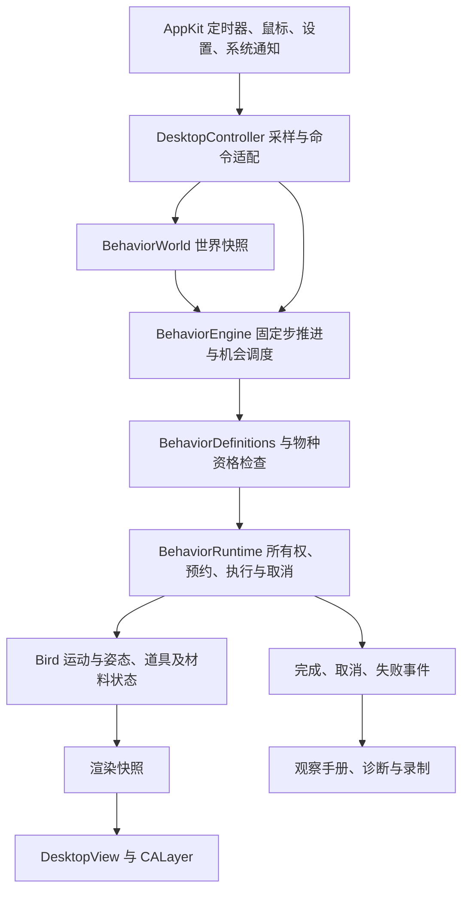
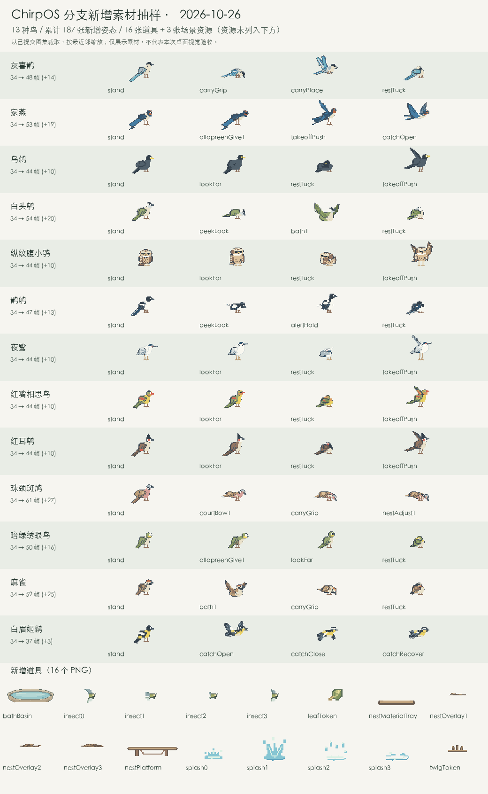

# ChirpOS 自有分支阶段性成果分析报告

分析日期：2026-10-26，Asia/Shanghai。分析对象：`fix/click-to-relocate-birds`，提交 `53680ae5738cdd5caabe460c4bf25e7090659ada`。

本报告以 Git 历史、当前源码、素材清单及本地原始验收文件为依据。统计不包含本报告及其附件，也不将未提交的 M8–M9 规划及相关文档更新计为实现成果。本次进行了静态核对、图集像素比较和历史证据复核，没有重新编译应用、运行全量 Swift 测试或操作日常桌面应用。

## 1. 阶段结论

自有分支已经形成一套以 **macOS 桌面鸟类互动和场景生态** 为重点的扩展：统一行为执行、被动感知、多鸟社交、环境道具、个体记忆、完成行为记录，以及配套的回放、压力检查和原生验收。它已经具备从“展示小鸟”向“可持续扩展的桌面生态体验”发展的基础。

相对分叉时的原版 v0.6.0，累计成果如下。

| 维度 | 本阶段实际成果 | 口径 |
| --- | --- | --- |
| 提交 | 42 个分叉后提交 | 2026-10-23 至 2026-10-25，含功能、修复、测试和文档 |
| 文件 | 373 个文件变化：新增 328，修改 45，无删除 | `2b3c05c..53680ae` |
| 文本 | 新增 87,119 行，删除 310 行，净增 86,809 行 | 含测试、清单和文档，不能全部称为业务代码 |
| 行为体系 | 当前统一登记 27 类行为 | 包含换位和对既有休息、理羽的重新组织，不能等同于 27 项全新功能 |
| 鸟种 | 仍为 46 种，没有新增物种 | 物种目录与 v0.6.0 的解析后数据完全相同 |
| 鸟体素材 | 为 13 种鸟累计追加 187 张命名姿态，鸟体总帧数 1,564 → 1,751 | 早期 20 张 + M6–M7 的 167 张，约增长 12.0% |
| 道具素材 | 16 张导出道具 PNG + 3 张场景资源 PNG | 同时更新 13 张鸟种图集；新增 PNG 文件合计 19 个 |
| 核心测试文件 | 10 → 129 个 Swift 测试文件 | 新增 119 个，另修改 1 个原有测试文件 |
| 回放 | 22 个共享场景，历史 66 份 30/60/120 Hz 报告一致 | 输入回放稳定性，不代表 Windows 对齐 |
| 阶段验收 | M6/M7 按已确认的范围完成交付 | 窗口跟随、菜单暂停、真实睡眠及物理多屏仍有明确未验项 |

**与当前原版相比，结论需要加上版本背景。** 原版主分支截至本次核对已到 v0.7.0、100 鸟种，并增加观鸟模式及 Life List。自有分支仍基于 v0.6.0，没有合入这 3 个上游提交。因此，自有分支的阶段优势主要是互动深度、场景内容和行为工程；当前原版在鸟种广度、点击观鸟收集及双平台同步方面有本分支尚未整合的成果。

完整数值及文件清单见 [分析证据 JSON](reports/2026-10-26/analysis-evidence.json) 与 [373 文件变更清单](reports/2026-10-26/changed-files.csv)。

## 2. 对比基准与调查方法

### 2.1 必须保留的两个基准

| 对象 | 提交 | 提交时间（北京时间） | 用途 |
| --- | --- | --- | --- |
| 共同祖先／原版 v0.6.0 | `2b3c05caa8924eb0bf07f8c7757c75c4d4d43f07` | 2026-10-22 23:27:32 | 统计我们实际做了什么 |
| 当前自有分支 | `53680ae5738cdd5caabe460c4bf25e7090659ada` | 2026-10-25 19:31:04 | 本报告成果快照 |
| 当前原版 `upstream/main` | `6d2a9e2cd3bf68120b6335b9df092f5b2468ed69` | 2026-10-25 23:40:12 | 判断目前与原版的产品差异 |

远端原版为 `billtt/chirp-os`，自有远端为 `sucan2233/chirp-os`。本次先通过 `git ls-remote` 发现本地上游引用过期，再执行 `git fetch --no-tags upstream main` 更新引用；没有合并或修改业务代码。

两端已分岔：自有分支独有 42 个提交，上游独有 3 个提交。不能把原版后来新增、我们尚未合入的 54 种鸟称作“我们删除了 54 种鸟”。同理，用当前两端直接差分得到的 494 个变化文件，不适合作为自己的开发工作量；本报告采用共同祖先到自有 HEAD 的 373 文件口径。

### 2.2 证据等级

- **本次源码／Git 核对**：提交、文件、代码组织、物种资格、默认设置、素材数量等。
- **本次数据复核**：读取原始检查字典、历史测试日志、跨率报告及八小时事件文件；直接比较 46 种鸟的旧图集像素。
- **历史验收结论**：安装、签名、原生图层、GIF、实际桌面操作、性能测量，保留原候选和原轮次口径。本次未重做这些操作。
- **分析判断**：阶段定位、维护压力及后续优先级，属于基于证据的建议。

## 3. 原版已有能力与我们新增的产品能力

### 3.1 沿用的基础，不能重复计为自研新增

原版 v0.6.0 已有 46 种像素鸟、按物种定制的飞行节奏、窗口和地面停靠、窗口遮挡、鸟群数量与概率设置、悬停显示名称、图鉴、自动更新、中英文和随系统启动。夜鹭的守望／伸颈／抖毛、大斑啄木鸟的侧边停靠／啄击，以及基础理羽、着陆、滑翔等素材也已存在。

本分支在这些基础之上增加了触发规则、行为生命周期、个体差异及专用动作。尤其是 `preen`、`rest`、`stretch`、`shake` 等名称的出现，不应直接解释为对应视觉语义全部从零创作。

### 3.2 人与鸟、鸟与环境的互动

| 功能 | 用户能获得的变化 | 实现重点与边界 |
| --- | --- | --- |
| 点击换位 | 点击鸟身，让它飞到其他安全位置 | 共享可见像素命中；保留点击穿透，不抢焦点；避开原落脚区域 |
| 悬停延时设置 | 名称等待时间可调为 0–10 秒 | 默认 1 秒，0 表示立即显示 |
| 绕鼠标／可选跟随 | 鼠标静止、空间足够时鸟会访问；可开启移动跟随 | 跟随默认关闭；鼠标移动或点击按设置取消；有安全距离与空间检查 |
| 鸟群过境 | 3–5 只同种鸟错峰掠过 | 临时鸟与居民分开，不占居民数量；当前允许 8 种鸟 |
| 停栖活动 | 闭眼休息、落地后整理、起飞准备，节奏存在个体差异 | 统一运行时安排；12 种鸟获得专用观察／警觉／休息／起飞姿态 |
| 被动观察与警觉 | 鸟会对鼠标靠近和近期惊扰作出反应 | 感知状态、性格参数、短期记忆共同影响机会 |
| 侧跳让路 | 在合法支撑面上侧跳，主动避开附近干扰 | 需要空间、支撑和目标安全余量；条件失效时退出 |
| 窗口边缘探头 | 从边缘探身后安全恢复 | 6 种鸟开放；其中白头鹎、鹊鸲新增专用探头帧 |
| 昼夜／安静陪伴 | 减少显著自动互动，调整休息节奏 | 有日常、本地昼夜、安静三模式；不是完整生物作息模拟，不离线补发行为 |

主要证据：[交互命中与鼠标监听](../platforms/macos/Sources/Birding/HoverNames.swift#L17)、[设置默认值](../platforms/macos/Sources/BirdingCore/Probability.swift#L95)、[被动感知](../platforms/macos/Sources/BirdingCore/Behavior/PassiveEcology.swift)、[昼夜策略](../platforms/macos/Sources/BirdingCore/Behavior/ActivityRhythm.swift)。

### 3.3 多鸟社交与协调飞行

| 功能 | 行为组成 | 当前物种范围 |
| --- | --- | --- |
| 双鸟招呼 | 同伴响应与短时互动 | 通用资格；仍需满足实际位置、状态和空间条件 |
| 并排停靠 | 协调相邻位置与落点 | 通用资格 |
| 让座 | 一方让出位置、双方恢复 | 通用资格 |
| 结伴起飞 | 两只鸟按时序起飞 | 通用资格 |
| 双鸟追逐 | 从停栖起飞，短时追逐后各自返回 | 7 种 |
| 空中临时结队 | 原本正在飞行的两只鸟靠拢、同行、再分离 | 7 种；不强制停栖鸟起飞 |
| 同伴理羽 | 接近、给予／接受理羽、退回原位 | 家燕、暗绿绣眼鸟；有各自接触姿态 |
| 求偶展示 | 两只珠颈斑鸠进行发起／观察角色展示 | 珠颈斑鸠；没有性别、永久配偶或繁殖模型 |

这些功能的主要工程价值是多参与者协调：双方共享一次运行、统一取消，不能只移动一只后遗留另一只的占位或姿态。对应实现位于 [SocialMotion](../platforms/macos/Sources/BirdingCore/Behavior/SocialMotion.swift)、[Chase](../platforms/macos/Sources/BirdingCore/Behavior/Chase.swift)、[TravelTogether](../platforms/macos/Sources/BirdingCore/Behavior/TravelTogether.swift)、[Allopreening](../platforms/macos/Sources/BirdingCore/Behavior/Allopreening.swift) 与 [CourtshipDisplay](../platforms/macos/Sources/BirdingCore/Behavior/CourtshipDisplay.swift)。

### 3.4 场景道具与专用活动

| 功能 | 当前实际实现 | 容量、寿命及完成规则 |
| --- | --- | --- |
| 动态落叶追随 | 居民观察、跟随落叶后返回；有手动与低频自动入口 | 不新增居民；与静止携叶独立控制 |
| 固定小栖木 | 用户延迟取点、保存位置，鸟可自然访问或预览 | 最多 3 根，每根单鸟；7 种鸟有资格；关闭保留位置 |
| 临时食盘 | 麻雀、珠颈斑鸠接近、着陆、进食、返回 | 初始 3 份，180 秒；完整访问消耗一份 |
| 浅水浴盆 | 麻雀、白头鹎试水、洗澡、甩水后返回 | 300 秒或 3 次完整访问；返程落稳才记完成 |
| 静止叶片携带 | 麻雀真实拾取、短途携带、放下和恢复 | 同一叶片实体贯穿生命周期；待拾取 180 秒，放下展示 8 秒 |
| 家燕捕虫 | 复用普通飞行居民，空中拦截后继续原目标 | 全局最多 1 只独立昆虫，寿命 12 秒；预览可等自然起飞最多 10 秒 |
| 白眉姬鹟捕虫 | 从普通窗口／地面栖点出击，尝试回原脚位 | 原点失效时找安全替代落点；捕获且最终落稳才记录，不开放固定栖木资格 |
| 熟客赠叶 | 熟悉的灰喜鹊携叶至固定栖木接收位置 | 默认关闭；有持久额度授权，最小授权间隔 24 小时；明确为风格化内容 |
| 珠颈斑鸠运材 | 用户放置巢台和三根材料，鸟拾取并运输 | 巢台 900 秒、单访客；同一材料 ID 贯穿拾取、附着、交付 |
| 简化筑巢／理巢 | 将已交付材料逐根整理为三个可见进度层 | 运材和整理分别计完成；取消保留已提交进度，不自动补材料；无蛋或幼鸟 |

食盘、浴盆、巢台共享栖息地容量与场景约束；静止叶片等还受独立对象存储和场景焦点规则限制。表格不能理解为所有道具可以同时放置，或勾选开关就能立即触发。

深度已经延伸到“拾取／附着／放下／提交／返程／清理”，而不只是播放一组动画。特别是捕虫采用真实喙接触检测，筑巢区分材料交付与整理提交；这些规则使中断、暂停和观察计数能够保持一致。

证据：[场景对象存储](../platforms/macos/Sources/BirdingCore/Behavior/HabitatObjects.swift)、[携带物](../platforms/macos/Sources/BirdingCore/Behavior/CarriedObject.swift)、[昆虫接触](../platforms/macos/Sources/BirdingCore/Behavior/InsectContactResolver.swift)、[巢材生命周期](../platforms/macos/Sources/BirdingCore/Behavior/NestMaterials.swift)、[内容实施规格](BEHAVIOR-CONTENT-SPEC.md)。

### 3.5 个体记忆与观察积累

**熟客记忆**保存稳定身份、个体随机种子、来访次数和累计安静停留时间，最多 128 份档案。熟悉度会影响既有行为机会；它不是完整的关系、配偶或情感系统。

**观察手册**按“鸟种 × 已完成行为”汇总首次、最近时间及次数，区分自动、手动、预览来源，提供搜索、筛选和本地持久化。取消、拒绝和未完成的场景不增加完成记录；点击换位不计入该手册。当前归档版本为 2，包含旧格式迁移和读取失败时保护旧文件的处理。

**赠礼账本**独立于普通行为计时，增加跨重启的额度、身份绑定、文件版本和异常处理。礼物预览采用虚构的内存授权，不消耗真实额度。

这三部分分别承担“记住谁来过”“记住看到了什么行为”“限制某次赠礼资格”，数据语义不同。证据：[VisitorMemory](../platforms/macos/Sources/BirdingCore/Behavior/VisitorMemory.swift)、[ObservationJournal](../platforms/macos/Sources/BirdingCore/Behavior/ObservationJournal.swift)、[GiftLedger](../platforms/macos/Sources/BirdingCore/Behavior/GiftLedger.swift)。

## 4. 新增代码与架构成果

### 4.1 代码规模按用途拆分

分类按文件路径、扩展名及 `Verification` 文件名统计；诊断 CLI、回放和压力工具随所在源码目录计入运行时／平台类，不代表全部是日常热路径代码。

| 类型 | 变化文件 | 新增文件 | 新增行 | 删除行 | 净增行 |
| --- | ---: | ---: | ---: | ---: | ---: |
| 核心运行时与诊断 Swift | 76 | 71 | 15,091 | 20 | 15,071 |
| macOS 平台、界面与渲染 Swift | 30 | 20 | 6,559 | 204 | 6,355 |
| 核心自动化测试 | 120 | 119 | 24,195 | 27 | 24,168 |
| macOS 原生验收代码 | 59 | 54 | 15,784 | 45 | 15,739 |
| Windows 验收兼容代码 | 1 | 0 | 12 | 1 | 11 |
| 构建／验证脚本 | 5 | 1 | 213 | 2 | 211 |
| 共享清单与数据 | 4 | 2 | 17,173 | 2 | 17,171 |
| 回放 JSON 夹具 | 22 | 22 | 3,946 | 0 | 3,946 |
| Markdown 文档 | 23 | 20 | 4,145 | 8 | 4,137 |
| Swift 包配置 | 1 | 0 | 1 | 1 | 0 |
| PNG 素材 | 32 | 19 | 二进制 | 二进制 | 不计文本行 |
| **合计** | **373** | **328** | **87,119** | **310** | **86,809** |

运行时及平台源码净增约 2.14 万行；测试／原生验收及 Windows 验收兼容净增约 3.99 万行。共享清单另外占约 1.72 万行，其中 `species-support.json` 和图集 manifest 是大头。总行数反映交付体量，不能直接衡量功能数量或代码效率。

核心 Swift 文件从 9 个增至 80 个；平台 Swift 文件从 22 个增至 96 个，后者包含原生验收文件。Swift Package 仍保持核心库、macOS 可执行目标和核心测试目标的结构，没有新增包依赖。

### 4.2 主调用链已经从平台控制器扩展为明确的行为执行层



1. `DesktopController.tick()`读取平台时间、窗口与鼠标状态，将它们整理成世界输入。
2. `BehaviorEngine.handle()`接受点击、预览、放道具、暂停等命令；`advance()`按 `1/60` 秒固定步推进。
3. `BehaviorDefinitions`定义行为所需能力、开关、优先级与冷却；`SpeciesBehaviorProfile`决定物种是否允许。
4. `BehaviorRuntime`获取参与者所有权和落点／场景预约，再启动具体执行对象；后续每步验证环境是否仍有效。
5. 各执行对象推进鸟体运动、接触姿态及场景资源，渲染层消费快照。
6. 完成后释放运行所有权，输出唯一终态事件；合格的完成行为再进入观察手册。

关键收益是将“执行中的行为”“普通飞行”“视觉呈现”“记录输出”分开管理，使多鸟和道具不必各自建立定时器或互相修改平台状态。普通 Bird 运动模型仍被复用，并非整个底层飞行系统全部重写。

源码入口：[Desktop.swift:329](../platforms/macos/Sources/Birding/Desktop.swift#L329)、[BehaviorEngine.swift:380](../platforms/macos/Sources/BirdingCore/Behavior/BehaviorEngine.swift#L380)、[固定步推进](../platforms/macos/Sources/BirdingCore/Behavior/BehaviorEngine.swift#L1578)、[BehaviorRuntime](../platforms/macos/Sources/BirdingCore/Behavior/BehaviorRuntime.swift#L85)。

### 4.3 核心对象及其作用

| 对象 | 承载内容 | 生命周期与作用 |
| --- | --- | --- |
| `BirdID`／`BehaviorRunID` | 鸟实体和行为运行的独立身份 | 避免用视图或临时数组索引管理协同行为 |
| `BehaviorWorld` | 显示器、支撑面、鼠标、比例、素材可用性、本地时段 | 平台输入快照；供准入和持续安全检查 |
| `BehaviorExecution`／Runtime Run | 参与鸟、阶段、年龄、超时、资源声明 | 从启动到唯一终态，由统一 Runtime 管理 |
| `LandingReservation`／`SurfaceAnchor` | 目标位置、宿主及空间占用 | 运行时持有；随环境变化验证和释放 |
| `HabitatObjectStore` | 食盘、浴盆、巢台及余量／寿命 | 对象可以跨多次访问存在，不随单次运行直接消失 |
| `CarriedObjectStore`／`InsectStore` | 叶片、礼物、昆虫等独立实体 | 负责附着、接触、过期；避免把道具烘焙为鸟体的一部分 |
| `NestMaterial`／巢台状态 | 三根材料的身份、位置和整理进度 | 按拾取、交付、整理的原子提交点转移，维护三根守恒 |
| `PoseClip`／`PoseMixer` | 命名姿态、时长和交接 | 使用行为模拟年龄，衔接准备、重点和恢复动作 |
| `BehaviorEvent`／`BehaviorObservation` | 诊断终态／可入册完成结果 | 前者可含失败和拒绝，后者只在合格完成时输出 |
| 熟客、手册、赠礼归档 | 跨启动的积累数据 | 不承担实时运动，不保存仍活跃的运行或预约 |

### 4.4 三道独立的功能门槛

“图集中有帧”不等于“鸟种可以做该行为”。当前实现分别检查：

1. **产品资格**：`SpeciesBehaviorProfile`是否允许该鸟种参加。
2. **素材能力**：所有必需帧、姿态片段及喙／脚锚是否齐全。
3. **实时条件**：鸟的状态、冷却、空间、鼠标距离、预约、场景容量是否合适。

例如白眉姬鹟已有捕虫帧，但没有因此获得固定小栖木资格；灰喜鹊的携叶姿态用于赠礼，也没有因此开放麻雀的独立叶片携带玩法。`shared/species-support.json`将物种资格、缺帧和实际内容支持分别导出，方便审计。

## 5. 定时、事件及异步收尾机制

### 5.1 逐帧与外部事件的数据流

平台使用一个 60 Hz 主定时器，窗口约按 30 Hz 采样；引擎使用固定 `1/60` 秒步长。单次输入耗时最多接收 0.05 秒，最多推进三步，避免大时间差产生无限追赶。行为没有各自安装动画定时器。

每步分别处理对象寿命、环境感知、人口机会、延迟放置、执行阶段、运动及接触检查。暂停时，大部分行为年龄、对象寿命及机会倒计时冻结；点击换位有显式的暂停可执行政策。因此不能把 `engine.time`的继续推进理解为所有生态计时都继续。

中间输出是渲染快照、道具快照与诊断事件；这些值交给界面／图层消费。完成时，Runtime 先撤销运行和参与鸟所有权，再调用取消恢复或发送终态，降低重复结束风险。只有 `completed`且不是换位的合格运行才发出 `BehaviorObservation`；失败、取消、拒绝不会冒充观察成果。

睡眠、屏幕变化、Space 变化和退出会进入相应取消路径，释放道具与预约。源码存在这些处理，不等于已经完成真实操作系统睡眠／物理多屏验收。

证据：[定时与系统通知](../platforms/macos/Sources/Birding/Desktop.swift#L267)、[单步推进](../platforms/macos/Sources/BirdingCore/Behavior/BehaviorEngine.swift#L1578)、[完成与取消](../platforms/macos/Sources/BirdingCore/Behavior/BehaviorRuntime.swift#L145)。

### 5.2 赠礼授权的真正异步边界

赠礼额度需要文件 I/O，采用“引擎提出请求 → 平台后台队列检查账本 → 主线程返回授权结果 → 引擎重新验证”的流程，后台线程不直接推进引擎。授权具有 5 秒超时；会话、请求、身份和接收位置绑定用于拒绝过期或重复回调。

点击取消、设置改变或宿主失效后，即使旧 I/O 稍后返回，也不能重新激活旧行为。错误通过明确的授权拒绝原因返回，而不是继续赠礼；已经提交的额度不会因为画面取消而自动退款。预览走异步内存授权，不读取或消耗真实账本。

录制系统保存授权结果这一外部输入，回放消费已记录结果，不依赖重放机器的真实账本或墙钟。这使异步 I/O 的结果也能纳入确定性比较。

证据：[VisitorGiftPlatform](../platforms/macos/Sources/Birding/VisitorGiftPlatform.swift#L14)、[GiftLedgerPersistence](../platforms/macos/Sources/Birding/GiftLedgerPersistence.swift#L43)、[录制／回放](../platforms/macos/Sources/BirdingCore/Behavior/BehaviorRecording.swift#L465)。

### 5.3 持久化与终止收尾

观察手册通过独立完成回调接收记录，不依赖可能滚动淘汰的诊断事件环。平时按持久化策略保存，退出时 flush；读取失败时保护原文件，并向界面提供“仅本次内存保存”等状态。熟客档案及赠礼账本也有独立的版本、大小和异常边界。

这些是可靠性成果；它们不表示所有持久化都在后台异步执行。赠礼账本的后台授权与普通手册保存应分开理解。

## 6. 新增素材的完整账目

### 6.1 为什么 187 张与既有文档的 167 张都成立

分叉时原版：`46 × 34 = 1,564`张逻辑鸟体帧。

早期扩展：家燕与暗绿绣眼鸟各 6 张同伴理羽，麻雀与珠颈斑鸠各 4 张进食，共 20 张。

M6–M7：12 鸟基础姿态 120 + 探头 6 + 浴盆 14 + 麻雀携带 4 + 两鸟捕虫 6 + 灰喜鹊赠礼携带 4 + 斑鸠求偶 5 + 运材 4 + 理巢 4 = 167 张。

累计：`1,564 + 20 + 167 = 1,751`张。现有文档的 167 张是相对 M5n `0ec8378`，本报告的 187 张是相对原版 v0.6.0；不能混用基准。

### 6.2 逐鸟新增清单

下表都是命名姿态数量；左右镜像、放大、GIF 帧和接触参考图不重复计数。

| 鸟种 | 原版帧 | 早期新增 | M6–M7 新增 | 当前帧 | 主要新增内容 |
| --- | ---: | ---: | ---: | ---: | --- |
| 麻雀 | 34 | 4 | 21 | 59 | 进食、基础增强、浴盆、叶片携带 |
| 珠颈斑鸠 | 34 | 4 | 23 | 61 | 进食、基础增强、求偶、运材、理巢 |
| 家燕 | 34 | 6 | 13 | 53 | 同伴理羽、基础增强、捕虫 |
| 暗绿绣眼鸟 | 34 | 6 | 10 | 50 | 同伴理羽、基础增强 |
| 白头鹎 | 34 | 0 | 20 | 54 | 基础增强、探头、浴盆 |
| 红耳鹎 | 34 | 0 | 10 | 44 | 基础增强；另扩展追逐／结队资格 |
| 乌鸫 | 34 | 0 | 10 | 44 | 基础增强 |
| 鹊鸲 | 34 | 0 | 13 | 47 | 基础增强、探头 |
| 夜鹭 | 34 | 0 | 10 | 44 | 基础增强，原有特色动作保留 |
| 灰喜鹊 | 34 | 0 | 14 | 48 | 基础增强、赠礼携带 |
| 红嘴相思鸟 | 34 | 0 | 10 | 44 | 基础增强 |
| 纵纹腹小鸮 | 34 | 0 | 10 | 44 | 基础增强 |
| 白眉姬鹟 | 34 | 0 | 3 | 37 | 捕虫三帧；没有基础增强十帧 |
| **合计** | **442** | **20** | **167** | **629** | **13 种获得追加素材** |

其余 33 种保留各自 34 帧，共 1,122 帧；`629 + 1,122 = 1,751`。当前具有十帧基础增强包的是 12/46 种，尚有 34 种没有这个包，其中包括已获得捕虫三帧的白眉姬鹟。其余鸟仍可具有通用行为或已有专用资格，不能据此称为“没有动作”。

### 6.3 道具、图集和兼容性

| 文件类别 | 数量 | 内容 |
| --- | ---: | --- |
| 新增资源 PNG | 3 | `leaf.png`、`fixed-perch.png`、`food-tray.png` |
| 浴盆与水花 PNG | 5 | 盆体 1、水花 4 |
| 可携带叶片 PNG | 1 | `leafToken.png`，也供赠礼复用 |
| 昆虫 PNG | 4 | `insect0...3.png` |
| 筑巢 PNG | 6 | 枝条、巢台、材料盘、三层进度图 |
| 修改既有鸟种图集 PNG | 13 | 在原 34 帧后追加专用姿态 |
| **合计变化 PNG** | **32** | **19 个新增文件 + 13 个修改文件** |

187 张逻辑姿态并不对应 187 个独立 PNG；它们被追加在 13 张物种横向图集中。46 种鸟的公共 34 帧名称、顺序和脚锚 `(29,39)`保持。本次对原版全部 46 张图集的公共区域做 RGBA 像素比较，**46/46 完全相同**。

还新增／扩展了物种帧表、姿态片段、喙／脚锚、接触几何和道具 manifest。素材能够正确“接触、夹持、入水、压实”，依赖这些元数据及渲染分层，不能只靠图集图片。

下图从当前已提交图集裁取，第一列为原有 `stand`，后列为新增姿态抽样；底部展示 16 张导出道具。它是素材浏览图，不是桌面截图或完整动画视觉验收。



主要来源：[鸟体图集 manifest](../shared/art/manifest.json)、[道具 manifest](../shared/art/props/manifest.json)、[素材导出代码](../platforms/macos/Sources/Birding/SharedArt.swift#L5)、[物种交付矩阵](SPECIES-DELIVERY-MATRIX.md)。

## 7. 平台适配、开发工具与里程碑

### 7.1 macOS 与 Windows 的真实范围

macOS 是本阶段主要实现和验收平台。新增交互设置、预览、三槽栖木编辑、场景放置／清除、观察手册窗口及中英文文案；鼠标命中还考虑镜像、鸟体缩放、前景遮挡及浴盆前壁。开发包增加独立应用标识和名称，避免与日常包混淆；开发包也不启动原版自动更新控制器。

Windows 只有一个直接代码改动：`DesktopVerification.cs`允许物种图集在公共帧之后追加姿态，检查公共前缀、唯一名称和图集尺寸。Windows 的行为引擎、互动 UI、手册和原生功能没有完成对应迁移；共享 PNG 可兼容，不代表两端玩法已对齐。

### 7.2 工程工具

- 本地行为输入录制与离线回放：世界、设置、命令、时间推进和授权结果进入显式输入序列；当前模拟版本为 **18**，与归档格式版本分开。
- 22 个共享 JSON 场景：覆盖中断、社交、道具、记忆、捕虫、赠礼、求偶和筑巢等。
- 压力与自动生态诊断：检查多鸟负载、生命周期、资源零残留，并记录延迟分位和事件摘要。
- 真实墙钟长跑采集：记录 CPU、RSS、锁屏、睡眠、事件及清理顺序；使用隔离偏好和输出目录。
- 姿态／素材预览与导出：图集、锚点、道具、GIF 和原生图层检查。
- 版本和数据保护：未来版本拒绝、旧格式迁移、损坏文件保护、保存失败状态及安装前草稿保护。

证据：[BehaviorRecording](../platforms/macos/Sources/BirdingCore/Behavior/BehaviorRecording.swift#L465)、[BehaviorStress](../platforms/macos/Sources/BirdingCore/Behavior/BehaviorStress.swift)、[DesktopSoakSession](../platforms/macos/Sources/Birding/DesktopSoakSession.swift)、[开发包构建](../scripts/build.sh#L30)、[应用启动条件](../platforms/macos/Sources/Birding/main.swift#L224)。

### 7.3 交付过程

| 阶段 | 主要成果 | 提交／记录 |
| --- | --- | --- |
| M0–M3 | 统一行为引擎、桌面交互迁移、休息／理羽及平台保障 | `c2f7350`、`aeae062`、`a61c233` |
| M4 | 招呼、鼠标跟随、落点预约、并排／让座／结伴起飞 | `82ddab6`、`6fe6bab`、`825aa54` |
| M5 | 动态落叶、感知与性格、动作契约／回放、熟客、昼夜、更多社交、栖木／食盘／手册 | `b8a3aa7`至`0ec8378`之间的分批提交 |
| M6a–c | 集中物种配置、PoseClip、12 鸟增强、专用资格扩展 | `80b8a6d`、`4f89d7d` |
| M6d–g | 浴盆、静止携叶、两类捕虫、熟客赠礼 | `7eb6b26`、`45ae138`、`13e4733`、`3bad0e7`、`ce8b390` |
| M7a–c | 斑鸠求偶、运材、简化筑巢，修正并补齐原生验收 | `906d7e9`、`159c834`及后续修复 |
| M6h／M7d | 安装／用户数据保护、8h 默认长跑、取消矩阵补验、交付限制确认 | 截至`53680ae`的收尾记录 |

阶段验收已经形成规格、内容矩阵、实施进度、研究证据和各轮验收记录；历史失败与修正仍然保留。已提交快照中的路线图及夹具 README 部分段落保留较早阶段状态；本次分析期间工作区另有路线图、规格和 M8–M9 规划更新。判断已完成功能仍以实现源码、`IMPLEMENTATION-PROGRESS.md`及 `M7D-ACCEPTANCE.md`的最终结论为准，未提交规划单列。

## 8. 验证证据与交付边界

### 8.1 本次复核到了哪些原始结果

| 项目 | 原始结果 | 本次检查方式 | 能证明什么 |
| --- | --- | --- | --- |
| 核心全量测试历史日志 | 992 项、0 failures、0 unexpected | 读取`m7bc-tests-full-sixth.log`的完整执行结论 | 该轮核心套件全绿；不冒称后续所有验证代码已同轮全量重测 |
| 巢台专项 | 1,116/1,116 | 遍历原报告`checks`，全部为 true，errors 为空 | 该轮巢台专项通过 |
| 完整鸟行为 | 4,593/4,593 | 同上 | 对应候选的完整鸟行为验收通过 |
| 设置 | 2,190/2,190 | 同上 | 对应设置控件／数据契约通过 |
| V03 扩展取消矩阵 | 7,546/7,546 | 同上 | 后补的运材／理巢阶段取消和恢复覆盖通过 |
| 跨率回放 | 22 场景 × 3 频率 = 66 报告 | 读取历史摘要并比较现存报告 | 固定输入在 30/60/120 Hz 拆分下终态一致 |
| 旧场景回归 | 20 份完整报告，未忽略字段 | 读取与 M7a 比较记录及相应文件 | 不通过删字段掩盖旧场景变化 |
| 原版旧素材 | 46/46 公共图集 RGBA 相同 | 本次直接读取 Git 旧 PNG 并比较当前前 34 帧 | 相对原版 v0.6.0 保持旧像素和公共帧布局 |
| 八小时默认长跑 | 28,800.113 秒、43,836 事件 | 本次逐条读取事件并与 summary 分类计数比较 | 持续运行、事件连续及退出清理有证据 |

上述检查有交叉覆盖，不能简单相加为“独立测试用例总数”。历史后补核心用例仍按“原轮 46 项通过 + 修正方法单独 1 项通过”的证据记录，不改写成新一轮全量全绿。

原始路径、报告 SHA256 和本次审阅结果保存在附件 JSON。原始日志与图层大多位于 Git 忽略的 `.build/`，本机目前可读；只克隆仓库不会自动获得这批完整原始证据。若要对外移交，应另行打包。

### 8.2 八小时运行的结果与限制

本次重读确认事件序号连续、分类计数与 summary 完全相同，退出后 **28 个明确命名的资源计数全部归零**，关闭后图层计数全部归零，持久化和偏好隔离结论通过。采样 RSS 峰值为 **171.67 MiB**。

历史资源趋势记录中，第 2–7 小时 RSS 中位数约 170.89–171.39 MiB，第 8 小时约 143.53 MiB；前 7 小时单核 CPU 中位数约 6.33%–6.37%。这些是当时环境的进程采样，尾段还有并行构建／诊断，不能据此声称零泄漏、低系统能耗或对原版性能更优。

本轮确有休息 7,544 次、理羽 5,271 次、起飞准备 8,229 次、过境 29 次、落叶互动 13 次等完成记录，也有正常拒绝及`targetInvalid`安全失败。没有注入场景，因此未发生的浴盆、捕虫、赠礼和筑巢不获得八小时覆盖。实际 sleep/wake 计数为 0，约 7.35 小时处于已知锁屏状态，不能把八小时运行称作八小时人工视觉观察。

### 8.3 已明确保留的未验项

| 项目 | 阶段状态 |
| --- | --- |
| 连续真实窗口跟随 | 用户已接受本次保留未验；源码和隔离测试存在，实际连续操作证据不足 |
| 真实菜单栏暂停／恢复 | 用户已接受本次保留未验；不能用直接调用 handler 替代菜单操作 |
| 真实系统睡眠／唤醒 | 用户已接受本次保留未验；隔离 sleep 命令不等于系统验收 |
| 外接双屏／热插拔 | 无设备，未验收 |
| 2h 人工观察门槛 | 已按用户要求取消；短时全屏切换和关闭后恢复另有记录 |
| 所有新场景长期运行、系统能耗及零泄漏 | 当前证据不足以授予这些结论 |
| Windows 对应功能及原生验收 | 本阶段未迁移 |

阶段交付完成意味着在已确认范围和限制内交付完成，不能改写成全部硬件、系统操作和长期场景通过。最终依据见 [M7d 最终交付结论](M7D-ACCEPTANCE.md#最终交付结论2026-10-25)。

## 9. 与当前原版 v0.7.0 的差异

上游独有提交为 `0f7bb9b`（2026-10-24，观鸟模式）、`29a879d`（2026-10-25，v0.7.0 与百鸟扩展）、`6d2a9e2`（2026-10-25，预览 GIF）。本节来自这些已抓取提交的源码、`README.md`和`docs/releases/v0.7.0.md`，没有把原版发布说明当成本分支功能。

| 维度 | 我们当前分支 | 当前原版 |
| --- | --- | --- |
| 鸟种目录 | 46 种，目录数据与分叉时一致 | 100 种，新增 54 种并调整全国范围默认权重 |
| 互动方向 | 被动感知、多鸟社交、场景道具、熟客、捕虫／求偶／筑巢 | 以窗口观鸟和物种收集为核心 |
| 点击含义 | 鸟换位置，点击继续穿透 | 观鸟模式使用可交互取景框记录到访 |
| 记录模型 | 鸟种 × 完成行为，自动／手动／预览分别计数 | Life List 按物种记录次数与首次发现；同一次到访去重 |
| 发现反馈 | 行为发现安静入册 | 首次发现提示“加新！”、彩屑、未发现鸟种剪影隐藏名称 |
| 设置 | 保留概率／个体参数并扩展交互、预览和场景控制 | 通用／概率／鸟种设置左右分栏；观鸟模式暂时使用默认鸟种设置 |
| 暂停 | 保留暂停并定义行为／道具冻结语义 | v0.7.0 移除暂停菜单项 |
| 平台 | 新功能集中 macOS；Windows 仅图集验收兼容 | 百鸟与观鸟模式覆盖 macOS／Windows |
| 本分支尚未整合的修复 | 需逐项评估 | 包括鼠标追随飞鸟短暂卡顿、自身窗口遮挡、纹路越界及 Windows 排版修复 |

我们的“观察手册”与原版的“观鸟记录”虽名称接近，触发条件、去重维度和数据结构均不同。后续合并应保留二者语义，先决定产品入口和数据关系，不能直接互相覆盖。

两条路线相对共同祖先有 **31 个重叠变化文件**，包括 `Desktop.swift`、`HoverNames.swift`、设置窗口、绘制代码、飞行行为、共享 manifest 和物种清单。这是需要人工评估的集成范围，不是已经证明有 31 个 Git 冲突；本次没有执行合并预演或合并。

## 10. 阶段价值、维护压力与下一步建议

### 10.1 已形成的可复用成果

**产品层**已经有从自动陪伴到主动布置场景的完整链路，并以熟客记忆和观察手册形成持续积累。麻雀、家燕、斑鸠、灰喜鹊等拥有可辨识的专门玩法，进一步扩展有明确样板。

**架构层**具备统一时钟、行为所有权、资源预约、取消恢复和快照边界。以后新增行为可以接入既有准入、执行、记录和诊断，而无需再从平台控制器堆叠独立逻辑。

**内容层**已建立物种资格、姿态片段、接触锚点及图集导出契约，并实际完成 187 张累计姿态和 19 张独立场景／道具 PNG。旧素材逐像素保持有直接证据。

**交付层**已有独立语义断言、跨率回放、原生图层检查、真实墙钟长跑和用户数据保护。它们能支持后续迭代追踪，但现有检查通过仍有版本、候选和设备范围。

### 10.2 当前值得处理的维护压力

- `BehaviorEngine.swift`已达 1,789 行，包含多种专用请求、场景调度和外部授权协调。继续加内容时应保持单一执行者和时钟，同时逐步拆分候选规划／内容策略，避免总控持续膨胀。
- `SpeciesSettingsWindow.swift`本次净增 1,237 行，承载大量场景、资格、预览与说明。源码显示交互页采用长滚动内容；本报告未进行新的桌面视觉审计，不能据源码判定布局通过或失败。百鸟设置合入前需要统一信息结构。
- 生成清单、源码和阶段文档存在多份支持信息。支持清单已集中导出，但部分历史规划描述仍停留在较早状态；应明确“当前状态入口”和“历史记录”，减少误读。
- 测试与原生验收净增规模超过日常运行时净增，需要维护命名、测试数据、原始证据保存与失败归因，避免检查数量代替覆盖解释。
- 自有分支仍显示`0.6.0`构建版本，非开发构建的更新源仍指向`billtt/chirp-os`；开发包已跳过更新控制器。若发布自己的普通安装包，应先确定分支版本号、发布仓库和更新策略。

这些是阶段后续建议，不代表本次新增缺陷已经得到运行验证。

### 10.3 建议的推进顺序

1. **先确定上游集成方案**：以当前报告快照为基准，审阅百鸟、Life List 和修复；先定点击是拍照、换位还是模式切换，再处理共享入口及记录模型。
2. **再安排内容广度**：当前未提交的 M8 规划目标为 46 鸟追加 524 帧、总量 2,275 帧；它基于现有 46 鸟，若合入百鸟必须重算覆盖率、预算和验证矩阵。
3. **补真实验收缺口**：有条件时按用户优先级补窗口跟随、菜单暂停、真实睡眠和物理多屏；新场景单独做长期覆盖，不用默认八小时运行替代。
4. **收敛发布与可移交证据**：决定自有版本和更新源，整理 `.build/`原始证据包及唯一进度入口，再扩展跨平台承诺。

工作区的 [M8 素材规划](M8-SPECIES-ASSET-PLAN.md)明确标注“规划，尚未制作”，本次不将其 524 帧预算计为已完成。分析期间另新增了 [M8–M9 生态完善计划](M8-M9-ECOLOGY-PLAN.md)，并更新路线图和实施规格；这些尚未提交的规划／文档变化也不进入上述 373 文件实现统计。M9 候选另预算 32 张鸟体帧及 20 个道具单元，仍属于未来范围。

## 附录 A：当前专用行为资格

下表来自当前`SpeciesBehaviorProfile`与导出的`species-support.json`。它表示“产品允许且必需素材齐全”，实际触发仍依赖运行条件。

| 行为 | 鸟种 |
| --- | --- |
| 边缘探头（6） | 麻雀、乌鸫、戴胜、中杓鹬、白头鹎、鹊鸲 |
| 追逐（7） | 麻雀、家燕、暗绿绣眼鸟、白头鹎、灰喜鹊、黑领椋鸟、红耳鹎 |
| 空中结队（7） | 麻雀、家燕、珠颈斑鸠、白头鹎、灰喜鹊、黑领椋鸟、红耳鹎 |
| 同伴理羽（2） | 家燕、暗绿绣眼鸟 |
| 固定栖木（7） | 麻雀、家燕、暗绿绣眼鸟、红耳鹎、鹊鸲、红嘴相思鸟、白头鹎 |
| 食盘（2） | 麻雀、珠颈斑鸠 |
| 浴盆（2） | 麻雀、白头鹎 |
| 独立叶片携带（1） | 麻雀 |
| 捕虫（2） | 家燕、白眉姬鹟 |
| 熟客赠礼（1） | 灰喜鹊 |
| 求偶／运材／筑巢（各 1） | 珠颈斑鸠 |
| 鸟群过境（8） | 麻雀、家燕、暗绿绣眼鸟、白头鹎、灰喜鹊、绿头鸭、红嘴鸥、黑领椋鸟 |

其余通用行为目前对 46 种具备内容资格，但“具备资格”“有专用增强姿态”“本次运行实际触发”始终是三个不同的统计维度。

## 附录 B：复核入口与附件

| 文件 | 用途 |
| --- | --- |
| [analysis-evidence.json](reports/2026-10-26/analysis-evidence.json) | 完整提交 SHA、分类统计、逐鸟新帧、资格、报告哈希、像素和长跑复核结果 |
| [changed-files.csv](reports/2026-10-26/changed-files.csv) | 373 个文件的状态、类别、增删行及二进制标记 |
| [asset-contact-sheet.png](reports/2026-10-26/asset-contact-sheet.png) | 13 种鸟的新姿态抽样和 16 张导出道具 |
| [行为引擎设计与早期实施记录](BEHAVIOR-ENGINE-DESIGN.md) | M0–M5 架构和分批交付 |
| [内容实施规格](BEHAVIOR-CONTENT-SPEC.md) | 场景、时序、对象与完成合同 |
| [物种交付矩阵](SPECIES-DELIVERY-MATRIX.md) | 46 鸟逐项素材和资格决定 |
| [实施进度](IMPLEMENTATION-PROGRESS.md) | 当前阶段状态与历史收尾 |
| [M7b/c 验收](M7BC-ACCEPTANCE.md)／[M7d 最终交付](M7D-ACCEPTANCE.md) | 原始轮次、失败修正、安装、长跑和未验范围 |

主要 Git 复算命令：

```sh
git merge-base 53680ae 6d2a9e2
git rev-list --left-right --count 53680ae...6d2a9e2
git diff --numstat 2b3c05c..53680ae
git diff --name-status 2b3c05c..53680ae
git log --reverse --date=iso-strict --format='%h %ad %s' 2b3c05c..53680ae
git show 6d2a9e2:docs/releases/v0.7.0.md
git show 6d2a9e2:platforms/macos/Sources/BirdingCore/LifeList.swift
```

以上短 SHA 对应正文完整快照。远端后续变化不自动改变本报告统计；继续迭代应生成新快照，保留本报告作为阶段基准。

本次完成后的轻量核对：`python3 scripts/test-species-parity.py`通过（46 种鸟的计划／飞行参数一致、34 公共帧名一致），`git diff --check`通过，报告内本地文件链接全部存在。该脚本的 parity 结论不扩展为 Windows 新互动已经实现。
