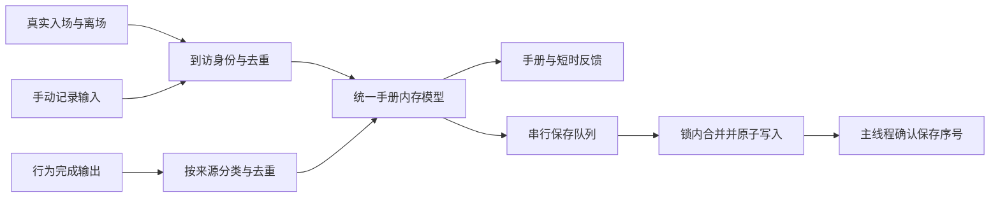

# 上游 v0.7 整合与统一观鸟手册方案

日期：2026-10-26。状态：**U1–U3已实现，U4证据与未验范围见[交付记录](U-INTEGRATION-ACCEPTANCE.md)**。本方案作为M6/M7交付与M8动作深化之间的中间阶段，代号U。用户确定的范围为：吸收修复优化、接入54种新鸟、合并优化观鸟收集与行为手册。

最终体验是：桌面具有100种鸟的基础内容，保留已有生态互动；用一个“观鸟手册”查看鸟种发现、手动记录和动作观察。扩种、修复、手册整合完成后，再继续原46种的M8增强动作制作。

本阶段对应已选定的第1、2、4项：修复优化、新鸟接入、观鸟收集。以下保留冻结设计；实现与验证结果以交付记录为准。独立候选尚未替换当前安装版。

## 1. 整合基线与范围

| 项目 | 冻结基线 |
| --- | --- |
| 本地开发分支 | `fix/click-to-relocate-birds`，`53680ae5738cdd5caabe460c4bf25e7090659ada` |
| 上游目标 | `6d2a9e2cd3bf68120b6335b9df092f5b2468ed69`，2026-10-25 23:40:12，Asia/Shanghai |
| 远程关系 | 上次拉取时 `origin/main` 与 `upstream/main` 指向同一目标 |
| 共同基线 | `2b3c05caa8924eb0bf07f8c7757c75c4d4d43f07` |
| 分叉情况 | 本地独有42个提交，上游独有3个提交 |
| 合并预演 | 25个冲突文件，其中13张PNG图集；规划时仅预演；实施时已按此目标真实合并 |

上游3个提交为 `0f7bb9b`（观鸟模式）、`29a879d`（v0.7.0及100鸟种）、`6d2a9e2`（预览GIF）。相对共同基线，修改152个文件，文本新增4596行、删除425行；代码和脚本含测试新增1932行、删除250行。以上是上游增量，不能与本地M6/M7统计混为一谈。

本次范围：

- 命中检测缓存、自身窗口遮挡及羽色纹路越界修复。
- 54种新鸟的稳定ID、元数据、可编辑绘制源、基础图集、飞行和闲置参数，以及100种目录兼容。
- 统一观鸟手册、可选手动观鸟记录、到访去重、旧记录迁移和设置整合。

原46种M8的524帧增强包、M9新增场景仍是后续项目；新54种的10帧增强包与4帧特色包不在U阶段自动展开。仅推进macOS整合，Windows代码可保留上游提交内容及共享资源，但不据此宣称Windows生态能力或原生验收完成。

## 2. 上游能力的取舍

| 上游改动 | 本次决定 | 适配要求 |
| --- | --- | --- |
| 54种新鸟和绘制源 | 接入 | 逐种核对ID、形体、公共帧与实际能力；保留原46种专用追加帧 |
| 命中区域及顶部像素缓存 | 接入 | 对 `BirdArt.names(for:)` 的全部实际帧建缓存，覆盖浴盆、携带、求偶等追加姿态，保留水线及前景遮挡判定 |
| 自身普通窗口遮挡 | 接入 | 只排除透明渲染面板；设置、手册和普通窗口参与遮挡；是否可停靠另设资格，隔离长跑控制窗仍不得成为鸟宿主 |
| 羽色受身体轮廓约束 | 接入并复核 | 冠羽、角羽、饰羽属于形体，不能被颜色裁切误删；重新核对旧34帧与新姿态视觉连续性 |
| Life List收集及首次发现反馈 | 合入观鸟手册 | 单一入口、统一物种详情；保留手动记录与行为完成的不同计数含义 |
| 观鸟模式开启即改用标准配置 | 不采用 | 记录方式不改变鸟种概率、体型、行为开关或用户草稿，不强制驱离现有鸟 |
| 升级后自动开启观鸟 | 不采用 | 无已有模式偏好时默认关闭；若导入有效上游模式偏好则保留，并说明整合后仍使用用户配置 |
| 删除暂停菜单 | 不采用 | 保留暂停恢复及既有生命周期语义 |
| 数量收窄到5–20、固定数量轮换 | 不自动采用 | 保留当前数量范围与调度语义；不为收集强制换鸟、稀有鸟保底或提高概率 |
| 全国默认权重 | 作为100种的新默认方案 | 既有用户配置按第5节迁移，不能因升级或开观鸟模式而覆盖 |
| 左侧分类设置布局 | 按整合需要吸收 | 保留本地生态场景、交互、熟客、调试与预览入口，不拿上游较少的设置页覆盖本地功能 |

## 3. 素材接入与能力判定

上游新增54张鸟种图集，每张34个基础帧位，合计1836帧位。逐帧像素核对发现，每种实际只有23–25张不同图像；54种的 `stretch/shake/poop0/poop1` 与 `stand` 相同，除普通䴓外53种的 `cling0/cling1/peck0/peck1` 也与站立相同。重复图像有时是合理回退，但不能凭同名帧认定专用动作已完成。

接入时建立逐鸟能力清单：必需帧存在、动作语义真实、产品允许、当时场景可用四者分别判断。新54种初步开放基础展示、飞行及已核实的闲置表现；通用理羽、警觉、休息等也需审核完整片段，不能让目前“非专用行为默认所有鸟”的逻辑替代内容审核。无真实伸展/抖毛姿态时使用明确的站立回退，不刷出该动作的完成记录。

普通䴓已有独立的头朝下侧面姿态。需把上游桌面层的侧边选择适配到本地 `DestinationPlanner`，验证脚点、朝向和退出；不能只合并 `SpeciesBehavior` 就声称其侧面行为可用。浴盆、食盘、捕虫、求偶、筑巢、礼物等仍遵守本地逐鸟白名单，扩种不自动扩权。

素材整合采用以下口径：

1. 保留公共34帧名称、顺序与逻辑脚锚 `(29,39)`；继续保留本地按鸟种追加帧、喙锚、场景接触和manifest扩展字段。
2. 13张冲突图集从整合后的绘制源重新导出，禁止选“全部上游”覆盖。既有追加帧总量为187帧，即上期之前20帧加M6/M7的167帧。
3. 上游原46种全部存在像素变化；这些属于有意修正，必须生成旧版/新版差异清单，不能继续声称旧像素完全不变。身体轮廓变化若影响追加姿态，需要同步修正绘制或锚点并记录。
4. 基础接入目标为 **100 × 34 + 187 = 3587帧位**。原M8再追加524帧后目标为4111帧位。以上均不是不同图像数量，也不把1836帧位计入M8原创增量。
5. 现有 `greatTit` 稳定ID保留；按上游元数据将其对应为 `Parus minor`，与新 `eurasianGreatTit` / `Parus major` 区分。默认形象修正、用户尺寸设置、旧手册关联分别处理，不改ID导致记录断裂。

实现时随代码提交逐鸟能力表和素材审计结果。旧行为测试中“46种”“旧像素不变”等断言要按实际变化升级，保留能继续成立的断言；不可仅改期望值来掩盖内容丢失。

## 4. 统一观鸟手册

### 4.1 一个入口与一个物种详情

菜单使用 **“观鸟手册…”** 作为统一入口，原“图鉴”“观察手册”“Life List”的用户入口归并到这里。默认打开“我的发现”，另提供“全部鸟种”和“行为记录”视图。切换视图保留搜索、筛选和当前选中鸟种。

- **我的发现**：顶部显示“已发现 X / 100种”和“手动记录 Y 次”；默认列出已发现鸟，卡片显示鸟图、名称、首次发现或历史记录日期、手动次数、已观察动作数。可选“显示未发现”，以剪影展示剩余鸟种。
- **全部鸟种**：完整名称和素材预览，供了解100种鸟；打开图鉴或播放预览不增加发现进度。无需为了查看资料强制收集。
- **物种详情**：鸟种图像、简介、发现来源、首次及最近记录、手动记录次数，下方展示该鸟真实支持的行为及已观察记录。无支持的动作不显示为“未完成任务”。
- **行为记录**：保留自然发生、主动触发、预览三类来源筛选；默认呈现自然与主动触发记录，预览单独可查，不计发现或动作收集进度。

“已观察动作数”按不同的、真实完成的行为种类统计，同一动作重复发生不增加种类数。尚未支持的动作不计入分母；设置暂时关闭的已支持动作仍可查看，并标记关闭。未知行为或未来版本内容只能只读保留，不能展示成已支持。

初版继续展示已有聚合数据，不伪造逐次事件时间线。现有档案只有累计次数、首次和最近日期，不能恢复每次事件发生时刻。

### 4.2 发现和计数规则

| 输入 | 发现鸟种 | 手动记录次数 | 行为记录与动作进度 |
| --- | --- | --- | --- |
| 手动观鸟记录成功 | 是 | 同一次到访最多加1 | 不因点击而完成任何动作 |
| 自然行为真实完成 | 是 | 不增加 | 自然次数加1，支持的行为可点亮 |
| 用户主动触发场景并完成 | 是 | 不增加 | 主动触发次数加1，支持的行为可点亮 |
| 预览完成 | 否 | 不增加 | 只增加预览来源次数，不点亮收集进度 |
| 图鉴浏览、普通鼠标悬停 | 否 | 不增加 | 不增加 |
| 行为取消、拒绝、失败 | 否 | 不增加 | 不记录为完成 |
| 已经记录的同一次到访再次点击 | 保持 | 不增加 | 显示“本次已记录”，不刷庆祝 |

“发现”表示应用已记录该鸟种的有效活动或手动记录，不宣称用户亲眼看见了所有自动事件。物种详情明确展示发现来源。关闭手动观鸟模式不关闭既有行为统计。

同一次拍摄和一次自然行为可能同时发生：可分别增加各自计数，但物种发现只算一个。手动次数、行为发生次数、熟客来访次数分别显示，不汇总成一个含义不明的总次数。

### 4.3 点击、暂停与模式切换

| 状态 | 左键点击可见鸟 | 其他约束 |
| --- | --- | --- |
| 普通模式 | 沿用点击换位 | 保留现有鼠标事件传递与生态输入抑制 |
| 观鸟模式 | 记录该次到访，出现简短反馈 | 不同时换位；`Option + 左键`保留换位且不记录，界面有简短说明 |
| 暂停状态 | 不接受新的手动记录 | 取景框隐藏，关闭暂停后恢复；暂停和用户点击换位仍按现有引擎合同处理 |
| 按键拖动、菜单打开、弹窗或上层窗口遮挡 | 不建立新取景框 | 不截获其他应用已经开始的拖动；关闭或失焦时清理交互面板 |

只采用一处点击分发，必须同时处理全局监听、本地监听和取景框回调，防止同一个原生事件既记录又换位。点击时重新读取可见快照和真实像素命中；被浴盆前墙、水线或普通窗口遮挡的部分不能命中。

观鸟记录不获取鸟的动作所有权，不停止飞行、不打断筑巢/洗澡等进行中行为。物理按键状态继续进入输入快照，抑制新鼠标靠近行为；记录专用分支不再转发具有换位或取消含义的普通点击命令。实施中为这一区分设置独立测试。

开启模式后现有居民可直接记录，不强制送走；关闭再开启也不能使同一次到访重复计数。模式变化不影响用户的鸟种权重、尺寸、交互开关、场景对象和未保存草稿。

### 4.4 一次到访的身份

不用物种ID、永久熟客ID或可复用的对象地址单独去重。建议使用 `sessionUUID + BirdID + arrivalOrdinal` 作为到访键：同一只鸟换窗口、跨屏、换位、进入浴盆仍是一访；离开后再次入场是新访，同一熟客也可再次记录。

到访键从引擎实际入场到离场始终维护，与观鸟模式开关无关。熟客身份继续由现有VisitorMemory管理，不能因为它长期存在而使其永远只能拍一次。运行时只保留活跃访客状态，离场后清理；持久化记录采用有界提交序号去重，避免永久保存所有到访明细。

## 5. 100种目录与用户偏好迁移

新安装采用100种默认目录与上游全国游戏权重，文案继续明确“游戏权重”，不当作野外数量。已有用户升级先追加54种目录，新条目概率为0；原46种概率、锁定值、个体尺寸与行为偏好保持。

在统一设置中显示一次“新增54种鸟待分配”提示，提供手动调整及明确的分配方案，不用启动时反复弹窗。建议“给新鸟分配份额”预设20%，可调整；仅从未锁定旧鸟概率中扣除，旧鸟按原比例分配，新鸟按默认权重分配。预算不得超过未锁定余额；全部锁定或余额为0时，解释需要先解锁或手动调整，不偷偷修改锁定数值。总概率始终100.00%。

现有 `allocateNewSpecies` 的“按鸟种数量分配”会给54种分配54%并缩放锁定项；本阶段不能直接沿用该算法作为安全默认。新的保锁分配要有独立测试。“全部恢复默认”依然是用户主动操作，并清楚说明解除锁定和重置概率的后果。

鸟种名称、英文名、学名等目录元数据可以更新；尺寸、速度等自定义值单独保护。观鸟模式只控制记录交互，不再切换到另一套catalog。

## 6. 统一档案与旧记录保护

### 6.1 数据结构

建议将现有 `observations.json` 升级为明确版本的 `formatVersion = 3`，作为统一观鸟手册档案；熟客和用户设置继续使用原独立存储。字段设计在U3实施中落成类型化模型：

| 数据部分 | 内容 |
| --- | --- |
| speciesRecords | 每种鸟的手动记录次数、手动首次/最近日期、已知有效发现日期与来源；无法推导的日期保持缺省 |
| behaviorEntries | 原物种×行为聚合，保留自然/预览/主动来源计数及历史日期 |
| migration | 已完成的v1/v2转换、上游Life List一次性导入标记与来源指纹 |
| writerProgress | 有界会话提交序号，用于写入重试和多实例去重；不记录鼠标位置或窗口标题 |

预览历史不消失，但与发现、真实动作进度分开。旧行为首尾日期可能混合了多个来源；不能把这个日期无条件命名为“首次自然观察”。历史只有混合日期时展示“最早历史记录”，后续首次明确来源日期另存。

当前上限2048条对100种与现有26个可记录行为的理论组合2600条不足。v3建议行为条目上限4096、总文件上限4 MiB，物种条目限制在当前目录；统计采用饱和加法且保留既有每项计数上限。未来增加行为/鸟种时再次审查上限，未知版本禁止写回覆盖。

### 6.2 迁移规则

| 输入档案 | 处理 |
| --- | --- |
| 本地v1/v2行为手册 | 原计数与日期逐项保留；有自然或主动完成次数的物种可标记历史已发现；仅预览的物种不解锁 |
| 上游有效 `life-list.json` | 作为手动记录历史导入，保留次数和首次日期；没有最近日期就留空；不伪造行为记录 |
| 两种档案同时存在 | 按同一SpeciesID呈现在一个详情；手动次数只来自Life List，行为次数只来自旧手册，不交叉相加 |
| 已有统一v3档案 | 正常加载；已经导入的来源不重复导入，启动不持续同步旧文件 |
| 损坏、未知版本、未知ID或越界数据 | 保留原文件与备份，明确显示无法导入的来源；不能清空后用空档覆盖 |

迁移前对源档案做校验并保留字节备份。迁移标记与数据在同一次原子提交中落盘；成功后再启用新档案写入，失败则沿用可读旧数据的只读展示。Life List来源槽位及导入标记用于防止改动了文件哈希后再次全量相加；首版不做旧上游应用与新档案的持续双向同步。

导入只读取本应用已知配置目录中可识别的文件，不扫描用户磁盘寻找所有Life List。旧上游应用没有协作锁，导入前确认其已退出、文件稳定；否则将该来源标为待导入，仍可使用本地有效行为记录。默认仅自动兼容上游当前已识别结构，额外字段或未来引导版本视为待适配，不作无损承诺。

原手册聚合不推导手动次数，熟客来访计数也不导入为手动次数。重复启动、迁移后崩溃和保存失败重试都不得重复加数。

### 6.3 事件和异步保存

模拟仍由现有唯一时钟推进。手册消费行为完成输出；不在视图绘制时推进引擎或新增随机决策。手动记录使用主线程当前可见快照并更新内存，保存通过串行队列处理，文件IO不阻塞逐帧渲染。上游引导的 `DispatchQueue.main.async` 只安排UI提示，不能当作现有保存已异步的依据。

新手动记录先显示“已记录，正在保存”；持久化成功后完成保存状态，失败保留内存增量并显示“尚未保存”，使用同一操作身份重试。失败期间同一到访再次点击不能重复加数。进程在保存确认前异常退出可能丢失待保存记录，不能把内存反馈表述为已可靠落盘。

保存队列用稳定旁路锁，锁内重新读取磁盘，只合并本会话尚未提交的增量；数据与会话提交序号一并原子写入。返回主线程时按确认序号更新基线，后续新事件不被旧快照覆盖。单次任务失败、锁竞争、写后确认前崩溃均有幂等恢复。U3需先冻结会话账本上限、活动写者识别和清理规则；不能仅凭时间淘汰仍可能重试的写者。达到容量且无法安全清理时，新写者进入只读并提示，不能牺牲已有记录的去重保证。

正常退出先停止接收新记录，收尾保存队列；超时或写失败明确保留未保存状态，不无限阻塞退出。验证、回放、压力与隔离长跑使用独立路径，所有新档案、锁和迁移标记都纳入隔离清单。

## 7. 合并策略与模块安排

实际开发前，先保存当前M8/M9方案和本整合文档的版本化快照，使用中文Conventional Commit。创建 `codex/upstream-v07-integration` 隔离分支，从本地冻结基线及文档快照出发，固定合并目标SHA；不直接更新正在使用的安装包。

建议保留上游提交历史，在隔离分支执行真实merge并逐项解决冲突，再提交本地适配。U1–U3是同一整合批次内的实施顺序，全部代码完成后统一编译验证；不能把中间未接完的状态写成通过。上游冲突外的自动合并也需审查，特别是Population随机调用、设置版本、启动路径及保存隔离。

| 阶段 | 交付内容 | 重点文件或对象 |
| --- | --- | --- |
| U0 冻结输入 | 基线、冲突清单、旧设置与素材合同、逐鸟待接入表 | Git历史、manifest、支持清单；真实用户档案仅在实际迁移/安装前备份 |
| U1 修复适配 | 全帧命中缓存、遮挡与宿主资格分离、绘制边界修复 | PixelArt、HoverNames、Desktop、DetailedBirdArt |
| U2 扩种 | 100种目录、54种绘制源与运动参数、真实能力表、保锁概率迁移 | Species、ExpansionBirdArt、FlightBehavior、SpeciesBehavior、DestinationPlanner、Probability |
| U3 手册统一 | 单一入口、发现/动作详情、模式与点击分流、迁移和持久化 | ObservationJournal、持久化层、手册窗口、取景反馈、设置页 |
| U4 统一验证 | 构建、核心测试、素材审计、回放、短时单屏与安装保护报告 | 现有验证工具及本轮新增定向检查 |

具体冲突处理：Desktop保留引擎推进及生命周期，以适配层接入上游UI能力；SharedArt保留本地按鸟种帧列表与pose元数据；HoverNames保留统一快照、水线、前墙遮挡并增加缓存查询；设置页保留本地生态控制；README与共享说明按整合后的真实能力重写，不能同时出现46种和100种当前状态。

不自动采用上游版本号或宣称发行包通过签名/公证；安装包、版本号与发布单独按本地交付流程处理。代码合并完成不等于已安装或已发布。

## 8. 统一验证与验收

遵循“代码全部实现后再统一编译、验证、验收”。规划阶段仅校验方案；现已按以下矩阵执行，具体轮次与未通过项目见交付记录。

| 验证主题 | 必须满足的结果 |
| --- | --- |
| Git与资源 | 目标SHA可追溯；无冲突标记；100个ID唯一；本地187追加帧保留；目标3587基础及追加帧位；道具与扩展manifest不丢失 |
| 视觉与能力 | 54种三缩放双向预览，原46种有像素差异报告；重复站立帧不会误开放动作；普通䴓侧面几何单独检查 |
| 命中缓存 | 所有实际帧缓存与逐像素查询一致；浴盆前墙、水线、方向、体型、遮挡仍正确；不以代码推断宣称性能已提升 |
| 窗口遮挡 | 手册与设置能遮住鸟，透明面板不遮住自身；隔离控制窗不可作为宿主；窗口采样与停靠资格不混淆 |
| 设置保护 | 旧46种概率/锁定/尺寸/生态开关不变；新54种初始0%；保锁分配、全锁定、余额不足、100.00%总和及未保存草稿验证 |
| 点击与到访 | 普通点击只换位，观鸟点击只记录，Option点击只换位；同访多次/切模式/跨屏不重复计数，熟客新访可再计 |
| 统一计数 | 预览不解锁发现；失败取消不完成；拍摄不完成动作；自然与主动事件正确分类；同一完成事件不重复消费 |
| 迁移 | v1、v2、Life List、双源、重复启动、损坏/未来结构均覆盖；所有旧计数与日期不丢失，不能推断的字段保持缺省 |
| 保存收尾 | 写入失败、锁竞争、多实例、写后确认前崩溃、并发新事件与退出均覆盖；重试不重复加数；所有测试路径隔离 |
| 原生态回归 | M6/M7的浴盆、捕虫、携带、求偶、礼物、运材理巢等完整生命周期及187追加帧仍可用 |
| 性能与容量 | 100种启动、图集解码内存、命中查询、手册刷新与保存队列做同机对照；关闭窗口后计时器/队列资源收尾 |

手册视图按数据修订号刷新，列表复用/裁剪，避免每帧对100种重排并创建日期格式器。预览只在可见时动画，关闭窗口后停止；反馈动效受暂停和安静设置约束，不增加自动生态事件频率。

实际验收采用短时单屏操作；不重新设立2小时人工观察门槛。窗口跟随、真实菜单暂停恢复、系统睡眠唤醒、物理双屏热插拔依照实际证据记录；此前保留未验的项目不会自动变成通过，若本轮取得新证据再更新状态。

U阶段完成要求是100种基础内容、统一手册、旧数据保护和回归检查共同成立。不能只导入图集就标“整合完成”，也不能把上游已有测试源码当成本地整合版测试通过。

## 9. 与M8 M9的衔接

2026-10-26整合后修订：U代码已保存于`143217e`，下述原46种预算继续有效。下一步增加U遗留问题定向收口与100种能力核对，六鸟样板作为首个内容交付包；新54种深化仍单列候选。当前执行顺序、阻塞边界与验收标准以[M8/M9调整后需求](M8-M9-ECOLOGY-PLAN.md)为准，U实际未验项见[交付记录](U-INTEGRATION-ACCEPTANCE.md)。

推进顺序调整为 **U阶段整合 → 原46种M8a样板 → M8b–f → M9场景扩展**。M8保留原46种、524帧内容合同，新54种基础导入的工作量单列。新54种未来若补同等10帧基础与4帧特色，需要另规划756帧；不能自动追加到这次中间阶段。

U2完成后对M8样板的“大山雀”形象、旧帧像素合同和素材基线做一次同步；原46种名单不变，鸟体累计基数按3587重新统计。M9白名单也不因目录扩到100种自动扩大。

## 10. 可追溯证据

上游内容以本文件冻结SHA为准，可用 `git show 6d2a9e2:<路径>` 重新读取，不依赖临时分析目录长期保留：

- `docs/releases/v0.7.0.md`：上游功能范围。
- `platforms/macos/Sources/Birding/ExpansionBirdArt.swift`、`shared/art/manifest.json`：54种绘制与公共34帧合同。
- `platforms/macos/Sources/Birding/PixelArt.swift`、`HoverNames.swift`：命中缓存。
- `platforms/macos/Sources/Birding/Observations.swift`、`BirdingCore/LifeList.swift`：取景记录、到访去重和保存。
- `platforms/macos/Tests/BirdingCoreTests/ExpansionTests.swift`、`LifeListTests.swift`：上游测试范围，未替代本地整合验收。

本地接入依据：[专用行为配置](../platforms/macos/Sources/BirdingCore/Behavior/SpeciesBehaviorProfile.swift)、[点击与命中](../platforms/macos/Sources/Birding/HoverNames.swift)、[行为手册模型](../platforms/macos/Sources/BirdingCore/Behavior/ObservationJournal.swift)、[现有持久化](../platforms/macos/Sources/Birding/ObservationJournalPersistence.swift)、[概率迁移](../platforms/macos/Sources/BirdingCore/Probability.swift)、[M8 M9计划](M8-M9-ECOLOGY-PLAN.md)、[M7最终交付](M7D-ACCEPTANCE.md)。
